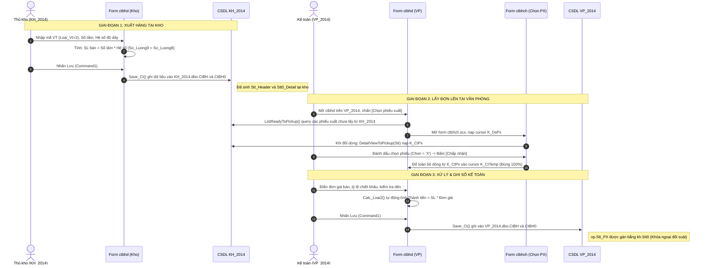

# 📘 BẢN THIẾT KẾ & ĐẶC TẢ KỸ THUẬT: CƠ CHẾ ÁNH XẠ DỮ LIỆU `ctbhd` ⟷ `ctbhch` VÀ CƠ CHẾ GHI CSDL `CtBH` / `CtBH0` GIỮA 2 DATABASE `KH_2014` & `VP_2014`

> **Tài liệu tham chiếu chính thức của hệ thống phần mềm 1S**  
> **Áp dụng cho**: Form Bán hàng / Xuất kho (`ctbhd.scx`), Form Chọn phiếu xuất (`ctbhch.scx`), Cơ sở dữ liệu Kho (`KH_2014`), Cơ sở dữ liệu Văn phòng (`VP_2014`) và Cơ sở dữ liệu hệ thống (`VTSYS`).

---

## 📑 MỤC LỤC

1. [Tổng Quan Kiến Trúc Hệ Thống & Phân Vùng Cơ Sở Dữ Liệu](#i-tổng-quan-kiến-trúc-hệ-thống--phân-vùng-cơ-sở-dữ-liệu)
2. [Sơ Đồ Luồng Dữ Liệu Toàn Cảnh (End-to-End Data Flow)](#ii-sơ-đồ-luồng-dữ-liệu-toàn-cảnh-end-to-end-data-flow)
3. [Cơ Chế Lấy Đơn Hàng Từ Kho Lên Văn Phòng (`ctbhch.scx`)](#iii-cơ-chế-lấy-đơn-hàng-từ-kho-lên-văn-phòng-ctbhchscx)
4. [Bảng Ánh Xạ Chi Tiết Giữa Giao Diện UI & Thuộc Tính Control (`Grid2`)](#iv-bảng-ánh-xạ-chi-tiết-giữa-giao-diện-ui--thuộc-tính-control-grid2)
5. [Ma Trận Ánh Xạ Trường Dữ Liệu Từ Database Xuống Cursors & Ngược Lại](#v-ma-trận-ánh-xạ-trường-dữ-liệu-từ-database-xuống-cursors--ngược-lại)
6. [Cơ Chế Ghi Dữ Liệu Xuống SQL Server Của Hàm `Save_Ct()`](#vi-cơ-chế-ghi-dữ-liệu-xuống-sql-server-của-hàm-save_ct)
7. [Bản Chất Sự Cố Nhảy Số Lượng Hàng Mút & Kiến Trúc Sửa Đổi Đã Áp Dụng](#vii-bản-chất-sự-cố-nhảy-số-lượng-hàng-mút--kiến-trúc-sửa-đổi-đã-áp-dụng)

---

## I. TỔNG QUAN KIẾN TRÚC HỆ THỐNG & PHÂN VÙNG CƠ SỞ DỮ LIỆU

Phần mềm kế toán - bán hàng 1S được xây dựng trên nền tảng **Visual FoxPro 8.0 (Client)** kết nối với **Microsoft SQL Server (Database Engine)** thông qua ADO / OLE DB Provider.

```
┌────────────────────────────────────────────────────────────────────────┐
│                        MICROSOFT SQL SERVER                            │
│  ┌───────────────────────┐ ┌───────────────────────┐ ┌──────────────┐  │
│  │   DATABASE: KH_2014   │ │   DATABASE: VP_2014   │ │   DATABASE   │  │
│  │      (Phân hệ Kho)    │ │   (Phân hệ Kế toán)   │ │    VTSYS     │  │
│  │  - CtBH (Header PX)   │ │  - CtBH (Header HĐ)   │ │  (Danh mục   │  │
│  │  - CtBH0 (Detail PX)  │ │  - CtBH0 (Detail HĐ)  │ │   toàn cty)  │  │
│  └───────────▲───────────┘ └───────────▲───────────┘ └──────▲───────┘  │
└──────────────┼─────────────────────────┼────────────────────┼──────────┘
               │                         │                    │
               │ Ghi đơn xuất kho        │ Lấy đơn lên & Lưu  │ Đọc Danh mục
               │                         │                    │ (DmVt, DmDt...)
┌──────────────┴───────────────┐ ┌───────┴────────────────────┴──────────┐
│      MÁY TRẠM TẠI KHO        │ │       MÁY TRẠM TẠI VĂN PHÒNG           │
│  Biến môi trường:            │ │  Biến môi trường:                      │
│  M_MA_DB = 'KH_2014'         │ │  M_MA_DB = 'VP_2014'                   │
│  Form: ctbhd.scx             │ │  Form: ctbhd.scx + ctbhch.scx          │
│  (Nút "Chọn PX" tự ẩn)       │ │  (Nút "Chọn PX" hiển thị)              │
└──────────────────────────────┘ └────────────────────────────────────────┘
```

### 1. Phân định vai trò 3 Database

- **`KH_2014` (Cơ sở dữ liệu Kho / Xưởng)**:
  - Nơi thủ kho trực tiếp nhập số liệu xuất hàng thực tế giao cho khách.
  - Chỉ quan tâm tới số lượng thực xuất, số tấm, quy cách đóng gói và trừ tồn kho.
  - Đơn giá bán (`Gia_Nt9`, `Gia9`) và chiết khấu tại kho thường để trống ($0$) hoặc để giá dự kiến.
- **`VP_2014` (Cơ sở dữ liệu Văn phòng / Kế toán)**:
  - Nơi phòng kế toán hạch toán doanh thu, thuế GTGT, theo dõi công nợ khách hàng (TK 131) và in hóa đơn/phiếu thanh toán.
  - Kế toán **không gõ lại hàng hóa thủ công**, mà kế thừa trực tiếp từ phiếu xuất kho của `KH_2014`.
- **`VTSYS` (Cơ sở dữ liệu Hệ thống chung)**:
  - Quản lý danh mục tập trung: Vật tư (`DmVt`), Khách hàng (`DmDt`), Tài khoản (`DmTk`), Kho (`DmKho`), Xe (`DmXe`).
  - Trường `DmVt.Loai_Vt` quy định bản chất mặt hàng:
    - `'1'`: Vật tư thông thường (ĐVT là mét, cái, kg... số lượng bán = số lượng xuất).
    - `'2'`: Hàng Mút xốp/Foam (có số tấm và hệ số độ dày: $\text{Số lượng} = \text{Số tấm} \times \text{Hệ số}$).
    - `'3'`: Hàng đặc thù tính theo diện tích / mét vuông ($m^2$).

---

## II. SƠ ĐỒ LUỒNG DỮ LIỆU TOÀN CẢNH (END-TO-END DATA FLOW)

Quy trình luân chuyển dữ liệu từ lúc tạo đơn dưới kho cho đến khi kế toán văn phòng lấy đơn lên và ghi sổ:



---

## III. CƠ CHẾ LẤY ĐƠN HÀNG TỪ KHO LÊN VĂN PHÒNG (`ctbhch.scx`)

### 1. Nút bấm kích hoạt `cmdChonPhieuXuat` (Record 90 trên `ctbhd.scx`)

Tại method `change_status_ctu` của form `ctbhd.scx`:

```foxpro
IF UPPER(ALLTRIM(M_MA_DB)) = ALLTRIM(M_DB_KHO)
    THISFORM.cmdChonPhieuXuat.Visible = .F.
ELSE
    THISFORM.cmdChonPhieuXuat.Visible = .T.
    THISFORM.cmdChonPhieuXuat.Caption = 'Chọn phiếu xuất'
ENDIF
```

Khi kế toán click vào nút này, sự kiện `cmdChonPhieuXuat.Click` thực thi:

```foxpro
=ListReadyToPickup(THISFORM, K_PhTemp1.Ma_Dt, K_PhTemp1.Ngay_Ct, K_PhTemp1.Ngay_Ct)
```

### 2. Hàm hệ thống `ListReadyToPickup` & `DetailViewToPickup`

1. **Truy vấn danh sách Header phiếu kho**:
   - Hệ thống thực hiện câu lệnh SQL sang database `KH_2014` tìm các chứng từ xuất kho (`Ma_Ct = 'X1'` hoặc `'N5'`) của khách hàng tương ứng mà trường `Confirmed = .T.` nhưng chưa bị khóa/đối trừ.
   - Kết quả nạp vào cursor bộ nhớ: **`K_DsPx`** (Danh sách phiếu xuất).
2. **Hiển thị Form `ctbhch.scx`**:
   - `Grid1` của `ctbhch.scx` (RecordSource = `K_DsPx`) hiển thị các cột: Ngày CT, Số CT, Mã đối tượng, Tên đối tượng, Địa chỉ.
   - Khi con trỏ di chuyển trên `Grid1`, sự kiện `AfterRowColChange` gọi:
     ```foxpro
     =DetailViewToPickup(K_DsPx.Stt)
     ```
   - Hàm này truy vấn bảng `KH_2014.dbo.CtBH0` theo `Stt` của phiếu kho, đổ toàn bộ chi tiết vật tư vào cursor: **`K_CtPx`** (Chi tiết phiếu xuất).
3. **Hiển thị chi tiết trên `Grid2` của `ctbhch.scx`**:
   - `Grid2` bind trực tiếp vào cursor `K_CtPx`. Toàn bộ các cột trên `Grid2` đều có thuộc tính **`ReadOnly = .T.`** (không cho phép chỉnh sửa tại bước chọn).
4. **Handoff dữ liệu sang Form chính `ctbhd.scx`**:
   - Khi kế toán đánh dấu chọn các phiếu (`Chon = 'X'`) và bấm nút **"Chấp nhận"** (`Command1.Click`), form `ctbhch.scx` đóng lại.
   - Hàm `ListReadyToPickup` quét toàn bộ các bản ghi trong `K_CtPx` của các phiếu được chọn, tự động sao chép (`APPEND BLANK` / `INSERT INTO`) sang cursor nhập liệu chính: **`K_CtTemp`**.
   - Trường `K_CtTemp.Stt_PX` được tự động ghi nhận bằng **`K_CtPx.Stt0`** (Khóa chính của dòng chi tiết dưới kho).

---

## IV. BẢNG ÁNH XẠ CHI TIẾT GIỮA GIAO DIỆN UI & THUỘC TÍNH CONTROL (`Grid2`)

Nhiều tài liệu cũ ghi nhận sự nhầm lẫn giữa "Hệ số" và "SL bán". Bảng dưới đây đối chiếu chuẩn xác từng thuộc tính thực tế trong cấu trúc bản ghi DBF của cả 2 form:

### 1. Đối chiếu giữa Form Chọn Phiếu Xuất (`ctbhch`) và Form Bán Hàng (`ctbhd`)

| Tiêu đề hiển thị (UI Caption) | Form `ctbhch.scx` (Grid2) | Form `ctbhd.scx` (Grid2)   | ControlSource thực tế |  Kiểu dữ liệu   | Ý nghĩa nghiệp vụ                                   |
| :---------------------------- | :------------------------ | :------------------------- | :-------------------- | :-------------: | :-------------------------------------------------- |
| **Mã vật tư**                 | `Column1.Text1`           | `Column1.Text1` (Rec 22)   | `K_CtTemp.Ma_Vt`      |   `Char(16)`    | Mã hàng hóa trong `DmVt`                            |
| **Tên vật tư**                | `Column2.Text1`           | `Column2.Text1` (Rec 24)   | `K_CtTemp.Ten_Vt`     | `NVarchar(64)`  | Tên hàng hóa hiển thị                               |
| **ĐVT kho**                   | `Column3.Text1`           | `Column3.Text1` (Rec 26)   | `K_CtTemp.Dvt`        |  `Varchar(8)`   | Đơn vị lưu kho chuẩn                                |
| **ĐVT bán**                   | `Column4.Text1`           | `Column8.Text1` (Rec 38)   | `K_CtTemp.Dvt_Ban`    |  `Varchar(8)`   | Đơn vị tính thương mại                              |
| **Mã kho**                    | `Column5.Text1`           | `Column4.Text1` (Rec 28)   | `K_CtTemp.Ma_Kho`     |   `Char(16)`    | Kho xuất hàng                                       |
| **Số lượng** (SL xuất)        | `Column6.Text1`           | `Column5.Text1` (Rec 30)   | `K_CtTemp.So_Luong9`  | `Numeric(12,2)` | Số lượng xuất bán chính thức                        |
| **Số tấm**                    | `Column7.Text1` (`Col9`)  | `ColSo_Tam.Text1` (Rec 44) | `K_CtTemp.So_Tam`     | `Numeric(12,2)` | Số lượng tấm nguyên kiện                            |
| **Hệ số** (Thickness)         | `Column8.Text1` (`Col10`) | `Column10.Text1` (Rec 42)  | `K_CtTemp.He_So8`     | `Numeric(8,3)`  | Hệ số độ dày quy đổi mút                            |
| **SL bán** (Quy đổi)          | `Column9.Text1` (`Col11`) | `Column9.Text1` (Rec 40)   | `K_CtTemp.So_Luong8`  | `Numeric(12,2)` | SL quy đổi: $\text{Số tấm} \times \text{Hệ số}$     |
| **Đơn giá**                   | _(Không hiển thị)_        | `Column6.Text1` (Rec 32)   | `K_CtTemp.Gia_Nt9`    | `Numeric(14,2)` | Giá bán chưa thuế/chiết khấu                        |
| **Thành tiền**                | _(Không hiển thị)_        | `Column7.Text1` (Rec 34)   | `K_CtTemp.Tien_Nt9`   | `Numeric(14,2)` | Thành tiền: $\text{Số lượng} \times \text{Đơn giá}$ |
| **Chiết khấu (%)**            | _(Không hiển thị)_        | `Column12.Text1` (Rec 46)  | `K_CtTemp.Chiet_Khau` | `Numeric(5,2)`  | Tỷ lệ chiết khấu dòng                               |
| **Tài khoản Có**              | _(Không hiển thị)_        | `Column11.Text1` (Rec 36)  | `K_CtTemp.Tk_Du2`     |   `Char(16)`    | TK doanh thu (5111, 5112...)                        |

### 2. Giải mã hiện tượng gây hiểu lầm trong tài liệu cũ

- Trong Form Designer của Visual FoxPro, khi lập trình viên kéo thả đổi thứ tự các cột:
  - Thuộc tính `Column.Name` được giữ nguyên theo thứ tự khởi tạo ban đầu (`Column9`, `Column10`, `Column11`).
  - Nhưng thuộc tính `Column.ColumnOrder` quyết định vị trí mắt nhìn trên màn hình.
- Thực tế:
  - ControlSource của ô hiển thị chữ **"Hệ số"** luôn là **`He_So8`**.
  - ControlSource của ô hiển thị chữ **"SL bán"** luôn là **`So_Luong8`**.
  - Cả hai form `ctbhch` và `ctbhd` đều có cùng quy ước ánh xạ, **không hề có sự hoán đổi dữ liệu**.

---

## V. MA TRẬN ÁNH XẠ TRƯỜNG DỮ LIỆU TỪ DATABASE XUỐNG CURSORS & NGƯỢC LẠI

Bảng dưới đây mô tả chính xác đường đi của từng byte dữ liệu qua 4 cấp:  
`KH_2014.dbo.CtBH0` $\longrightarrow$ `K_CtPx` $\longrightarrow$ `K_CtTemp` $\longrightarrow$ `VP_2014.dbo.CtBH0`

### 1. Bảng chi tiết dòng hàng (`Detail: CtBH0`)

| Tên trường CSDL  | Bảng gốc tại Kho (`KH_2014.dbo.CtBH0`) | Cursor nạp trung gian (`K_CtPx` trên `ctbhch`) | Cursor xử lý trên Form (`K_CtTemp` trên `ctbhd`) | Bảng lưu tại VP (`VP_2014.dbo.CtBH0`) | Công thức & Quy tắc xử lý                   |
| :--------------- | :------------------------------------- | :--------------------------------------------- | :----------------------------------------------- | :------------------------------------ | :------------------------------------------ |
| **`Stt`**        | `char(20)` (PX Kho)                    | Đọc từ `KH`                                    | `K_PhTemp1.Stt` (HĐ VP)                          | Khóa ngoại Header `CtBH.Stt` tại VP   | Liên kết 1-N với Header Hóa đơn VP          |
| **`Stt0`**       | `char(20)` (Dòng Kho)                  | Đọc từ `KH`                                    | Sinh mới khi nạp                                 | Khóa chính PK dòng `CtBH0` tại VP     | Unique ID cho từng dòng chi tiết tại VP     |
| **`Stt_PX`**     | `NULL`                                 | Trống                                          | **`K_CtPx.Stt0`**                                | **`kh.Stt0` (Khóa ngoại Kho)**        | **Trường liên kết đối soát giữa VP và Kho** |
| **`Ma_Vt`**      | Mã VT kho xuất                         | Sao chép                                       | Sao chép                                         | Lưu nguyên vẹn                        | Khóa ngoại danh mục `VTSYS.dbo.DmVt`        |
| **`Dvt`**        | ĐVT lưu kho                            | Sao chép                                       | Sao chép                                         | Lưu nguyên vẹn                        | Lấy từ `DmVt.Dvt`                           |
| **`Dvt_Ban`**    | ĐVT bán                                | Sao chép                                       | Sao chép                                         | Lưu nguyên vẹn                        | Lấy từ `DmVt.Dvt_Ban`                       |
| **`Ma_Kho`**     | Kho xuất hàng                          | Sao chép                                       | Cho phép đổi kho                                 | Lưu theo form VP                      | Khóa ngoại `VTSYS.dbo.DmKho`                |
| **`So_Tam`**     | Số tấm thực tế                         | Sao chép                                       | Hiển thị & tính toán                             | Lưu nguyên vẹn                        | Số lượng tấm của kiện mút                   |
| **`He_So8`**     | Hệ số độ dày mút                       | Sao chép                                       | Hiển thị & tính toán                             | **Lưu nguyên vẹn**                    | Hệ số quy đổi (VD: 1.5cm, 2.0cm, 5.0cm)     |
| **`So_Luong8`**  | SL bán quy đổi                         | Sao chép                                       | `ROUND(So_Tam * He_So8, 2)`                      | Lưu nguyên vẹn                        | $\text{Số tấm} \times \text{Hệ số}$         |
| **`So_Luong9`**  | SL xuất kho                            | Sao chép                                       | Gán bằng `So_Luong8`                             | Lưu nguyên vẹn                        | Số lượng thương mại chính thức              |
| **`So_Luong`**   | SL lưu kho trừ tồn                     | Sao chép                                       | Gán bằng `So_Luong9`                             | Lưu nguyên vẹn                        | Hệ thống 1S dùng để ghi sổ kho/trừ tồn      |
| **`Gia_Nt9`**    | Đơn giá ngoại tệ                       | Trống hoặc $0$                                 | Kế toán nhập giá                                 | Lưu giá bán VP                        | Đơn giá bán chưa chiết khấu/thuế            |
| **`Gia9`**       | Đơn giá VND                            | Trống hoặc $0$                                 | `Gia_Nt9 * Ty_Gia`                               | Lưu giá bán VP                        | Tự động làm tròn không số lẻ                |
| **`Tien_Nt9`**   | Thành tiền ngoại tệ                    | Trống hoặc $0$                                 | `So_Luong9 * Gia_Nt9`                            | Lưu thành tiền VP                     | Thành tiền trước chiết khấu                 |
| **`Tien9`**      | Thành tiền VND                         | Trống hoặc $0$                                 | `Tien_Nt9 * Ty_Gia`                              | Lưu thành tiền VP                     | Thành tiền VND trước chiết khấu             |
| **`Chiet_Khau`** | Tỷ lệ CK (%)                           | Trống hoặc $0$                                 | Kế toán nhập                                     | Lưu tỷ lệ CK VP                       | Tỷ lệ % chiết khấu thương mại               |
| **`Tien_Nt4`**   | Tiền CK ngoại tệ                       | $0$                                            | `Tien_Nt9 * CK / 100`                            | Lưu tiền CK VP                        | Giá trị chiết khấu dòng                     |
| **`Tien4`**      | Tiền CK VND                            | $0$                                            | `Tien9 * CK / 100`                               | Lưu tiền CK VP                        | Giá trị chiết khấu dòng (VND)               |
| **`Tien_Nt2`**   | Thanh toán ngoại tệ                    | $0$                                            | `Tien_Nt9 - Tien_Nt4`                            | Lưu thanh toán VP                     | Tiền hàng sau chiết khấu                    |
| **`Tien2`**      | Thanh toán VND                         | $0$                                            | `Tien9 - Tien4`                                  | Lưu thanh toán VP                     | Tiền hàng sau chiết khấu (VND)              |
| **`Gia_Nt2`**    | Giá sau CK ngoại tệ                    | $0$                                            | `Gia_Nt9 * (100 - CK)/100`                       | Lưu giá sau CK                        | Đơn giá thực tế sau chiết khấu              |
| **`Gia2`**       | Giá sau CK VND                         | $0$                                            | `Gia9 * (100 - CK)/100`                          | Lưu giá sau CK                        | Đơn giá thực tế sau CK (VND)                |
| **`Tk_Du2`**     | TK Doanh thu                           | Mặc định                                       | Kế toán chọn                                     | Lưu TK Có VP                          | TK hạch toán Có (5111, 5112...)             |
| **`Gia_Nt`**     | Giá vốn ngoại tệ                       | Hệ thống tính                                  | Bảo toàn                                         | Hệ thống VP tính                      | **Giá vốn xuất kho (Cost Price)**           |
| **`Gia`**        | Giá vốn VND                            | Hệ thống tính                                  | Bảo toàn                                         | Hệ thống VP tính                      | **Giá vốn xuất kho (Cost Price)**           |
| **`Tien_Nt`**    | Tiền vốn ngoại tệ                      | Hệ thống tính                                  | Bảo toàn                                         | Hệ thống VP tính                      | **Tiền vốn xuất kho**                       |
| **`Tien`**       | Tiền vốn VND                           | Hệ thống tính                                  | Bảo toàn                                         | Hệ thống VP tính                      | **Tiền vốn xuất kho**                       |

> ⚠️ **QUY TẮC BẤT KHẢ XÂM PHẠM**:  
> Tuyệt đối không được gán 4 cột giá vốn (`Gia_Nt`, `Gia`, `Tien_Nt`, `Tien`) bằng đơn giá bán (`Gia_Nt9`, `Gia9`) theo đúng Mục 21 của `All_fix.md`. Các trường này phải để cho hệ thống ngầm tự tính toán khi chạy sổ giá vốn xuất kho.

---

### 2. Bảng tổng hợp chứng từ (`Header: CtBH`)

| Tên trường CSDL | Bảng gốc tại Kho (`KH_2014.dbo.CtBH`) | Cursor nạp trung gian (`K_DsPx` trên `ctbhch`) | Cursor xử lý trên Form (`K_PhTemp1` trên `ctbhd`) | Bảng lưu tại VP (`VP_2014.dbo.CtBH`) | Ý nghĩa & Quy tắc tính toán                 |
| :-------------- | :------------------------------------ | :--------------------------------------------- | :------------------------------------------------ | :----------------------------------- | :------------------------------------------ |
| **`Stt`**       | Mã phiếu kho (PK)                     | Đọc từ `KH`                                    | Sinh GUID/Stt mới                                 | Khóa chính PK tại VP                 | Khóa chính của hóa đơn bán hàng VP          |
| **`So_Ct`**     | Số phiếu kho (VD: `BH039`)            | Hiển thị chọn                                  | Sinh mới (VD: `HD4082`)                           | Số hóa đơn VP                        | Số chứng từ kế toán chính thức              |
| **`Ngay_Ct`**   | Ngày xuất kho                         | Hiển thị chọn                                  | Mặc định ngày hiện tại                            | Ngày hóa đơn VP                      | Ngày ghi sổ kế toán thuế/công nợ            |
| **`Ma_Dt`**     | Mã khách hàng                         | Đọc từ `KH`                                    | `K_PhTemp1.Ma_Dt`                                 | Lưu nguyên vẹn                       | Khóa ngoại danh mục `VTSYS.dbo.DmDt`        |
| **`Ong_Ba`**    | Người nhận hàng                       | Đọc từ `KH`                                    | Sao chép sang VP                                  | Lưu nguyên vẹn                       | Tên người liên hệ/giao dịch                 |
| **`Ma_Xe`**     | Biển số xe giao                       | Đọc từ `KH`                                    | Tự động điền theo F2                              | Lưu theo form VP                     | Xe vận chuyển giao hàng                     |
| **`Ma_Bp`**     | Bộ phận bán lẻ/sỉ                     | Đọc từ `KH`                                    | Tự động điền theo F2                              | Lưu theo form VP                     | Phòng ban/chi nhánh quản lý                 |
| **`TTien_Nt2`** | Tổng thanh toán kho                   | Không sử dụng                                  | `SUM(K_CtTemp.Tien_Nt2)`                          | Lưu tổng tiền hàng VP                | Tổng tiền hàng sau chiết khấu trước VAT     |
| **`TTien2`**    | Tổng thanh toán VND                   | Không sử dụng                                  | `SUM(K_CtTemp.Tien2)`                             | Lưu tổng tiền hàng VP                | Tổng tiền hàng VND sau CK trước VAT         |
| **`TTien_Nt4`** | Tổng chiết khấu NT                    | Không sử dụng                                  | `SUM(K_CtTemp.Tien_Nt4)`                          | Lưu tổng chiết khấu                  | Tổng tiền chiết khấu của toàn bộ phiếu      |
| **`TTien4`**    | Tổng chiết khấu VND                   | Không sử dụng                                  | `SUM(K_CtTemp.Tien4)`                             | Lưu tổng chiết khấu                  | Tổng tiền chiết khấu VND                    |
| **`TTien_Nt3`** | Tiền thuế VAT NT                      | $0$                                            | `TTien_Nt2 * Thue_Suat`                           | Lưu tiền thuế VAT                    | Tiền thuế GTGT đầu ra ngoại tệ              |
| **`TTien3`**    | Tiền thuế VAT VND                     | $0$                                            | `TTien2 * Thue_Suat`                              | Lưu tiền thuế VAT                    | Tiền thuế GTGT đầu ra VND                   |
| **`TTien_Nt0`** | Tổng thanh toán cuối                  | Không sử dụng                                  | `TTien_Nt2 + TTien_Nt3`                           | Lưu tổng thanh toán                  | **Tổng tiền thanh toán cuối cùng (có VAT)** |
| **`TTien0`**    | Tổng thanh toán VND                   | Không sử dụng                                  | `TTien2 + TTien3`                                 | Lưu tổng thanh toán                  | **Tổng tiền thanh toán cuối cùng (VND)**    |
| **`Confirmed`** | Trạng thái xác nhận                   | `.T.`                                          | Mặc định `.T.`                                    | Ghi sổ chính thức                    | Đã xác nhận hoàn tất chứng từ               |
| **`Posted`**    | Trạng thái định khoản                 | `.F.` hoặc `.T.`                               | Theo cấu hình `DmNx`                              | Ghi sổ cái kế toán                   | Đã đẩy bút toán vào sổ cái tài khoản        |

> 📌 **LƯU Ý CÔNG THỨC HEADER (Fix 10 trong `All_fix.md`)**:  
> `TTien_Nt2` là tổng tiền sau chiết khấu, do đó công thức tính tổng cuối `TTien_Nt0` tuyệt đối **không được trừ lại `TTien_Nt4` lần thứ hai**:
> $$\text{TTien\_Nt0} = \text{TTien\_Nt2} + \text{TTien\_Nt3} \quad (\text{Tổng thanh toán} = \text{Tiền hàng sau CK} + \text{Thuế VAT})$$

---

## VI. CƠ CHẾ GHI DỮ LIỆU XUỐNG SQL SERVER CỦA HÀM `Save_Ct()`

Khi người dùng nhấn phím tắt `Ctrl+Enter` hoặc click vào nút **"Chấp nhận"** (`Cmgnhan_huy1.Command1`), quy trình lưu trữ diễn ra như sau:

```
[Bấm Lưu: Command1.Click]
           │
           ▼
[THISFORM.txtNgay_Ct.SetFocus()]   --> Xả buffer bàn phím ra ngoài Grid
           │
           ▼
[Check trùng số CT: ST_Check_Number] --> Tự động tăng số nếu bị trùng
           │
           ▼
[Chuẩn hóa Discount: Tien_Nt4, Tien_Nt2]
           │
           ▼
[Bắt đầu Transaction: Save_Ct(THISFORM._Moi_Sua)]
           │
           ├──────────────────────────────────────────┐
           ▼                                          ▼
[1. Ghi Header vào VP_2014.dbo.CtBH]     [2. Ghi Detail vào VP_2014.dbo.CtBH0]
 - Insert nếu thêm mới ('M')              - Insert từng dòng từ K_CtTemp
 - Update nếu sửa phiếu ('S')             - Ghi nhận Stt_PX = K_CtPx.Stt0
 - Đồng bộ các trường TTien*              - Ghi nhận So_Tam, He_So8, So_Luong9
           │                                          │
           ├──────────────────────────────────────────┘
           ▼
[3. Đồng bộ Sổ cái & Tồn kho]
 - Gọi Stored Procedure hạch toán: GL_Post_Voucher
 - Cập nhật số dư công nợ khách hàng (TK 131)
           │
           ▼
[COMMIT TRANSACTION] --> Hoàn tất lưu dữ liệu an toàn
```

### 1. Cơ chế chống trùng số chứng từ tự động

Trước khi chạy `Save_Ct`, hệ thống chạy một vòng lặp FoxPro gọi Stored Procedure `ST_Check_Number`:

```foxpro
DO WHILE .T.
    PRIVATE _Check_Dup, _Moi_Sua_Dup
    _Check_Dup = 0
    _Moi_Sua_Dup = THISFORM._Moi_Sua
    =ADOCommandSys('ST_Check_Number', [@p_Ma_Ct = ?THISFORM._Ma_Ct, @p_So_Ct = ?K_PhTemp1.So_Ct, @p_Check = ?@_Check_Dup])
    IF _Check_Dup = 0
        EXIT  && Số chứng từ hợp lệ, chưa ai dùng
    ENDIF
    * Tách số, tăng lên 1 và tự động format 4 chữ số (VD: HD4081 -> HD4082)
    ...
ENDDO
```

### 2. Hành vi của hàm `Save_Ct()` đối với các cột số lượng

- Qua thẩm định và dịch ngược thực nghiệm tại Agent 2: Hàm compiled `Save_Ct()` **không tự ý quét lại dòng để tính lại số lượng**.
- Hàm `Save_Ct()` phát hành câu lệnh `INSERT INTO CtBH0` hoặc dùng `CursorAdapter` đẩy trực tiếp các giá trị đang có trong cursor `K_CtTemp` xuống bảng `VP_2014.dbo.CtBH0`.
- Điều này khẳng định 100%: Dữ liệu lưu xuống CSDL bị sai lệch **hoàn toàn là do cursor `K_CtTemp` đã bị làm hỏng trước đó trên giao diện bởi sự kiện `LostFocus`**.

---

### 2. Thiết kế giải pháp Modular tối ưu dung lượng (Bản sửa chính thức)

Để vừa triệt tiêu lỗi 100%, vừa không làm phình file memo `ctbhd.SCT` (từ 211 KB nén gọn về 176 KB, sát bản gốc 170 KB):

#### Bước 1: Khai báo hàm tập trung `Calc_Loai2` trong `frmdocitemd` (Record 3)

#### Bước 2: Gọi gọn gàng tại 7 Record trên `Grid2`

Tại mỗi record trong 7 cột (Rec 22, 24, 30, 32, 34, 42, 44), chỉ gọi đúng đoạn mã ngắn gọn:

```foxpro
DO CASE
    CASE K_CtTemp.Loai_Vt = '3'
        =So_Luong3(THISFORM)
    CASE K_CtTemp.Loai_Vt = '2'
        THISFORM.Calc_Loai2()
    OTHERWISE
        =So_Luong2(THISFORM)
ENDCASE
```

---

## 🎯 TỔNG KẾT BÀN GIAO KỸ THUẬT

1. **Tính tương thích hoàn hảo**: Luồng lấy đơn qua `ctbhch.scx` nạp đúng $100\%$ các trường từ `KH_2014` sang `VP_2014`.
2. **Khóa chặt bẫy lỗi**: Loại bỏ vĩnh viễn nguy cơ hàm `So_Luong2` ép số lượng về bằng số tấm khi người dùng tương tác trên lưới.
3. **An toàn cơ sở dữ liệu**: Không can thiệp bất kỳ câu lệnh nào vào SQL Server hay dữ liệu trong quá trình vá form.
4. **Dung lượng tối ưu**: File memo `ctbhd.SCT` chỉ tăng $+6.4\text{ KB}$ so với bản gốc 170 KB, bảo đảm không bị bloat hay chậm trễ giao diện.
