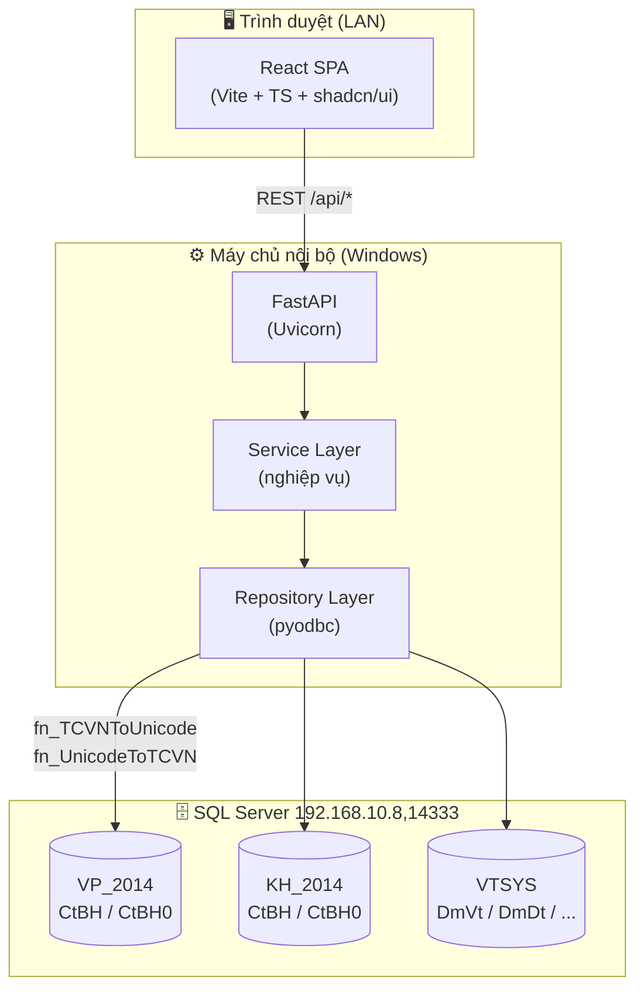
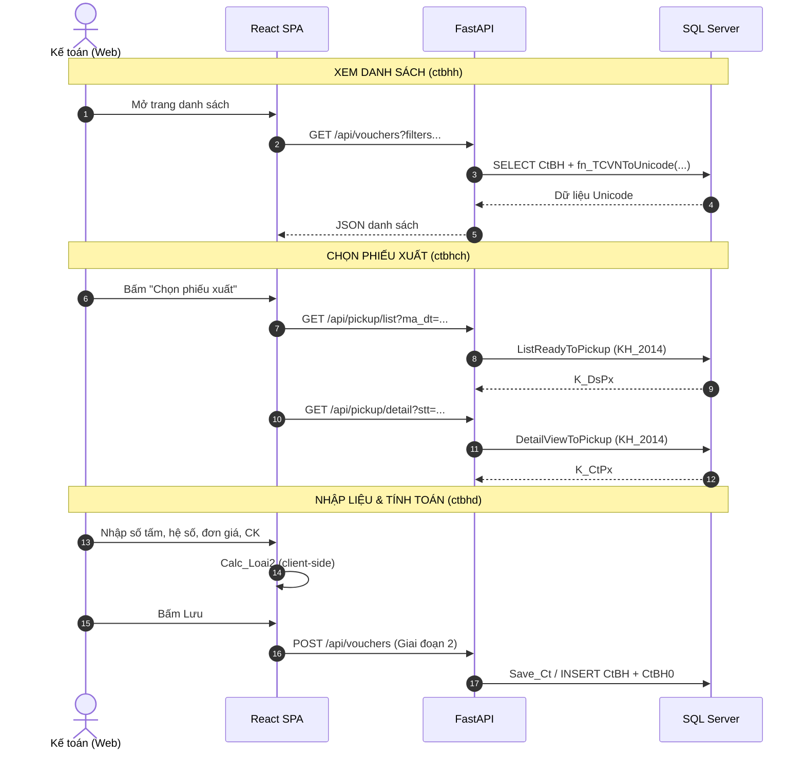
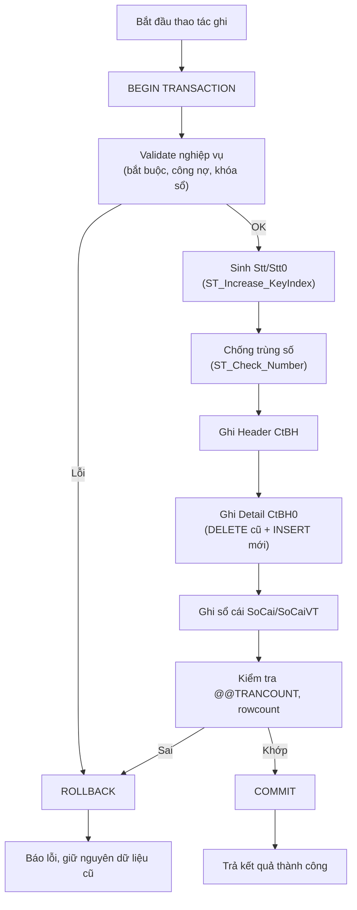

# 📋 KẾ HOẠCH TRIỂN KHAI: WEB APP QUẢN LÝ CHỨNG TỪ BÁN HÀNG (`ctbhh` + `ctbhd`)

> **Mục tiêu:** Xây dựng một web application thay thế/mở rộng chức năng của 2 form Visual FoxPro `ctbhh.scx` (danh sách chứng từ) và `ctbhd.scx` (nhập liệu chứng từ), với đầy đủ tính năng nghiệp vụ tương đương phần mềm 1S, ghi/đọc dữ liệu trên SQL Server, hiển thị Unicode tiếng Việt.
>
> **Tài liệu tham chiếu:**
>
> - `html/html.md` — Cơ chế ánh xạ `ctbhd` ⟷ `ctbhch`, ghi CSDL `CtBH`/`CtBH0`
> - `html/ctbhd_to_ctbh0_mapping.md` — Ma trận ánh xạ 46 cột Header + 35 cột Detail
> - `html/vp2014_schema.md` — Cấu trúc database `VP_2014` & `VTSYS`
> - `All_fix.md` — Nguyên tắc sửa form, các Fix #1–#24
> - `a_import_python_app.md` — Mẫu tool Python + `pyodbc` hiện có
>
> **Ngày lập:** 2026-10-19
> **Trạng thái:** Draft — chờ phê duyệt

---

## 📑 MỤC LỤC

1. [Tổng quan & Phạm vi](#1-tổng-quan--phạm-vi)
2. [Quyết định kỹ thuật đã chốt](#2-quyết-định-kỹ-thuật-đã-chốt)
3. [Kiến trúc hệ thống](#3-kiến-trúc-hệ-thống)
4. [Cấu trúc thư mục dự án](#4-cấu-trúc-thư-mục-dự-án)
5. [Chiến lược Database & Unicode](#5-chiến-lược-database--unicode)
6. [Đặc tả API Backend](#6-đặc-tả-api-backend)
7. [Đặc tả Frontend](#7-đặc-tả-frontend)
8. [Đặc tả Logic nghiệp vụ](#8-đặc-tả-logic-nghiệp-vụ)
   - 8.8. Nguyên tắc Toàn vẹn & An toàn Dữ liệu (ACID)
   - 8.9. Nguyên tắc Tối ưu Hiệu năng (Performance)
9. [Lộ trình triển khai theo giai đoạn](#9-lộ-trình-triển-khai-theo-giai-đoạn)
10. [Kiểm thử & Nghiệm thu](#10-kiểm-thử--nghiệm-thu)
11. [Rủi ro & Lưu ý quan trọng](#11-rủi-ro--lưu-ý-quan-trọng)

---

## 1. TỔNG QUAN & PHẠM VI

### 1.1. Bối cảnh

Phần mềm kế toán 1S hiện chạy trên **Visual FoxPro 8.0** (client) kết nối **SQL Server** qua ADO/OLE DB. Hai form chính:

| Form         | Vai trò                                     | Cursor chính                                  |
| :----------- | :------------------------------------------ | :-------------------------------------------- |
| `ctbhh.scx`  | **Danh sách chứng từ** bán hàng (list view) | `K_PhTemp` (header list), `K_CtTemp` (detail) |
| `ctbhd.scx`  | **Nhập liệu chứng từ** (entry form)         | `K_PhTemp1` (header), `K_CtTemp` (detail)     |
| `ctbhch.scx` | **Chọn phiếu xuất** từ kho (`KH_2014`)      | `K_DsPx` (danh sách), `K_CtPx` (chi tiết)     |

### 1.2. Phạm vi tính năng (đã xác nhận)

|  #  | Tính năng                               | Nguồn gốc                      |  Ưu tiên   |
| :-: | :-------------------------------------- | :----------------------------- | :--------: |
| F1  | Danh sách chứng từ + Thêm/Sửa/Xóa       | `ctbhh` (Command1/2/3)         |    Cao     |
| F2  | Nhập liệu header + grid chi tiết        | `ctbhd`                        |    Cao     |
| F3  | Chọn phiếu xuất từ kho (`KH_2014`)      | `ctbhch` + `ListReadyToPickup` |    Cao     |
| F4  | Tính toán hàng mút (`Calc_Loai2`)       | `ctbhd` Rec 3                  |    Cao     |
| F5  | Chiết khấu + Thuế VAT + tổng thanh toán | `ctbhd` Rec 46/59              |    Cao     |
| F6  | Kiểm tra công nợ realtime (TK 131)      | `ctbhd` Rec 12/59              |    Cao     |
| F7  | In phiếu / Xem trước                    | `In_Ct_Kh` / `In_Ct_Hd`        | Trung bình |
| F8  | Lọc chứng từ (F9)                       | `filterID`                     | Trung bình |
| F9  | Chi tiết công nợ                        | `Command8` → `Edit_Ct_Congno`  |    Thấp    |

### 1.3. Ngoài phạm vi (Out of scope)

- Không thay thế các form khác (`ctckh`, `ctnxh`, `kct04`...).
- Không sửa đổi cấu trúc bảng SQL hiện có.
- Không can thiệp vào các file `.scx/.sct/.fxp` của VFP (trừ khi cần đối chiếu).

---

## 2. QUYẾT ĐỊNH KỸ THUẬT ĐÃ CHỐT

| Hạng mục              | Quyết định                                                                  | Ghi chú                                                                                                                                                            |
| :-------------------- | :-------------------------------------------------------------------------- | :----------------------------------------------------------------------------------------------------------------------------------------------------------------- |
| **Backend**           | Python **FastAPI** + `pyodbc`                                               | Tái sử dụng pattern từ `import_baoco_tool.py`                                                                                                                      |
| **Frontend**          | **React + Vite + TypeScript**                                               | SPA hiện đại, dễ mở rộng                                                                                                                                           |
| **UI Library**        | shadcn/ui + TailwindCSS                                                     | Component nhất quán, hỗ trợ bảng/form tốt                                                                                                                          |
| **Xác thực**          | Đăng nhập đơn giản (tài khoản cấu hình trong `.env`)                        | Giai đoạn 1; có thể nâng cấp sau                                                                                                                                   |
| **Ghi dữ liệu**       | **Giai đoạn 1: READ-ONLY** → Giai đoạn 2: ghi `VP_2014` + `KH_2014`         | An toàn dữ liệu thật                                                                                                                                               |
| **Stored Procedures** | **Tái sử dụng tối đa** SP/Function hiện có                                  | `Save_Ct`, `ST_Check_Number`, `ST_Increase_KeyIndex`, `CtBH_Delete`, `ListReadyToPickup`, `DetailViewToPickup`, `SO_Get_Price`, `GL_Alert_ClosingAccount4Customer` |
| **In phiếu**          | Tái tạo mẫu in trên web (HTML/CSS → PDF, in từ trình duyệt)                 | Mẫu `.frx` do người dùng cung cấp                                                                                                                                  |
| **Triển khai**        | Máy chủ nội bộ LAN (Windows), truy cập qua IP                               | Uvicorn + build tĩnh React                                                                                                                                         |
| **Unicode**           | `fn_TCVNToUnicode` (đọc) / `fn_UnicodeToTCVN` (ghi) cho **mọi trường text** | `Ten_Vt`, `Ten_Dt`, `Dia_Chi`, `Dien_Giai`, `Ong_Ba`...                                                                                                            |
| **Vị trí dự án**      | `e:\1S2024\html\webapp\`                                                    | Trong thư mục `html` hiện có                                                                                                                                       |

### 2.1. Danh mục lookup (autocomplete) cần nạp

| Cursor gốc | Bảng SQL           | Trường hiển thị                                                                                 |
| :--------- | :----------------- | :---------------------------------------------------------------------------------------------- |
| `M_DmVt`   | `VTSYS.dbo.DmVt`   | `Ma_Vt`, `Ten_Vt`, `Dvt`, `Dvt_Ban`, `Loai_Vt`, `Tk_Gv`, `Tk_Vt`, `Tk_Dt`, `Tk_Ck`, `He_So0..2` |
| `M_DmDt`   | `VTSYS.dbo.DmDt`   | `Ma_Dt`, `Ten_Dt`, `Dia_Chi`, `Ong_Ba`, `MS_Thue`, `Han_Tt`, `Gioi_Han`, `Toi_Han`, `Doi_Tac`   |
| `M_DmKho`  | `VTSYS.dbo.DmKho`  | `Ma_Kho`, `Ten_Kho`                                                                             |
| `M_DmThue` | `VTSYS.dbo.DmThue` | `Ma_Thue`, `Thue_GTGT`, `Tk`                                                                    |
| `M_DmTk`   | `VTSYS.dbo.DmTk`   | `Tk`, `Ten_Tk`, `Tk_Dt`                                                                         |
| `M_DmNx`   | `VTSYS.dbo.DmNx`   | `Ma_Nx`, `Ten_Nx`, `Dinh_Khoan`                                                                 |
| `M_DmXe`   | `VTSYS.dbo.DmXe`   | `Ma_Xe`, `Ten_Xe`                                                                               |
| `M_DmBp`   | `VTSYS.dbo.DmBp`   | `Ma_Bp`, `Ten_Bp`                                                                               |
| `M_DmHD`   | `VTSYS.dbo.DmHD`   | `Ma_HD`, `Ten_HD`                                                                               |
| `M_DmTte`  | `VTSYS.dbo.DmTte`  | `Ma_Tte`, `Ty_Gia`                                                                              |

---

## 3. KIẾN TRÚC HỆ THỐNG



### 3.1. Luồng dữ liệu chính



---

## 4. CẤU TRÚC THƯ MỤC DỰ ÁN

```
e:\1S2024\html\webapp\
├── backend\
│   ├── app\
│   │   ├── main.py                 # FastAPI app, CORS, router mount
│   │   ├── config.py               # Đọc .env (DB, auth)
│   │   ├── database.py             # pyodbc connection pool
│   │   ├── deps.py                 # Dependency injection (auth, db)
│   │   ├── routers\
│   │   │   ├── auth.py             # POST /api/auth/login
│   │   │   ├── vouchers.py         # CRUD chứng từ (ctbhh/ctbhd)
│   │   │   ├── pickup.py           # Chọn phiếu xuất (ctbhch)
│   │   │   ├── lookups.py          # Danh mục (DmVt, DmDt...)
│   │   │   ├── debt.py             # Công nợ TK 131
│   │   │   └── print.py            # Dữ liệu in phiếu
│   │   ├── services\
│   │   │   ├── voucher_service.py  # Nghiệp vụ chứng từ
│   │   │   ├── calc_service.py     # Calc_Loai2, chiết khấu, thuế
│   │   │   ├── pickup_service.py   # ListReadyToPickup/DetailViewToPickup
│   │   │   └── debt_service.py     # GL_Alert_ClosingAccount4Customer
│   │   ├── repositories\
│   │   │   ├── voucher_repo.py     # SQL CtBH/CtBH0
│   │   │   ├── lookup_repo.py      # SQL danh mục
│   │   │   └── unicode.py          # Helper fn_TCVNToUnicode/UnicodeToTCVN
│   │   ├── schemas\                # Pydantic models
│   │   │   ├── voucher.py
│   │   │   ├── detail.py
│   │   │   └── lookup.py
│   │   └── utils\
│   │       ├── money.py            # ROUND 2/0 chữ số
│   │       └── errors.py
│   ├── requirements.txt
│   ├── .env.example
│   └── run.bat                     # 1-click chạy server
├── frontend\
│   ├── src\
│   │   ├── main.tsx
│   │   ├── App.tsx
│   │   ├── api\                    # Axios client + hooks
│   │   ├── components\
│   │   │   ├── ui\                 # shadcn components
│   │   │   ├── VoucherList.tsx     # ctbhh
│   │   │   ├── VoucherForm.tsx     # ctbhd
│   │   │   ├── DetailGrid.tsx      # Grid2
│   │   │   ├── PickupDialog.tsx    # ctbhch
│   │   │   ├── FilterDialog.tsx    # filterID
│   │   │   └── PrintPreview.tsx    # In phiếu
│   │   ├── pages\
│   │   ├── hooks\
│   │   │   ├── useHotkeys.ts       # Xử lý phím tắt giống VFP (F2/F3/F7/F8/F9...)
│   │   │   └── useVoucher.ts       # State chứng từ
│   │   ├── lib\
│   │   │   ├── calc.ts             # Calc_Loai2 (mirror backend)
│   │   │   ├── hotkeys.ts          # Bảng định nghĩa hotkey (map nKeyCode)
│   │   │   └── format.ts           # Định dạng tiền, ngày
│   │   └── types\
│   ├── package.json
│   ├── vite.config.ts
│   └── tailwind.config.js
├── docs\
│   ├── plan.md                     # (bản sao kế hoạch này)
│   ├── api-spec.md                 # Đặc tả API chi tiết
│   └── business-rules.md           # Quy tắc nghiệp vụ
└── README.md                       # Hướng dẫn cài đặt & chạy
```

---

## 5. CHIẾN LƯỢC DATABASE & UNICODE

### 5.1. Kết nối

```python
# backend/app/config.py
DB_SERVER = "192.168.10.8,14333"
DB_VP     = "VP_2014"     # Văn phòng (kế toán)
DB_KH     = "KH_2014"     # Kho
DB_SYS    = "VTSYS"       # Danh mục
DB_USER   = "sa"
DB_PASS   = "sql2008@"    # ⚠️ Chuyển vào .env, không hardcode
```

> ⚠️ **Bảo mật:** Thông tin kết nối phải đặt trong `.env`, không commit vào git. Thêm `.env` vào `.gitignore`.

### 5.2. Chiến lược Unicode (BẮT BUỘC)

Dữ liệu trong SQL lưu ở bảng mã **TCVN3** (font `Vn-Sans-Serif`). Web hiển thị **Unicode**. Do đó:

| Chiều               | Hàm SQL                       | Áp dụng cho               |
| :------------------ | :---------------------------- | :------------------------ |
| **Đọc** (SQL → Web) | `dbo.fn_TCVNToUnicode(field)` | Mọi trường text hiển thị  |
| **Ghi** (Web → SQL) | `dbo.fn_UnicodeToTCVN(value)` | Mọi trường text nhập liệu |

**Các trường text cần chuyển đổi:**

| Bảng    | Trường                                                      |
| :------ | :---------------------------------------------------------- |
| `CtBH`  | `Ong_Ba`, `Dia_Chi`, `Dien_Giai0`, `Desc_EN0`, `Ten_DtGtGt` |
| `CtBH0` | _(không có trường text dài; `Ma_Vt`, `Dvt` là mã)_          |
| `DmVt`  | `Ten_Vt`, `Ten_Vt_E`                                        |
| `DmDt`  | `Ten_Dt`, `Dia_Chi`, `Ong_Ba`, `Doi_Tac`                    |
| `DmKho` | `Ten_Kho`                                                   |
| `DmTk`  | `Ten_Tk`, `Ten_Tk_E`                                        |
| `DmNx`  | `Ten_Nx`                                                    |
| `DmXe`  | `Ten_Xe`                                                    |
| `DmBp`  | `Ten_Bp`                                                    |
| `DmHD`  | `Ten_HD`                                                    |

**Ví dụ câu SQL đọc:**

```sql
SELECT
    h.Stt, h.So_Ct, h.Ngay_Ct, h.Ma_Dt,
    dbo.fn_TCVNToUnicode(h.Ong_Ba)      AS Ong_Ba,
    dbo.fn_TCVNToUnicode(h.Dia_Chi)     AS Dia_Chi,
    dbo.fn_TCVNToUnicode(h.Dien_Giai0)  AS Dien_Giai0,
    dbo.fn_TCVNToUnicode(c.Ten_Dt)      AS Ten_Dt
FROM dbo.CtBH h WITH (NOLOCK)
LEFT JOIN VTSYS.dbo.DmDt c WITH (NOLOCK) ON c.Ma_Dt = h.Ma_Dt
WHERE h.Ma_Ct = ? AND h.Ngay_Ct BETWEEN ? AND ?
```

**Ví dụ câu SQL ghi (Giai đoạn 2):**

```sql
INSERT INTO dbo.CtBH (Stt, Ma_DvCs, Ma_Ct, ..., Ong_Ba, Dia_Chi, Dien_Giai0, ...)
VALUES (?, ?, ?, ..., dbo.fn_UnicodeToTCVN(?), dbo.fn_UnicodeToTCVN(?), dbo.fn_UnicodeToTCVN(?), ...)
```

### 5.3. Bảng dữ liệu chính

**Header `dbo.CtBH` (46 cột)** — xem chi tiết tại `html/ctbhd_to_ctbh0_mapping.md` Chương 2.

**Detail `dbo.CtBH0` (35 cột)** — xem chi tiết tại `html/ctbhd_to_ctbh0_mapping.md` Chương 3.

> ⚠️ **QUY TẮC BẤT KHẢ XÂM PHẠM (Fix #21):** Tuyệt đối **KHÔNG** gán 4 cột giá vốn (`Gia_Nt`, `Gia`, `Tien_Nt`, `Tien`) bằng đơn giá bán (`Gia_Nt9`, `Gia9`). Các trường này do hệ thống ngầm tính khi chạy sổ giá vốn xuất kho.

---

## 6. ĐẶC TẢ API BACKEND

### 6.1. Xác thực

| Method | Endpoint           | Mô tả                    |
| :----- | :----------------- | :----------------------- |
| `POST` | `/api/auth/login`  | Đăng nhập, trả JWT token |
| `POST` | `/api/auth/logout` | Đăng xuất                |
| `GET`  | `/api/auth/me`     | Thông tin user hiện tại  |

### 6.2. Chứng từ (ctbhh / ctbhd)

| Method   | Endpoint                     | Mô tả                                  | Giai đoạn |
| :------- | :--------------------------- | :------------------------------------- | :-------: |
| `GET`    | `/api/vouchers`              | Danh sách chứng từ (phân trang, lọc)   |     1     |
| `GET`    | `/api/vouchers/{stt}`        | Chi tiết 1 chứng từ (header + detail)  |     1     |
| `POST`   | `/api/vouchers`              | Tạo mới chứng từ                       |     2     |
| `PUT`    | `/api/vouchers/{stt}`        | Sửa chứng từ                           |     2     |
| `DELETE` | `/api/vouchers/{stt}`        | Xóa chứng từ                           |     2     |
| `POST`   | `/api/vouchers/check-number` | Kiểm tra trùng số (`ST_Check_Number`)  |     2     |
| `POST`   | `/api/vouchers/calc`         | Tính toán lại (Calc_Loai2, thuế, tổng) |     1     |

**Query params cho `GET /api/vouchers`:**

```
?ma_ct=BH          # Mã chứng từ
&ngay_ct1=2026-01-01
&ngay_ct2=2026-12-31
&so_ct1=&so_ct2=
&ma_dt=            # Mã khách hàng
&ma_bp=            # Bộ phận
&ma_hd=            # Hợp đồng
&ma_nx=            # Nhập xuất
&ma_kho=           # Kho
&ma_vt=            # Vật tư
&ma_tte=           # Tiền tệ
&tk=&tk_du=        # Tài khoản
&tien_nt1=&tien_nt2=
&filter_by_user=   # Lọc theo user
&page=1&page_size=50
```

### 6.3. Chọn phiếu xuất (ctbhch)

| Method | Endpoint                   | Mô tả                                               |
| :----- | :------------------------- | :-------------------------------------------------- |
| `GET`  | `/api/pickup/list`         | Danh sách phiếu xuất chưa lấy (`ListReadyToPickup`) |
| `GET`  | `/api/pickup/detail/{stt}` | Chi tiết phiếu xuất (`DetailViewToPickup`)          |
| `POST` | `/api/pickup/accept`       | Nhận các phiếu đã chọn → trả về dòng cho `K_CtTemp` |

### 6.4. Danh mục (lookup)

| Method | Endpoint                     | Mô tả                     |
| :----- | :--------------------------- | :------------------------ |
| `GET`  | `/api/lookups/vat-tu?q=`     | Tìm vật tư (autocomplete) |
| `GET`  | `/api/lookups/khach-hang?q=` | Tìm khách hàng            |
| `GET`  | `/api/lookups/kho`           | Danh sách kho             |
| `GET`  | `/api/lookups/thue`          | Danh sách thuế suất       |
| `GET`  | `/api/lookups/tai-khoan?q=`  | Tìm tài khoản             |
| `GET`  | `/api/lookups/nhap-xuat`     | Danh sách nhập xuất       |
| `GET`  | `/api/lookups/xe`            | Danh sách xe              |
| `GET`  | `/api/lookups/bo-phan`       | Danh sách bộ phận         |
| `GET`  | `/api/lookups/hop-dong?q=`   | Tìm hợp đồng              |
| `GET`  | `/api/lookups/tien-te`       | Danh sách tiền tệ         |

### 6.5. Công nợ & In phiếu

| Method | Endpoint                        | Mô tả                                                   |
| :----- | :------------------------------ | :------------------------------------------------------ |
| `GET`  | `/api/debt/customer?ma_dt=&tk=` | Công nợ khách hàng (`GL_Alert_ClosingAccount4Customer`) |
| `GET`  | `/api/debt/detail/{stt}`        | Chi tiết công nợ chứng từ (`Edit_Ct_Congno`)            |
| `GET`  | `/api/print/{stt}?loai=kh\|hd`  | Dữ liệu in phiếu (JSON cho template)                    |

---

## 7. ĐẶC TẢ FRONTEND

### 7.1. Trang & Component

| Trang/Component    | Tương ứng VFP   | Mô tả                                                |
| :----------------- | :-------------- | :--------------------------------------------------- |
| `VoucherList.tsx`  | `ctbhh`         | Bảng danh sách chứng từ, toolbar Thêm/Sửa/Xóa/In/Lọc |
| `VoucherForm.tsx`  | `ctbhd`         | Form nhập liệu header + grid chi tiết                |
| `DetailGrid.tsx`   | `Grid2` (ctbhd) | Lưới nhập hàng hóa, tính toán realtime               |
| `PickupDialog.tsx` | `ctbhch`        | Dialog chọn phiếu xuất (2 grid)                      |
| `FilterDialog.tsx` | `filterID`      | Dialog lọc chứng từ                                  |
| `PrintPreview.tsx` | `In_Ct_Kh/Hd`   | Xem trước & in phiếu                                 |
| `DebtPanel.tsx`    | `Command8`      | Panel chi tiết công nợ                               |

### 7.2. Ánh xạ phím tắt (BẮT BUỘC giống hệt VFP)

> ⚠️ **YÊU CẦU BẮT BUỘC:** Toàn bộ hotkey trên web **phải giống hệt** 3 form `ctbhd`, `ctbhh`, `ctbhch` để giữ nguyên thói quen và tốc độ thao tác của người dùng. Không được đổi sang tổ hợp khác (ví dụ không dùng `Ctrl+N` thay cho `F2`).

#### 7.2.1. Form danh sách `ctbhh` (kế thừa `DocItemH`)

| Phím VFP    |   `nKeyCode`   | Hành động                                                         | Control gọi              |
| :---------- | :------------: | :---------------------------------------------------------------- | :----------------------- |
| `F2`        |      `-1`      | Thêm mới chứng từ                                                 | `CmdGrpControl.Command1` |
| `Ctrl+F2`   |      `95`      | Thêm mới (SaveAs)                                                 | `CmdGrpControl.Command1` |
| `F3`        |      `-2`      | Sửa chứng từ                                                      | `CmdGrpControl.Command2` |
| `F6`        |      `-5`      | Nhập số IMEI (chỉ `PN/PX/TL/HD`)                                  | `Nhap_IMEI`              |
| `F7`        |      `-6`      | In chứng từ                                                       | `CmdGrpControl.Command5` |
| `Shift+F7`  | `90` + `Shift` | Xem trước chứng từ                                                | `CmdGrpControl.Command4` |
| `Ctrl+F7`   |       —        | Alias → `Shift+F7` (`ON KEY LABEL CTRL+F7 KEYBOARD [{SHIFT+F7}]`) | `CmdGrpControl.Command4` |
| `F8`        |      `-7`      | Xóa chứng từ                                                      | `CmdGrpControl.Command3` |
| `F9`        |      `-8`      | Lọc chứng từ                                                      | `CmdGrpControl.Command6` |
| `Ctrl+F3`   | `96` + `Ctrl`  | Sửa mẫu in (`Edit_Repo`)                                          | —                        |
| `Ctrl+Home` |      `29`      | Về dòng đầu lưới                                                  | `GO TOP IN K_PhTemp`     |
| `Ctrl+End`  |      `23`      | Về dòng cuối lưới                                                 | `GO BOTTOM IN K_PhTemp`  |
| `Ctrl+F`    |     `102`      | Đánh số chứng từ (`Danh_So_Ct`)                                   | —                        |
| `Space`     |      `32`      | Đánh dấu / bỏ đánh dấu dòng                                       | `Mark`                   |
| `Ctrl+A`    |  `1` + `Ctrl`  | Chọn tất cả dòng                                                  | `Mark = .T.`             |
| `Ctrl+U`    | `21` + `Ctrl`  | Bỏ chọn tất cả dòng                                               | `Mark = .F.`             |
| `Esc`       |       —        | Đóng form (`Command7.Cancel = .T.`)                               | `CmdGrpControl.Command7` |

#### 7.2.2. Form nhập liệu `ctbhd`

| Phím VFP           | `nKeyCode` | Hành động                                    | Ghi chú                                               |
| :----------------- | :--------: | :------------------------------------------- | :---------------------------------------------------- |
| `F8`               |    `-7`    | Xóa dòng hàng trên `Grid2`                   | Chỉ khi `ActiveControl = Grid2`, giữ tối thiểu 1 dòng |
| `F4`               |    `-3`    | Mở chọn tài khoản (`Command_F4`)             | Chỉ khi `ActiveControl = Grid2`                       |
| `Ctrl+F7`          |     —      | Alias → `Shift+F7` (xem trước)               | `ON KEY LABEL CTRL+F7`                                |
| `Enter`            |    `13`    | Chuyển sang bản ghi kế tiếp (`GoNextRecord`) | Trong grid                                            |
| `Ctrl+Shift+Tab`   |     —      | Điều hướng ngược trong grid                  | `KEYBOARD [{CTRL+SHIFT+TAB}]`                         |
| `Enter` (mặc định) |     —      | **Chấp nhận / Lưu** (`DefaultButton`)        | `Cmgnhan_huy1.Command1`                               |
| `Esc`              |     —      | **Hủy bỏ** (`Cancel = .T.`)                  | `Cmgnhan_huy1.Command2`                               |
| _(nút)_            |     —      | **Chọn phiếu xuất** (`cmdChonPhieuXuat`)     | Chỉ hiện khi `M_MA_DB <> M_DB_KHO`                    |

#### 7.2.3. Form chọn phiếu xuất `ctbhch`

| Phím VFP           |  `nKeyCode`   | Hành động                                          | Ghi chú                  |
| :----------------- | :-----------: | :------------------------------------------------- | :----------------------- |
| `Ctrl+Home`        |     `29`      | Về phiếu đầu tiên                                  | `GO TOP IN K_DsPx`       |
| `Ctrl+End`         |     `23`      | Về phiếu cuối cùng                                 | `GO BOTTOM IN K_DsPx`    |
| `Space`            |     `32`      | Đánh dấu / bỏ đánh dấu phiếu (`Mark` + `Chon='X'`) | Cập nhật `txtTSoPhieu`   |
| `Ctrl+A`           | `1` + `Ctrl`  | Chọn tất cả phiếu                                  | `Mark = .T., Chon = 'X'` |
| `Ctrl+U`           | `21` + `Ctrl` | Bỏ chọn tất cả phiếu                               | `Mark = .F., Chon = ''`  |
| `Enter` (mặc định) |       —       | **Chấp nhận** (`DefaultButton`)                    | `cmgNhan_huy.Command1`   |
| `Esc`              |       —       | **Hủy bỏ** (`Cancel = .T.`)                        | `cmgNhan_huy.Command2`   |

#### 7.2.4. Quy tắc triển khai hotkey trên web

1. **Dùng đúng phím chức năng gốc** (`F2`, `F3`, `F4`, `F6`, `F7`, `F8`, `F9`) — **KHÔNG** thay bằng `Ctrl+N/E/P/...`.
2. **Chặn hành vi mặc định của trình duyệt** cho các phím này (`e.preventDefault()`), đặc biệt `F3` (tìm kiếm), `F7` (caret browsing), `F8`, `Ctrl+A`, `Ctrl+U`, `Ctrl+F`.
3. **`Ctrl+F7` phải alias sang `Shift+F7`** giống VFP (`ON KEY LABEL CTRL+F7 KEYBOARD [{SHIFT+F7}]`).
4. **`Space`** trong lưới = đánh dấu dòng (không phải cuộn trang) → `preventDefault()` khi focus ở grid.
5. **`Esc`** = đóng form/dialog (map với `Cancel = .T.`).
6. **`Enter`** = nút mặc định (Chấp nhận/Lưu) trong form nhập liệu; trong grid = chuyển dòng.
7. **`Ctrl+Home` / `Ctrl+End`** = về đầu/cuối danh sách.
8. Hotkey chỉ hoạt động khi **không ở trong ô nhập text** (trừ các phím điều hướng grid), tránh xung đột khi người dùng đang gõ.
9. Hiển thị **gợi ý phím tắt** (tooltip/help bar) giống `txtHelp` của VFP:
   `F2-Thêm, F3-Sửa, F7-In, F8-Xóa, F9-Lọc, Ctrl+F2-Copy phiếu, Ctrl+F3-Sửa mẫu in, Ctrl+F7-Xem phiếu / Spacebar-Đánh dấu, Esc-Thoát`

### 7.3. Cột hiển thị Grid2 (theo `ctbhd`)

| Order | Caption    | ControlSource | ReadOnly | Ghi chú             |
| :---: | :--------- | :------------ | :------: | :------------------ |
|   1   | Vật tư     | `Ma_Vt`       |    ✏️    | Lookup `DmVt`       |
|   2   | Tên vật tư | `Ten_Vt`      |    🔒    | Auto từ lookup      |
|   3   | Đvt        | `Dvt`         |    ✏️    |                     |
|   4   | Đvt bán    | `Dvt_Ban`     |    ✏️    |                     |
|   5   | Số lượng   | `So_Luong9`   |    ✏️    |                     |
|   6   | Đơn giá    | `Gia_Nt9`     |    ✏️    |                     |
|   7   | Thành tiền | `Tien_Nt9`    |    ✏️    | Nhập ngược tính giá |
|   8   | Tk Có      | `Tk_Du2`      |    ✏️    |                     |
|   9   | SL bán     | `So_Luong8`   |    🔒    | = Số tấm × Hệ số    |
|  10   | Hệ số      | `He_So8`      |    ✏️    |                     |
|  11   | Số tấm     | `So_Tam`      |    ✏️    |                     |
|  12   | CK         | `Chiet_Khau`  |    ✏️    |                     |
|  13   | TT         | `gia_tb_tt`   |    ✏️    |                     |

---

## 8. ĐẶC TẢ LOGIC NGHIỆP VỤ

### 8.1. Phân loại vật tư (`DmVt.Loai_Vt`)

| Loại  | Tên               | Công thức                               | Hàm            |
| :---: | :---------------- | :-------------------------------------- | :------------- |
| `'1'` | Hàng thông thường | `So_Luong = So_Luong9 × He_So9`         | `So_Luong2()`  |
| `'2'` | Hàng Mút xốp      | `So_Luong8 = ROUND(So_Tam × He_So8, 2)` | `Calc_Loai2()` |
| `'3'` | Hàng đặc thù      | Theo thuật toán riêng                   | `So_Luong3()`  |

### 8.2. Công thức `Calc_Loai2` (hàng Mút) — BẮT BUỘC chính xác

```
1. Tỷ giá an toàn:  Ty_Gia = (Ty_Gia > 0) ? Ty_Gia : 1
2. Số lượng bán:    So_Luong_Ban = ROUND(So_Tam × He_So8, 2)
3. Đơn giá & thành tiền:
   - Nếu nhập từ cột Thành tiền (_VARREAD2 = 'TIEN_NT9'):
       Gia_Nt9   = ROUND(Tien_Nt9 / So_Luong_Ban, 2)   [nếu So_Luong_Ban > 0]
       Tien_Nt9  = giữ nguyên
   - Ngược lại:
       Gia_Nt9   = giữ nguyên
       Tien_Nt9  = ROUND(So_Luong_Ban × Gia_Nt9, 2)
   Gia9  = ROUND(Gia_Nt9 × Ty_Gia, 0)
   Tien9 = ROUND(Tien_Nt9 × Ty_Gia, 0)
4. Chiết khấu:
   - Nếu CK > 0:
       Tien_Nt4 = ROUND(Tien_Nt9 × CK / 100, 2)
       Tien4    = ROUND(Tien9 × CK / 100, 0)
       Tien_Nt2 = Tien_Nt9 - Tien_Nt4
       Tien2    = Tien9 - Tien4
       Gia_Nt2  = ROUND(Gia_Nt9 × (100 - CK) / 100, 2)
       Gia2     = ROUND(Gia9 × (100 - CK) / 100, 0)
   - Nếu CK = 0:
       Tien_Nt4 = 0; Tien4 = 0
       Tien_Nt2 = Tien_Nt9; Tien2 = Tien9
       Gia_Nt2  = Gia_Nt9; Gia2 = Gia9
5. Ghi đồng bộ: So_Luong8 = So_Luong9 = So_Luong = So_Luong_Ban
   ⚠️ KHÔNG đụng Gia_Nt / Gia / Tien_Nt / Tien (giá vốn)
6. Cộng dồn Header:
   TTien_Nt  = SUM(Tien_Nt9);  TTien  = SUM(Tien9)
   TTien_Nt2 = SUM(Tien_Nt2);  TTien2 = SUM(Tien2)
   TTien_Nt4 = SUM(Tien_Nt4);  TTien4 = SUM(Tien4)
7. Thuế: gọi Thue_GTGT() nếu có Ma_Thue
8. Tổng cuối: TTien_Nt0 = TTien_Nt2 + TTien_Nt3
              TTien0    = TTien2 + TTien3
```

### 8.3. Công thức thuế GTGT

| `Loai_Ck` | Căn cứ tính thuế                                              |
| :-------: | :------------------------------------------------------------ |
|   `'1'`   | `TTien_Nt3 = ROUND(TTien_Nt2 × Thue_GTGT / 100, 2)` (sau CK)  |
|   khác    | `TTien_Nt3 = ROUND(TTien_Nt × Thue_GTGT / 100, 2)` (trước CK) |

> ⚠️ **Fix #10:** `TTien_Nt0 = TTien_Nt2 + TTien_Nt3` — **KHÔNG** trừ lại `TTien_Nt4` (tránh trừ kép chiết khấu).

### 8.4. Kiểm tra công nợ realtime (Fix #1, #2, #3)

```
1. Query trực tiếp SQL Server (KHÔNG dùng cursor cache):
   - VTSYS.dbo.DmDt: Gioi_Han, Toi_Han
   - VTSYS.dbo.DmNhDt: Gioi_HanN, Toi_HanN
2. Lấy dư nợ mới nhất tại DATE() (không phải Ngay_Ct):
   GL_Alert_ClosingAccount4Customer
3. Cảnh báo tới hạn: IF _No_Cu >= _Toi_Han AND _No_Cu < _Gioi_Han AND _Toi_Han <> 0
4. Chặn lưu khi vượt: IF _No_Cu >= _Gioi_Han → focus ô tên khách
```

### 8.5. Chống trùng số chứng từ (Fix #9)

```
DO WHILE .T.
    _Check_Dup = 0
    ST_Check_Number(@p_Ma_Ct, @p_So_Ct, @p_Check = @_Check_Dup)
    IF _Check_Dup = 0 THEN EXIT
    * Tách số, tăng 1, format 4 chữ số (HD4081 → HD4082)
ENDDO
```

### 8.6. Chuẩn hóa chiết khấu = 0 (Fix #5, #17, #21)

Khi `Chiet_Khau = 0`, phải ép đồng bộ:

```
Tien_Nt4 = 0; Tien4 = 0
Tien_Nt2 = Tien_Nt9; Tien2 = Tien9
Gia_Nt2  = Gia_Nt9;  Gia2  = Gia9
→ Gọi lại Thue_GTGT() → tính lại TTien_Nt2/4/0
⚠️ KHÔNG đụng Gia_Nt / Gia / Tien_Nt / Tien
```

### 8.7. Bẫy hàng khuyến mại 1–10đ (Fix #17)

```
IF Ma_Tte = 'VND' AND BETWEEN(Gia_Nt9, 1, 10) ...
```

> ⚠️ Phải bọc điều kiện `Ma_Tte = 'VND'` để tránh xóa nhầm chiết khấu hóa đơn USD có giá $1–$10.

### 8.8. Nguyên tắc Toàn vẹn & An toàn Dữ liệu (ACID khi ghi dữ liệu)

Mọi thao tác **ghi** xuống SQL (Thêm/Sửa/Xóa chứng từ — Giai đoạn 2) **bắt buộc** tuân thủ 4 tính chất ACID. Một chứng từ bán hàng gồm nhiều bảng liên kết (`CtBH` Header + `CtBH0` Detail + `SoCai`/`SoCaiVT` sổ cái), nên **không bao giờ** được để trạng thái nửa vời.



#### A. Atomicity (Tính nguyên tử) — Tất cả hoặc không gì cả

| Quy tắc                      | Chi tiết                                                                                          |
| :--------------------------- | :------------------------------------------------------------------------------------------------ |
| **Một transaction duy nhất** | Bọc toàn bộ Header + Detail + sổ cái trong **1 transaction**                                      |
| **Rollback tuyệt đối**       | Bất kỳ lỗi nào (validate, SQL, timeout, mất kết nối) → `ROLLBACK`, không để lại dữ liệu rác       |
| **Không Header mồ côi**      | Không bao giờ để `CtBH` có mà `CtBH0` rỗng, hoặc ngược lại                                        |
| **Sửa = thay thế an toàn**   | Sửa chứng từ: `DELETE CtBH0 WHERE Stt=?` + `INSERT` lại toàn bộ detail **trong cùng transaction** |
| **Xóa = cascade thủ công**   | `DELETE CtBH0` → `DELETE CtBH` → xóa sổ cái, theo thứ tự FK, cùng transaction                     |

```python
# Pseudocode chuẩn
def save_voucher(data, mode):  # mode = 'M' (thêm) | 'S' (sửa)
    conn = get_connection()          # autocommit=False
    try:
        cur = conn.cursor()
        # 1. Validate (thất bại -> raise -> rollback)
        validate(data)
        # 2. Sinh khóa
        stt = call_sp("ST_Increase_KeyIndex", ...)
        # 3. Chống trùng số
        so_ct = resolve_duplicate_number(cur, data.ma_ct, data.so_ct)
        # 4. Ghi Header
        if mode == 'M':
            insert_ctbh(cur, data, stt)
        else:
            update_ctbh(cur, data, stt)
        # 5. Ghi Detail (xóa cũ + insert mới)
        cur.execute("DELETE FROM dbo.CtBH0 WHERE Stt = ?", stt)
        for row in data.details:
            insert_ctbh0(cur, row, stt, gen_stt0())
        # 6. Ghi sổ cái
        post_ledger(cur, stt)
        # 7. Kiểm tra tính toàn vẹn trước khi commit
        assert_header_detail_match(cur, stt)
        conn.commit()                # COMMIT
        return {"ok": True, "stt": stt, "so_ct": so_ct}
    except Exception as e:
        conn.rollback()              # ROLLBACK
        raise
    finally:
        conn.close()
```

#### B. Consistency (Tính nhất quán) — Dữ liệu luôn hợp lệ

| Quy tắc                             | Chi tiết                                                                                                       |
| :---------------------------------- | :------------------------------------------------------------------------------------------------------------- |
| **Validate trước khi ghi**          | Kiểm tra `Ma_Dt`, `Ma_Nx` bắt buộc; `Ngay_Ct > M_Ngay_Kt_Ht` (khóa sổ); công nợ không vượt `Gioi_Han`          |
| **Đồng bộ Header ⟷ Detail**         | `TTien_Nt2 = SUM(CtBH0.Tien_Nt2)`, `TTien_Nt = SUM(Tien_Nt9)`, `TTien_Nt4 = SUM(Tien_Nt4)`… **phải khớp 100%** |
| **Đẳng thức tổng thanh toán**       | `TTien_Nt0 = TTien_Nt2 + TTien_Nt3` và `TTien0 = TTien2 + TTien3` (Fix #10)                                    |
| **Ràng buộc khóa ngoại**            | `Ma_Vt` ∈ `DmVt`, `Ma_Dt` ∈ `DmDt`, `Ma_Kho` ∈ `DmKho`, `Ma_Tte` ∈ `DmTte`                                     |
| **Bảo toàn giá vốn**                | **KHÔNG** ghi `Gia_Nt/Gia/Tien_Nt/Tien` từ giá bán (Fix #21)                                                   |
| **Chiết khấu hợp lệ**               | `0 ≤ Chiet_Khau ≤ 99`; khi `= 0` phải chuẩn hóa `Tien_Nt4 = 0`, `Tien_Nt2 = Tien_Nt9` (Fix #5, #17)            |
| **Không ghi NULL vào cột NOT NULL** | `Stt`, `Ma_DvCs`, `Ma_Ct`, `Nh_Ct`, `Ma_Tte`, `Ty_Gia`, `Ngay_Ps`, `Ngay_Ct`, `Ma_Dt`                          |
| **Mã hóa thống nhất**               | Ghi text qua `fn_UnicodeToTCVN`, đảm bảo round-trip khớp                                                       |

#### C. Isolation (Tính cô lập) — Chống tranh chấp đa người dùng

| Quy tắc                          | Chi tiết                                                                                          |
| :------------------------------- | :------------------------------------------------------------------------------------------------ |
| **Chống trùng số khi đồng thời** | Dùng `ST_Check_Number` **trong transaction**; nếu trùng thì tự tăng số (Fix #9)                   |
| **Sinh khóa an toàn**            | `Stt`/`Stt0` sinh qua `ST_Increase_KeyIndex` (có khóa nội bộ), không tự sinh bằng random ở client |
| **Mức cô lập phù hợp**           | Dùng `READ COMMITTED` (mặc định) hoặc `READ COMMITTED SNAPSHOT` cho ghi; tránh dirty read         |
| **Khóa dòng khi sửa**            | Sửa chứng từ nên `SELECT ... WITH (UPDLOCK)` dòng Header để tránh 2 người sửa cùng lúc            |
| **Không giữ transaction lâu**    | Transaction chỉ bao quanh khối ghi, không bao gồm validate nặng/gọi API ngoài                     |
| **Chống lost update**            | Kiểm tra `Confirmed`/`Printed`/`UserName` trước khi sửa/xóa (như `ctbhh.Command3`)                |
| **Đọc nhất quán**                | Danh sách/chi tiết được đọc với `WITH (NOLOCK)` để không chặn người đang ghi                      |

#### D. Durability (Tính bền vững) — Ghi xong là an toàn

| Quy tắc                   | Chi tiết                                                                                       |
| :------------------------ | :--------------------------------------------------------------------------------------------- |
| **Commit tường minh**     | Chỉ `COMMIT` khi mọi bước thành công và đã kiểm tra rowcount                                   |
| **Xác nhận sau commit**   | Đọc lại chứng từ vừa ghi để xác nhận tồn tại & đúng số tiền                                    |
| **Ghi log thao tác**      | Ghi vết vào `History_Ct` (nếu có) kèm `UserName`, thời gian, hành động                         |
| **Không nuốt lỗi**        | Mọi exception phải được log đầy đủ (SQL error code + message) và trả về lỗi rõ ràng cho client |
| **Idempotency khi retry** | Khi retry do timeout, phải kiểm tra chứng từ đã ghi chưa trước khi ghi lại (tránh nhân đôi)    |

> 🔒 **BẤT BIẾN:** Không có bất kỳ đường code nào ghi dữ liệu **ngoài transaction**. Mọi `INSERT/UPDATE/DELETE` đều nằm trong khối `try/commit/except/rollback`.

### 8.9. Nguyên tắc Tối ưu Hiệu năng (Performance)

Hệ thống phục vụ nhiều kế toán trên LAN, danh mục `DmVt`/`DmDt` có thể vài chục ngàn dòng. Cần tối ưu cả **truy vấn** lẫn **tầng ứng dụng**.

#### A. Tối ưu truy vấn SQL

|  #  | Quy tắc                                                    | Lý do / Cách làm                                                                            |
| :-: | :--------------------------------------------------------- | :------------------------------------------------------------------------------------------ |
| P1  | **Chỉ `SELECT` cột cần thiết**, tuyệt đối không `SELECT *` | Giảm I/O, giảm payload. `CtBH` có 46 cột, `CtBH0` 35 cột                                    |
| P2  | **Phân trang server-side** (`OFFSET ... FETCH NEXT`)       | Danh sách chứng từ không bao giờ tải toàn bộ; mặc định 50 dòng/trang                        |
| P3  | **`WITH (NOLOCK)` khi đọc**                                | Tránh chặn người đang ghi (chấp nhận dirty read cho báo cáo/danh sách)                      |
| P4  | **Lọc tại SQL, không lọc ở app**                           | Đẩy toàn bộ điều kiện `Ngay_Ct`, `Ma_Dt`, `Ma_Ct`… xuống `WHERE`                            |
| P5  | **Tránh hàm trên cột trong `WHERE`**                       | Không `WHERE fn_TCVNToUnicode(Ten_Vt) LIKE ...`; chuyển đổi ở `SELECT`                      |
| P6  | **Dùng `EXISTS`/`JOIN` thay subquery tương quan**          | Tối ưu cho truy vấn kiểm tra chứng từ đã lập hóa đơn, công nợ                               |
| P7  | **Tận dụng index sẵn có**                                  | `CtBH(Stt PK)`, `CtBH0(Stt0 PK, Stt)`, `CtBH(Ma_Ct, Ngay_Ct)`, `DmVt(Ma_Vt)`, `DmDt(Ma_Dt)` |
| P8  | **`SET NOCOUNT ON` trong SP**                              | Tránh "row affected" làm rối driver (bài học từ `a_import_python_app.md`)                   |
| P9  | **Tổng hợp bằng SQL, không tính ở Python**                 | `SUM(Tien_Nt2)`, `COUNT(*)` dùng aggregate của SQL Server                                   |
| P10 | **Batch insert cho nhiều dòng**                            | Dùng `fast_executemany` của `pyodbc` khi ghi nhiều dòng detail                              |

#### B. Tối ưu tầng ứng dụng (backend)

|  #  | Quy tắc                              | Lý do / Cách làm                                                                                                  |
| :-: | :----------------------------------- | :---------------------------------------------------------------------------------------------------------------- |
| P11 | **Connection pooling**               | Không mở/đóng connection mỗi request; dùng pool (`pyodbc` pool hoặc SQLAlchemy engine)                            |
| P12 | **Cache danh mục** (TTL ngắn)        | `DmVt`, `DmDt`, `DmKho`, `DmThue`, `DmTk` ít đổi → cache in-memory 1–5 phút, invalidate khi cần                   |
| P13 | **Autocomplete có debounce + limit** | Ô tìm vật tư/khách chỉ gọi sau khi ngừng gõ ~300ms, `TOP 20` kết quả                                              |
| P14 | **Code async (`async def`)**         | FastAPI endpoint I/O-bound dùng async; thao tác DB nặng chạy threadpool để không chặn event loop                  |
| P15 | **Tính toán nhẹ ở client**           | `Calc_Loai2`, chiết khấu, tổng tiền tính ngay trên UI (mirror `calc.ts`); server chỉ tính lại khi lưu để xác nhận |
| P16 | **Tránh N+1 query**                  | Nạp header + detail + danh mục liên quan bằng 1–vài query, không lặp query trong vòng for                         |
| P17 | **Nén & cache response HTTP**        | Bật gzip; cache danh mục tĩnh ở trình duyệt (`ETag`/`Cache-Control`)                                              |
| P18 | **Giới hạn payload**                 | Chặn danh sách quá lớn; cảnh báo nếu 1 chứng từ có hàng nghìn dòng                                                |

#### C. Tối ưu tầng giao diện (frontend)

|  #  | Quy tắc                                  | Lý do / Cách làm                                                                |
| :-: | :--------------------------------------- | :------------------------------------------------------------------------------ |
| P19 | **Virtual hóa lưới lớn**                 | Grid danh sách/detail dùng virtual scrolling (không render hàng nghìn DOM node) |
| P20 | **Lazy load detail**                     | Chỉ tải chi tiết khi người dùng chọn chứng từ, không tải trước toàn bộ          |
| P21 | **Memo hóa component**                   | `React.memo`, `useMemo`, `useCallback` cho lưới và row để tránh re-render thừa  |
| P22 | **Không re-render toàn form khi gõ 1 ô** | State tách theo ô/dòng; dùng controlled input hợp lý                            |
| P23 | **Chỉ số bảng (`Stt`/`Stt0`) làm key**   | Dùng khóa ổn định làm `key` React, tránh dùng index mảng                        |

#### D. Chỉ số mục tiêu (Acceptance)

| Hạng mục                                 | Ngưỡng mục tiêu       |
| :--------------------------------------- | :-------------------- |
| Tải danh sách chứng từ (50 dòng)         | < 500 ms              |
| Mở chi tiết 1 chứng từ (header + detail) | < 400 ms              |
| Autocomplete vật tư/khách hàng           | < 300 ms sau debounce |
| Lưu chứng từ (transaction đầy đủ)        | < 1.5 s               |
| Kiểm tra công nợ realtime                | < 500 ms              |

> ⚡ **CÂN BẰNG:** Tối ưu **không được** đánh đổi tính đúng đắn. Ví dụ: **không** dùng `NOLOCK` cho các truy vấn kiểm tra công nợ/trùng số (cần dữ liệu chính xác), chỉ dùng `NOLOCK` cho đọc danh sách/hiển thị.

---

## 9. LỘ TRÌNH TRIỂN KHAI THEO GIAI ĐOẠN

### 🎯 Giai đoạn 0: Khởi tạo dự án (1–2 ngày)

- [ ] Tạo cấu trúc thư mục `webapp/backend` + `webapp/frontend`
- [ ] Cấu hình `pyodbc` + test kết nối SQL Server
- [ ] Khởi tạo FastAPI skeleton + health check
- [ ] Khởi tạo Vite + React + TS + Tailwind + shadcn/ui
- [ ] Cấu hình CORS, `.env`, `.gitignore`
- [ ] Viết `README.md` hướng dẫn chạy

### 🎯 Giai đoạn 1: READ-ONLY (Xem/Lọc/In) — 1–2 tuần

**Backend:**

- [ ] Repository layer: kết nối `VP_2014`, `KH_2014`, `VTSYS`
- [ ] Helper Unicode: `fn_TCVNToUnicode` / `fn_UnicodeToTCVN`
- [ ] API danh mục lookup (10 endpoints)
- [ ] API `GET /api/vouchers` (danh sách + lọc + phân trang)
- [ ] API `GET /api/vouchers/{stt}` (header + detail)
- [ ] API `GET /api/pickup/list` + `/detail/{stt}`
- [ ] API `GET /api/debt/customer`
- [ ] API `GET /api/print/{stt}`

**Frontend:**

- [ ] Layout chính + routing + đăng nhập
- [ ] **`useHotkeys.ts` + `hotkeys.ts`** — hạ tầng phím tắt dùng chung (map `nKeyCode` → action)
- [ ] `VoucherList.tsx` (bảng danh sách, toolbar, **hotkey `ctbhh`**)
- [ ] `FilterDialog.tsx` (lọc chứng từ)
- [ ] `VoucherForm.tsx` (chế độ xem, read-only, **hotkey `ctbhd`**)
- [ ] `DetailGrid.tsx` (hiển thị chi tiết)
- [ ] `PickupDialog.tsx` (xem phiếu xuất, **hotkey `ctbhch`**)
- [ ] `DebtPanel.tsx` (công nợ)
- [ ] `PrintPreview.tsx` (xem trước + in PDF)
- [ ] **Thanh gợi ý phím tắt** (giống `txtHelp` của VFP)

**Nghiệm thu GĐ1:** Xem được danh sách, chi tiết, lọc, chọn phiếu xuất, xem công nợ, in phiếu — **không ghi dữ liệu**; **toàn bộ hotkey hoạt động giống hệt VFP**.

### 🎯 Giai đoạn 2: GHI DỮ LIỆU (Thêm/Sửa/Xóa) — 2–3 tuần

**Backend:**

- [ ] API `POST /api/vouchers` (tạo mới) — dùng `Save_Ct` hoặc INSERT
- [ ] API `PUT /api/vouchers/{stt}` (sửa)
- [ ] API `DELETE /api/vouchers/{stt}` (xóa) — dùng `CtBH_Delete`
- [ ] API `POST /api/vouchers/check-number` (`ST_Check_Number`)
- [ ] API `POST /api/vouchers/calc` (tính toán server-side)
- [ ] Sinh `Stt`/`Stt0` qua `ST_Increase_KeyIndex`
- [ ] Transaction wrapper (BeginTrans/Commit/Rollback) — **tuân thủ ACID §8.8**
- [ ] Kiểm tra tính toàn vẹn trước `COMMIT` (Header ⟷ Detail khớp 100%)
- [ ] Ghi Unicode qua `fn_UnicodeToTCVN`
- [ ] Ghi cả `VP_2014` và `KH_2014`
- [ ] Log lỗi SQL đầy đủ + idempotency khi retry

**Frontend:**

- [ ] `VoucherForm.tsx` chế độ nhập liệu (editable)
- [ ] `DetailGrid.tsx` nhập liệu + tính toán realtime (`calc.ts`)
- [ ] **Hotkey nhập liệu:** `F8` xóa dòng, `F4` chọn tài khoản, `Enter` chuyển dòng, `Ctrl+Shift+Tab` lùi, `Enter` lưu, `Esc` hủy
- [ ] Validation form (bắt buộc, công nợ, khóa sổ)
- [ ] Xử lý lỗi & thông báo

**Nghiệm thu GĐ2:** Thêm/Sửa/Xóa chứng từ ghi đúng vào SQL, dữ liệu Unicode chuẩn, không phá vỡ dữ liệu cũ; **hotkey nhập liệu giống hệt `ctbhd`**.

### 🎯 Giai đoạn 3: Hoàn thiện & Tối ưu — 1 tuần

- [ ] Kiểm thử hồi quy toàn diện (ma trận QA TC-01 → TC-08)
- [ ] **Kiểm thử ACID:** rollback khi lỗi giữa chừng, chống trùng số đồng thời, không dữ liệu mồ côi
- [ ] **Tối ưu hiệu năng (P1–P23):** connection pool, cache danh mục, phân trang, virtual hóa lưới, index
- [ ] **Đo lường theo ngưỡng mục tiêu §8.9-D** (< 500ms tải danh sách, < 1.5s lưu...)
- [ ] Đóng gói triển khai LAN (build tĩnh + Uvicorn service)
- [ ] Tài liệu hóa & bàn giao

---

## 10. KIỂM THỬ & NGHIỆM THU

### 10.1. Ma trận kiểm thử (theo `ctbhd_to_ctbh0_mapping.md` Chương 7)

|  Mã   | Kịch bản                                             | Kết quả mong đợi                                             |
| :---: | :--------------------------------------------------- | :----------------------------------------------------------- |
| TC-01 | Nhập hàng Mút: `So_Tam=10`, `He_So8=2.5`, `Gia=100k` | `So_Luong8=25`, `Tien_Nt9=2.5M`, không nhảy về 10            |
| TC-02 | Lấy đơn kho qua pickup, click qua các ô, Lưu         | SL giữ nguyên 30, `Tien_Nt9=3M`                              |
| TC-03 | Nhập ngược từ Thành tiền                             | `Gia_Nt9` tính ngược đúng                                    |
| TC-04 | Xóa CK về 0 có thuế                                  | `Tien_Nt4=0`, thuế tính lại, `TTien_Nt0=TTien_Nt2+TTien_Nt3` |
| TC-05 | Hóa đơn USD giá $1–$10 có CK                         | CK giữ nguyên, không bị xóa                                  |
| TC-06 | Hàng thường `He_So9=12`                              | `So_Luong=60`, `So_Luong9=5`                                 |
| TC-07 | Hàng đặc thù `Loai_Vt='3'`                           | `So_Luong3` chạy đúng                                        |
| TC-08 | Nợ vượt hạn mức / trùng số                           | Chặn lưu / tự tăng số                                        |

### 10.2. Kiểm thử Unicode

- [ ] Đọc `Ten_Vt`, `Ten_Dt`, `Dia_Chi`, `Dien_Giai0` → hiển thị đúng tiếng Việt có dấu
- [ ] Ghi text tiếng Việt → lưu TCVN3 đúng (kiểm tra bằng phần mềm cũ)
- [ ] Round-trip: ghi → đọc lại → khớp 100%

### 10.3. Kiểm thử an toàn dữ liệu

- [ ] Giai đoạn 1: xác nhận **không có** câu lệnh INSERT/UPDATE/DELETE nào chạy
- [ ] Giai đoạn 2: mọi thao tác ghi đều trong Transaction, rollback khi lỗi
- [ ] Không ghi đè 4 cột giá vốn (`Gia_Nt`, `Gia`, `Tien_Nt`, `Tien`)

### 10.4. Kiểm thử hotkey (BẮT BUỘC khớp VFP)

|  Mã   | Form     | Phím                           | Kết quả mong đợi                                 |
| :---: | :------- | :----------------------------- | :----------------------------------------------- |
| HK-01 | `ctbhh`  | `F2`                           | Mở form thêm mới chứng từ                        |
| HK-02 | `ctbhh`  | `F3`                           | Mở form sửa chứng từ đang chọn                   |
| HK-03 | `ctbhh`  | `F7`                           | In chứng từ (không hiện popup)                   |
| HK-04 | `ctbhh`  | `Shift+F7` / `Ctrl+F7`         | Xem trước chứng từ                               |
| HK-05 | `ctbhh`  | `F8`                           | Xóa chứng từ (có xác nhận)                       |
| HK-06 | `ctbhh`  | `F9`                           | Mở dialog lọc                                    |
| HK-07 | `ctbhh`  | `Space`                        | Đánh dấu/bỏ đánh dấu dòng                        |
| HK-08 | `ctbhh`  | `Ctrl+A` / `Ctrl+U`            | Chọn/bỏ chọn tất cả                              |
| HK-09 | `ctbhh`  | `Ctrl+Home` / `Ctrl+End`       | Về đầu/cuối danh sách                            |
| HK-10 | `ctbhh`  | `Esc`                          | Đóng form                                        |
| HK-11 | `ctbhd`  | `F8` (trong Grid2)             | Xóa dòng hàng (giữ ≥1 dòng)                      |
| HK-12 | `ctbhd`  | `F4` (trong Grid2)             | Mở chọn tài khoản                                |
| HK-13 | `ctbhd`  | `Enter`                        | Lưu chứng từ (nút mặc định)                      |
| HK-14 | `ctbhd`  | `Esc`                          | Hủy bỏ, đóng form                                |
| HK-15 | `ctbhch` | `Space`                        | Đánh dấu phiếu xuất                              |
| HK-16 | `ctbhch` | `Ctrl+A` / `Ctrl+U`            | Chọn/bỏ chọn tất cả phiếu                        |
| HK-17 | `ctbhch` | `Enter` / `Esc`                | Chấp nhận / Hủy bỏ                               |
| HK-18 | Tất cả   | `F3`, `F7`, `Ctrl+A`, `Ctrl+F` | **Không** kích hoạt hành vi mặc định trình duyệt |

### 10.5. Kiểm thử Toàn vẹn & ACID (§8.8)

|  Mã   | Kịch bản                                              | Kết quả mong đợi                                               |
| :---: | :---------------------------------------------------- | :------------------------------------------------------------- |
| AC-01 | Lỗi ghi Detail sau khi đã ghi Header                  | ROLLBACK — `CtBH` không có dòng rác, dữ liệu cũ nguyên vẹn     |
| AC-02 | Sửa chứng từ: xóa detail cũ rồi insert lỗi giữa chừng | ROLLBACK — detail cũ vẫn nguyên, không mất dòng                |
| AC-03 | 2 người cùng lưu số `HD2854` đồng thời                | Một người thành công, người kia tự tăng số (`ST_Check_Number`) |
| AC-04 | Header ⟷ Detail lệch tiền sau khi ghi                 | Bị chặn trước COMMIT (assert), không lưu                       |
| AC-05 | Ghi `Gia_Nt = Gia_Nt9`                                | Test tĩnh phát hiện — không được phép tồn tại (Fix #21)        |
| AC-06 | Mất kết nối SQL giữa transaction                      | ROLLBACK, không có chứng từ mồ côi                             |
| AC-07 | Retry sau timeout                                     | Không nhân đôi chứng từ (idempotency)                          |
| AC-08 | Ghi text tiếng Việt và đọc lại                        | Round-trip `fn_UnicodeToTCVN` → `fn_TCVNToUnicode` khớp 100%   |

### 10.6. Kiểm thử Hiệu năng (§8.9-D)

|  Mã   | Hạng mục                                      | Ngưỡng                                    |
| :---: | :-------------------------------------------- | :---------------------------------------- |
| PF-01 | Tải danh sách chứng từ (50 dòng)              | < 500 ms                                  |
| PF-02 | Mở chi tiết 1 chứng từ (header + detail)      | < 400 ms                                  |
| PF-03 | Autocomplete vật tư/khách hàng (sau debounce) | < 300 ms                                  |
| PF-04 | Lưu chứng từ (transaction đầy đủ)             | < 1.5 s                                   |
| PF-05 | Kiểm tra công nợ realtime                     | < 500 ms                                  |
| PF-06 | Danh sách 5.000 chứng từ                      | Phân trang server-side, không tải toàn bộ |
| PF-07 | Chứng từ có 500 dòng detail                   | Lưới virtual hóa, không giật/lag          |

---

## 11. RỦI RO & LƯU Ý QUAN TRỌNG

### 11.1. Rủi ro kỹ thuật

|  #  | Rủi ro                                 | Mức độ | Giải pháp                                                       |
| :-: | :------------------------------------- | :----: | :-------------------------------------------------------------- |
| R1  | Ghi sai bảng mã TCVN3/Unicode          | 🔴 Cao | Test round-trip kỹ, dùng đúng 2 hàm SQL                         |
| R2  | Ghi đè giá vốn bằng giá bán (Fix #21)  | 🔴 Cao | Không bao giờ gán `Gia_Nt=Gia_Nt9`                              |
| R3  | Sai số lượng hàng Mút (nhảy về số tấm) | 🔴 Cao | Mirror chính xác `Calc_Loai2`, không gọi `So_Luong2` cho loại 2 |
| R4  | Trùng số chứng từ khi nhiều người dùng | 🟡 TB  | Dùng `ST_Check_Number` + transaction                            |
| R5  | Trừ kép chiết khấu (Fix #10)           | 🟡 TB  | `TTien_Nt0 = TTien_Nt2 + TTien_Nt3`                             |
| R6  | Xóa nhầm CK hóa đơn USD (Fix #17)      | 🟡 TB  | Bọc điều kiện `Ma_Tte='VND'`                                    |
| R7  | Mất kết nối SQL khi đang ghi           | 🟡 TB  | Transaction + retry + rollback                                  |
| R8  | Lộ thông tin kết nối DB                | 🟡 TB  | Dùng `.env`, không commit                                       |

### 11.2. Nguyên tắc bất di bất dịch

1. **Giai đoạn 1 tuyệt đối READ-ONLY** — không chạy bất kỳ lệnh ghi nào.
2. **Không sửa cấu trúc bảng SQL** hiện có.
3. **Không can thiệp file `.scx/.sct/.fxp`** của VFP.
4. **Mọi trường text** phải qua `fn_TCVNToUnicode` / `fn_UnicodeToTCVN`.
5. **Không đụng 4 cột giá vốn** (`Gia_Nt`, `Gia`, `Tien_Nt`, `Tien`).
6. **Mọi thao tác ghi** phải trong Transaction có rollback (**ACID** — xem §8.8).
7. **File tạm** đặt trong `scratch/`, dọn sạch sau khi xong.
8. **Hotkey phải giống hệt VFP** — dùng đúng `F2/F3/F4/F6/F7/F8/F9`, `Shift+F7`, `Ctrl+F7`, `Ctrl+F2`, `Ctrl+F3`, `Ctrl+A`, `Ctrl+U`, `Ctrl+Home`, `Ctrl+End`, `Space`, `Enter`, `Esc`. Không tự ý đổi tổ hợp phím.
9. **Toàn vẹn dữ liệu (ACID)** — Atomicity, Consistency, Isolation, Durability là bắt buộc cho mọi thao tác ghi (xem §8.8). Không ghi ngoài transaction.
10. **Tối ưu hiệu năng** — tuân thủ quy tắc P1–P23 (xem §8.9): không `SELECT *`, phân trang server-side, cache danh mục, virtual hóa lưới, tránh N+1 query.

### 11.3. Điểm cần người dùng cung cấp thêm

- [ ] **File mẫu in** (`.frx` hoặc ảnh/PDF) cho `In_Ct_Kh` và `In_Ct_Hd`
- [ ] **Xác nhận thông tin kết nối** SQL Server (server, user, pass) — hiện dùng `192.168.10.8,14333`
- [ ] **Danh sách user** đăng nhập web (nếu dùng tài khoản cấu hình)
- [ ] **Xác nhận `Ma_DvCs`** thực tế (theo `a_import_python_app.md` là `'S1'`, không phải `'01'`)
- [ ] **Mã chứng từ** cần hỗ trợ (`BH`, `X1`, `N5`...)

---

## 📌 TỔNG KẾT

Kế hoạch này chia thành **4 giai đoạn** rõ ràng, ưu tiên **an toàn dữ liệu** (read-only trước, ghi sau). Các điểm cốt lõi:

- ✅ Tái sử dụng tối đa Stored Procedure/Function hiện có của 1S
- ✅ Chuyển đổi Unicode chuẩn qua `fn_TCVNToUnicode` / `fn_UnicodeToTCVN`
- ✅ Mirror chính xác logic nghiệp vụ (`Calc_Loai2`, chiết khấu, thuế, công nợ)
- ✅ **Toàn vẹn dữ liệu (ACID)** — mọi thao tác ghi trong transaction, có rollback, chống trùng số đồng thời (§8.8)
- ✅ **Tối ưu hiệu năng** — phân trang, cache danh mục, virtual hóa lưới, tránh N+1 (§8.9)
- ✅ Hotkey giống hệt VFP (`ctbhh`/`ctbhd`/`ctbhch`)
- ✅ Tuân thủ nghiêm ngặt các Fix #1–#24 trong `All_fix.md`
- ✅ Kiến trúc tách lớp (Router → Service → Repository) dễ bảo trì

**Bước tiếp theo:** Chờ phê duyệt kế hoạch → bắt đầu **Giai đoạn 0** (khởi tạo dự án).
