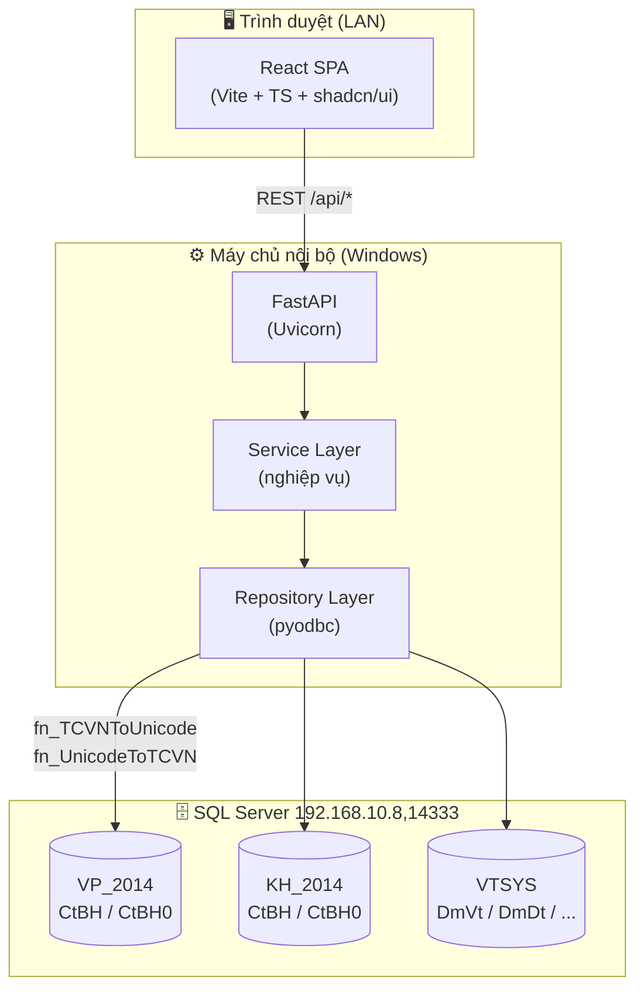
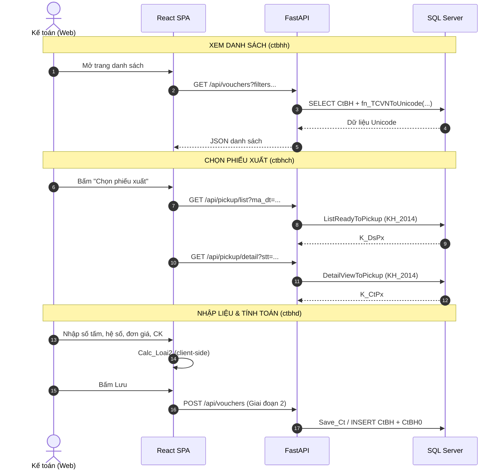
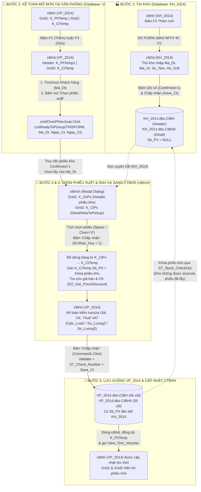
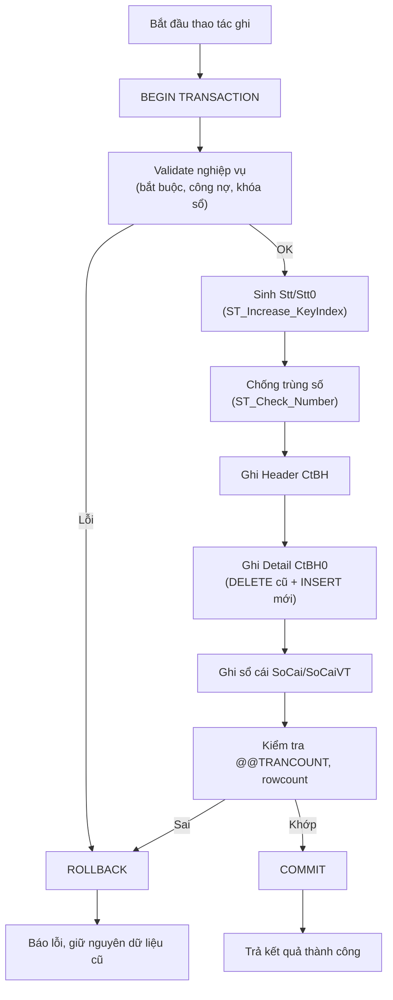

# 📋 KẾ HOẠCH TRIỂN KHAI: WEB APP QUẢN LÝ CHỨNG TỪ BÁN HÀNG (`ctbhh` + `ctbhd`)

> **Mục tiêu:** Xây dựng một web application thay thế/mở rộng chức năng của 2 form Visual FoxPro `ctbhh.scx` (danh sách chứng từ) và `ctbhd.scx` (nhập liệu chứng từ), với đầy đủ tính năng nghiệp vụ tương đương phần mềm 1S, ghi/đọc dữ liệu trên SQL Server, hiển thị Unicode tiếng Việt.
>
> **Tài liệu tham chiếu:**
>
> - `html/html.md` — Cơ chế ánh xạ `ctbhd` ⟷ `ctbhch`, ghi CSDL `CtBH`/`CtBH0`
> - `html/ctbhd_to_ctbh0_mapping.md` — Ma trận ánh xạ 46 cột Header + 35 cột Detail
> - `html/vp2014_schema.md` — Cấu trúc database `VP_2014` & `VTSYS`
> - `All_fix.md` — Nguyên tắc sửa form, các Fix #1–#24
> - `a_import_python_app.md` — Mẫu tool Python + `pyodbc` hiện có
>
> **Ngày lập:** 2026-10-19
> **Cập nhật:** 2026-10-23
> **Trạng thái:** 🟢 **Giai đoạn 0, 1 & 2 đã hoàn thành** — sẵn sàng Giai đoạn 3
>
> **Tiến độ tổng quan:**
>
> | Giai đoạn | Nội dung               | Trạng thái                   |
> | :-------- | :--------------------- | :--------------------------- |
> | GĐ0       | Khởi tạo dự án         | ✅ 100%                      |
> | GĐ1       | READ-ONLY (Xem/Lọc/In) | ✅ ~100% (chờ mẫu in `.frx`) |
> | GĐ2       | Ghi dữ liệu (ACID)     | ✅ 100%                      |
> | GĐ3       | Hoàn thiện & Tối ưu    | ⬜ Chưa bắt đầu              |
>
> **Quyết định thay đổi so với bản Draft:** **BỎ phần đăng nhập** (theo yêu cầu người dùng).
> Backend `deps.py` trả user tĩnh; frontend không có màn Login. Xem §2.

---

## 📑 MỤC LỤC

1. [Tổng quan & Phạm vi](#1-tổng-quan--phạm-vi)
   - 1.4. Quy ước đặt tên (tránh nhầm với VFP)
2. [Quyết định kỹ thuật đã chốt](#2-quyết-định-kỹ-thuật-đã-chốt)
3. [Kiến trúc hệ thống](#3-kiến-trúc-hệ-thống)
4. [Cấu trúc thư mục dự án](#4-cấu-trúc-thư-mục-dự-án)
5. [Chiến lược Database & Unicode](#5-chiến-lược-database--unicode)
6. [Đặc tả API Backend](#6-đặc-tả-api-backend)
7. [Đặc tả Frontend](#7-đặc-tả-frontend)
8. [Đặc tả Logic nghiệp vụ](#8-đặc-tả-logic-nghiệp-vụ)
   - 8.8. Nguyên tắc Toàn vẹn & An toàn Dữ liệu (ACID)
   - 8.9. Nguyên tắc Tối ưu Hiệu năng (Performance)
9. [Lộ trình triển khai theo giai đoạn](#9-lộ-trình-triển-khai-theo-giai-đoạn)
10. [Kiểm thử & Nghiệm thu](#10-kiểm-thử--nghiệm-thu)
11. [Rủi ro & Lưu ý quan trọng](#11-rủi-ro--lưu-ý-quan-trọng)

---

## 1. TỔNG QUAN & PHẠM VI

### 1.1. Bối cảnh

Phần mềm kế toán 1S hiện chạy trên **Visual FoxPro 8.0** (client) kết nối **SQL Server** qua ADO/OLE DB. Hai form chính:

| Form         | Vai trò                                     | Cursor chính                                  |
| :----------- | :------------------------------------------ | :-------------------------------------------- |
| `ctbhh.scx`  | **Danh sách chứng từ** bán hàng (list view) | `K_PhTemp` (header list), `K_CtTemp` (detail) |
| `ctbhd.scx`  | **Nhập liệu chứng từ** (entry form)         | `K_PhTemp1` (header), `K_CtTemp` (detail)     |
| `ctbhch.scx` | **Chọn phiếu xuất** từ kho (`KH_2014`)      | `K_DsPx` (danh sách), `K_CtPx` (chi tiết)     |

### 1.2. Phạm vi tính năng (đã xác nhận)

|  #  | Tính năng                               | Nguồn gốc                      |  Ưu tiên   |
| :-: | :-------------------------------------- | :----------------------------- | :--------: |
| F1  | Danh sách chứng từ + Thêm/Sửa/Xóa       | `ctbhh` (Command1/2/3)         |    Cao     |
| F2  | Nhập liệu header + grid chi tiết        | `ctbhd`                        |    Cao     |
| F3  | Chọn phiếu xuất từ kho (`KH_2014`)      | `ctbhch` + `ListReadyToPickup` |    Cao     |
| F4  | Tính toán hàng mút (`Calc_Loai2`)       | `ctbhd` Rec 3                  |    Cao     |
| F5  | Chiết khấu + Thuế VAT + tổng thanh toán | `ctbhd` Rec 46/59              |    Cao     |
| F6  | Kiểm tra công nợ realtime (TK 131)      | `ctbhd` Rec 12/59              |    Cao     |
| F7  | In phiếu / Xem trước                    | `In_Ct_Kh` / `In_Ct_Hd`        | Trung bình |
| F8  | Lọc chứng từ (F9)                       | `filterID`                     | Trung bình |
| F9  | Chi tiết công nợ                        | `Command8` → `Edit_Ct_Congno`  |    Thấp    |

### 1.3. Ngoài phạm vi (Out of scope)

- Không thay thế các form khác (`ctckh`, `ctnxh`, `kct04`...).
- Không sửa đổi cấu trúc bảng SQL hiện có.
- Không can thiệp vào các file `.scx/.sct/.fxp` của VFP (trừ khi cần đối chiếu).

### 1.4. Quy ước đặt tên (BẮT BUỘC — tránh nhầm với VFP)

> **Tên trên web KHÁC HOÀN TOÀN tên form VFP.** Khi trao đổi (họp, chat, ticket, PR),
> luôn dùng **tên nghiệp vụ** hoặc **tên component web**; chỉ ghi kèm mã VFP trong ngoặc
> khi thật sự cần đối chiếu. **Tuyệt đối không sửa file `.scx/.sct/.fxp` của VFP.**

**Bảng quy ước 3 tầng tên song song:**

| Mã VFP   | Tên nghiệp vụ (gọi khi làm việc) | Component web  | Route (đề xuất)          |
| :------- | :------------------------------- | :------------- | :----------------------- |
| `ctbhh`  | Danh sách phiếu xuất bán         | `VoucherList`  | `/sales-invoices`        |
| `ctbhd`  | Chi tiết / sửa phiếu xuất bán    | `VoucherForm`  | `/sales-invoices/:stt`   |
| `ctbhch` | Chọn phiếu xuất kho              | `PickupDialog` | (dialog, không có route) |

**Nguyên tắc áp dụng:**

1. **Giao tiếp:** nói **tên nghiệp vụ** (tiếng Việt) + ngoặc mã VFP nếu cần.
   _Ví dụ:_ "Màn **Chi tiết phiếu** (`ctbhd`) bị lệch cột — nhớ đừng đụng file VFP nhé."
2. **Trong code:** dùng tiền tố component web (`Voucher*`), **không** dùng `ctbhh/ctbhd/ctbhch`
   làm tên biến/hàm/component.
3. **Trong PR / commit / ticket:** tiêu đề ghi theo **cột "Component web"** hoặc **"Tên nghiệp vụ"**,
   phần mô tả mới ghi mã VFP nếu liên quan.
4. **Trên UI:** tiêu đề hiển thị tiếng Việt ("Phiếu Xuất Bán", "Sửa Chứng Từ"), có thể ghi phụ
   `(web)` để phân biệt khi chụp màn hình so sánh với VFP.
5. **Tài liệu:** mọi đặc tả mới dùng tên web; giữ bảng ánh xạ tại §1.4 làm nguồn tham chiếu duy nhất.

> ⚠️ **Bẫy thường gặp:** nhầm `ctbhd` (form **sửa** phiếu) với `ctbhch` (form **chọn phiếu xuất kho**).
> Trên web, `VoucherForm` = sửa phiếu; `PickupDialog` = chọn phiếu xuất kho — hai việc khác nhau.

---

## 2. QUYẾT ĐỊNH KỸ THUẬT ĐÃ CHỐT

| Hạng mục              | Quyết định                                                                  | Ghi chú                                                                                                                                                            |
| :-------------------- | :-------------------------------------------------------------------------- | :----------------------------------------------------------------------------------------------------------------------------------------------------------------- |
| **Backend**           | Python **FastAPI** + `pyodbc`                                               | Tái sử dụng pattern từ `import_baoco_tool.py`                                                                                                                      |
| **Frontend**          | **React + Vite + TypeScript**                                               | SPA hiện đại, dễ mở rộng                                                                                                                                           |
| **UI Library**        | shadcn/ui + TailwindCSS                                                     | Component nhất quán, hỗ trợ bảng/form tốt                                                                                                                          |
| **Xác thực**          | ~~Đăng nhập đơn giản~~ → **BỎ** (theo yêu cầu người dùng)                   | `deps.py` trả user tĩnh (`KETOAN01`); không có màn Login. Có thể bổ sung sau                                                                                       |
| **Ghi dữ liệu**       | **Giai đoạn 1: READ-ONLY** → Giai đoạn 2: ghi `VP_2014` + `KH_2014`         | An toàn dữ liệu thật                                                                                                                                               |
| **Stored Procedures** | **Tái sử dụng tối đa** SP/Function hiện có                                  | `Save_Ct`, `ST_Check_Number`, `ST_Increase_KeyIndex`, `CtBH_Delete`, `ListReadyToPickup`, `DetailViewToPickup`, `SO_Get_Price`, `GL_Alert_ClosingAccount4Customer` |
| **In phiếu**          | Tái tạo mẫu in trên web (HTML/CSS → PDF, in từ trình duyệt)                 | Mẫu `.frx` do người dùng cung cấp                                                                                                                                  |
| **Triển khai**        | Máy chủ nội bộ LAN (Windows), truy cập qua IP                               | Uvicorn + build tĩnh React                                                                                                                                         |
| **Unicode**           | `fn_TCVNToUnicode` (đọc) / `fn_UnicodeToTCVN` (ghi) cho **mọi trường text** | `Ten_Vt`, `Ten_Dt`, `Dia_Chi`, `Dien_Giai`, `Ong_Ba`...                                                                                                            |
| **Vị trí dự án**      | `e:\1S2024\html\webapp\`                                                    | Trong thư mục `html` hiện có                                                                                                                                       |

### 2.1. Danh mục lookup (autocomplete) cần nạp

| Cursor gốc | Bảng SQL           | Trường hiển thị                                                                                 |
| :--------- | :----------------- | :---------------------------------------------------------------------------------------------- |
| `M_DmVt`   | `VTSYS.dbo.DmVt`   | `Ma_Vt`, `Ten_Vt`, `Dvt`, `Dvt_Ban`, `Loai_Vt`, `Tk_Gv`, `Tk_Vt`, `Tk_Dt`, `Tk_Ck`, `He_So0..2` |
| `M_DmDt`   | `VTSYS.dbo.DmDt`   | `Ma_Dt`, `Ten_Dt`, `Dia_Chi`, `Ong_Ba`, `MS_Thue`, `Han_Tt`, `Gioi_Han`, `Toi_Han`, `Doi_Tac`   |
| `M_DmKho`  | `VTSYS.dbo.DmKho`  | `Ma_Kho`, `Ten_Kho`                                                                             |
| `M_DmThue` | `VTSYS.dbo.DmThue` | `Ma_Thue`, `Thue_GTGT`, `Tk`                                                                    |
| `M_DmTk`   | `VTSYS.dbo.DmTk`   | `Tk`, `Ten_Tk`, `Tk_Dt`                                                                         |
| `M_DmNx`   | `VTSYS.dbo.DmNx`   | `Ma_Nx`, `Ten_Nx`, `Dinh_Khoan`                                                                 |
| `M_DmXe`   | `VTSYS.dbo.DmXe`   | `Ma_Xe`, `Ten_Xe`                                                                               |
| `M_DmBp`   | `VTSYS.dbo.DmBp`   | `Ma_Bp`, `Ten_Bp`                                                                               |
| `M_DmHD`   | `VTSYS.dbo.DmHD`   | `Ma_HD`, `Ten_HD`                                                                               |
| `M_DmTte`  | `VTSYS.dbo.DmTte`  | `Ma_Tte`, `Ty_Gia`                                                                              |

---

## 3. KIẾN TRÚC HỆ THỐNG



### 3.1. Luồng dữ liệu chính



---

### 3.2. Đặc tả chi tiết mối quan hệ liên thông giữa 3 Form (`ctbhh` ⟷ `ctbhd` ⟷ `ctbhch`) & Cơ chế ghi dữ liệu liên Database (`KH_2014` → `VP_2014`)

Đây là **luồng nghiệp vụ xương sống** của phần mềm 1S cần được tái hiện chính xác 100% khi chuyển từ Visual FoxPro lên Web App (đặc biệt khi bước sang **Giai đoạn 2 — Ghi dữ liệu**).

#### 3.2.1. Vai trò & Bộ nhớ đệm (In-Memory Cursors) của 3 Form

| Form VFP                             | Component Web App                                                 | Database kết nối                                         | Cursor / State nắm giữ                                                                                                                                                                | Vai trò trong dây chuyền                                                                                                                                                                                                                     |
| :----------------------------------- | :---------------------------------------------------------------- | :------------------------------------------------------- | :------------------------------------------------------------------------------------------------------------------------------------------------------------------------------------ | :------------------------------------------------------------------------------------------------------------------------------------------------------------------------------------------------------------------------------------------- |
| **`ctbhh.scx`**<br/>_(Danh sách)_    | `VoucherList.tsx`<br/>(`/sales-invoices`)                         | `KH_2014` (Kho)<br/>hoặc<br/>`VP_2014` (Kế toán)         | • **`K_PhTemp`** (`Grid1`): Danh sách Header chứng từ trong kỳ lọc.<br/>• **`K_CtTemp`** (`Grid2`): Chi tiết dòng hàng của chứng từ đang đứng trên `Grid1`.                           | Màn hình điều phối trung tâm: Xem danh sách, lọc (`F9`), đánh dấu (`Space`/`Ctrl+A`), in (`F7`/`Ctrl+F7`), xóa (`F8`), mở form thêm mới (`F2`) hoặc sửa (`F3`).                                                                              |
| **`ctbhd.scx`**<br/>_(Nhập liệu)_    | `VoucherForm.tsx` + `DetailGrid.tsx`<br/>(`/sales-invoices/:stt`) | `KH_2014` (Kho)<br/>hoặc<br/>`VP_2014` (Kế toán)         | • **`K_PhTemp1`** (1 dòng): Bản nháp Header của phiếu đang thêm/sửa (46 cột `CtBH`).<br/>• **`K_CtTemp`** ($N$ dòng, `Grid2`): Danh sách mặt hàng của phiếu đang mở (35 cột `CtBH0`). | Form tác nghiệp chính: Nhập/sửa thông tin khách hàng (`Ma_Dt`), gọi chọn phiếu xuất kho (`cmdChonPhieuXuat`), tính toán số lượng/tiền/chiết khấu/thuế (`Calc_Loai2`, `So_Luong2`, `So_Luong3`), kiểm tra công nợ & lưu xuống DB (`Save_Ct`). |
| **`ctbhch.scx`**<br/>_(Chọn PX kho)_ | `PickupDialog.tsx`<br/>_(Modal Dialog)_                           | Đọc xuyên sang **`KH_2014`** từ phiên làm việc `VP_2014` | • **`K_DsPx`** (`Grid1`): Danh sách các phiếu xuất kho của khách hàng chưa lập hóa đơn.<br/>• **`K_CtPx`** (`Grid2`): Chi tiết mặt hàng của phiếu xuất đang trỏ trên `Grid1`.         | Cầu nối liên thông `KH_2014` → `VP_2014`: Cho phép kế toán tích chọn (`Space`/`Ctrl+A`) một hoặc nhiều phiếu xuất kho để hút toàn bộ dòng hàng về `K_CtTemp` của `ctbhd`.                                                                    |

---

#### 3.2.2. Sơ đồ kiến trúc liên thông 5 bước giữa 2 Database và 3 Form



---

#### 3.2.3. Giải phẫu chi tiết từng bước chuyển đổi dữ liệu

##### **Bước 1: Kho xuất hàng trên `ctbhd` trong database `KH_2014`**

1. **Khởi tạo phiếu xuất kho:** Thủ kho đăng nhập vào database `KH_2014` (`UPPER(ALLTRIM(M_MA_DB)) == ALLTRIM(M_DB_KHO)`). Trên màn hình danh sách `ctbhh`, thủ kho bấm `F2` (`Command1.Click`) $\rightarrow$ mở `ctbhd` với tham số `('M', 'X1')`.
2. **Ẩn nút Chọn phiếu xuất:** Tại `ctbhd.Init` (Block 3), do đang ở database Kho nên `THIS.cmdChonPhieuXuat.Visible = .F.`.
3. **Nhập hàng hóa xuất kho:**
   - Thủ kho chọn khách hàng (`Ma_Dt`), nhập xe (`Ma_Xe`), kho xuất (`Ma_Kho`), mã vật tư (`Ma_Vt`).
   - Nếu là hàng Mút (`Loai_Vt = '2'`): thủ kho nhập `So_Tam` (Số tấm) và `He_So8` (Hệ số/độ dày). Phương thức `THISFORM.Calc_Loai2()` tự động tính:
     $$\text{So\_Luong8} = \text{So\_Luong9} = \text{So\_Luong} = \text{ROUND}(\text{So\_Tam} \times \text{He\_So8}, 2)$$
   - Nếu là hàng thường (`Loai_Vt = '1'`): hàm `So_Luong2(THISFORM)` tính $\text{So\_Luong} = \text{So\_Luong9} \times \text{He\_So9}$.
4. **Xác nhận & Lưu tại Kho:**
   - Thủ kho bấm nút **"Ghi sổ"** (`Command3` trên `ctbhd` $\rightarrow$ bật `K_PhTemp1.Confirmed = .T.`) để xác nhận hàng đã thực xuất khỏi kho (điều kiện bắt buộc để kế toán văn phòng nhìn thấy phiếu).
   - Bấm **"Chấp nhận"** (`Cmgnhan_huy1.Command1.Click`): Hàm `=Save_Ct('M')` ghi Header vào `KH_2014.dbo.CtBH` và các dòng hàng vào `KH_2014.dbo.CtBH0` (lúc này dưới kho `Stt_PX` để trống/NULL).

##### **Bước 2: Kế toán tại `VP_2014` mở `ctbhd` từ `ctbhh` và tìm khách hàng**

1. **Cơ chế Master-Detail trên `ctbhh` (`VoucherList`):**
   - Khi kế toán mở `ctbhh` trên database `VP_2014`, `Grid1` hiển thị cursor `K_PhTemp` (danh sách các chứng từ).
   - Mỗi khi con trỏ dòng trên `Grid1` thay đổi (`Grid1.AfterRowColChange`), nếu `THISFORM._Grid_Current_Row <> THIS.ActiveRow`, form gọi `=View_One_Voucher(THISFORM, K_PhTemp.Stt)` để truy vấn bảng `VP_2014.dbo.CtBH0` (WHERE `Stt = K_PhTemp.Stt`) và đổ vào cursor `K_CtTemp` hiển thị ở `Grid2` bên dưới.
   - Khi di chuyển dòng trên `Grid2` (`Grid2.AfterRowColChange`), form gọi `THISFORM.ShowNotice(...)` chạy SP `IN_Alert_Inventory` để hiện tồn kho tức thời trên thanh `txtNotice`.
2. **Chuyển cảnh từ `ctbhh` sang `ctbhd` (`VoucherForm`):**
   - **Khi bấm `F2` (Thêm mới — `Command1.Click`):**
     - Kiểm tra phân quyền qua SP `ST_Get_DocumentID` và `ST_Check_Right` (`@p_RightNo = 1`).
     - Ẩn thanh công cụ `_BrowseControl`, gọi lệnh:
       ```foxpro
       DO FORM (M_Scre + 'CtBHD') WITH 'M', THISFORM._Ma_Ct
       ```
     - Trong `ctbhd.Init`:
       - Lưu trạng thái của `K_PhTemp` đang đứng ở `ctbhh` (như `Ma_Dt`, `Ten_Dt`, `Dia_Chi`, `Ong_Ba`, `Ma_Xe`, `Ten_Xe`).
       - Gọi `=Add_One_Voucher(THIS)` để tạo mới 1 dòng trong `K_PhTemp1` (cấp khóa `Stt` mới) và tạo 1 dòng trắng trong `K_CtTemp`.
       - Tự động điền các giá trị mặc định kế thừa từ dòng `K_PhTemp` trước đó + mặc định `Ma_Nx = '131'`, `Tk2 = '1311'`, tra cứu `Ma_Bp` qua `DmDt_Get_1Item` (Fix #13, #14, #15).
   - **Khi bấm `F3` (Sửa phiếu — `Command2.Click`):**
     - Gọi lệnh:
       ```foxpro
       DO FORM (M_Scre + 'CtBHD') WITH 'S', THISFORM._Ma_Ct, THISFORM._Stt
       ```
     - Trong `ctbhd.Init`: Kiểm tra quyền sửa (`@p_RightNo = 2`), gọi `=Edit_One_Voucher(THIS)` để nạp dữ liệu của phiếu `THISFORM._Stt` từ `VP_2014.dbo.CtBH` vào `K_PhTemp1` và từ `VP_2014.dbo.CtBH0` vào `K_CtTemp`.
3. **Chọn/Tìm khách hàng trên `ctbhd`:**
   - Kế toán có thể gõ mã khách tại `txtMa_Dt` (Rec 12) hoặc gõ tên khách tại `txtTen_Dt` (Rec 51) để tìm kiếm trong `M_DmDt`.
   - Khi `txtMa_Dt.LostFocus` hoặc `txtTen_Dt.LostFocus` chạy:
     - Cập nhật `Ma_Dt`, `Ten_Dt`, `Ong_Ba`, `Dia_Chi`, `Ma_DtGtGt` (MST), `Ten_DtGtGt`, `Han_Tt` vào `K_PhTemp1`.
     - Gọi `DmDt_Get_1Item` nạp `Ma_Bp`, `Ten_Bp`.
     - Truy vấn trực tiếp hạn mức tín dụng (`Gioi_Han`, `Toi_Han`) và công nợ hiện tại tại ngày `DATE()` qua SP `GL_Alert_ClosingAccount4Customer` (hoặc `GL_Alert_ClosingAccount4CustomerGroup`), hiển thị lên 3 nhãn `lblGioiHan`, `lblCongNo`, `lblVm` và cảnh báo nếu chạm/vượt hạn mức (Fix #1, #2, #16).

##### **Bước 3: Từ `ctbhd` mở `ctbhch` ("Chọn phiếu xuất") và tích chọn phiếu kho**

1. **Kích hoạt `cmdChonPhieuXuat`:**
   - Vì kế toán đang làm việc trên `VP_2014` (`UPPER(ALLTRIM(M_MA_DB)) <> ALLTRIM(M_DB_KHO)`), nút **"Chọn phiếu xuất"** (`cmdChonPhieuXuat`, Rec 90) được hiển thị (`Visible = .T.`).
   - Khi bấm nút, sự kiện `cmdChonPhieuXuat.Click` gọi hàm thư viện:
     ```foxpro
     =ListReadyToPickup(THISFORM, K_PhTemp1.Ma_Dt, K_PhTemp1.Ngay_Ct, K_PhTemp1.Ngay_Ct)
     ```
2. **Truy vấn sang `KH_2014` và khởi tạo `ctbhch.scx` (`PickupDialog`):**
   - Hàm `ListReadyToPickup` mở kết nối sang database kho `KH_2014`, lọc các phiếu xuất kho (`Ma_Ct IN ('X1', 'N5')`, `Confirmed = 1`) của đúng khách hàng `K_PhTemp1.Ma_Dt` mà các dòng hàng chưa được lấy lên hóa đơn văn phòng, đổ danh sách Header vào cursor **`K_DsPx`**.
   - Mở form modal `ctbhch.scx` (`WindowType = 1 - Modal`).
3. **Thao tác của kế toán bên trong `ctbhch.scx`:**
   - **Lưới trên (`Grid1` — `RecordSource = "K_DsPx"`):** Hiển thị 6 cột:
     1. `Chon` (`K_DsPx.Chon` — hiển thị `'X'` khi được tích)
     2. `Ngay_Ct` (Ngày xuất kho)
     3. `So_Ct` (Số phiếu xuất kho)
     4. `Ma_Dt` (Mã khách hàng)
     5. `Ten_Dt` (Tên khách hàng)
     6. `Dia_Chi` (Địa chỉ)
   - **Xem chi tiết phiếu xuất (`Grid1.AfterRowColChange`):**
     - Khi kế toán di chuyển vệt sáng qua từng phiếu trên `Grid1`, sự kiện `AfterRowColChange` gọi:
       ```foxpro
       =DetailViewToPickup(K_DsPx.Stt)
       ```
     - Hàm này truy vấn `KH_2014.dbo.CtBH0` của phiếu `K_DsPx.Stt`, đổ các mặt hàng vào cursor **`K_CtPx`** và hiển thị trên **Lưới dưới (`Grid2`)** gồm 10 cột: `Ma_Vt`, `Ten_Vt`, `Dvt`, `Ma_Kho`, `So_Luong9` (SL xuất), `Dvt_Ban`, `So_Tam`, `He_So8` (Hệ số), `So_Luong8` (SL bán), `Gia_Tb_Tt`.
   - **Tích chọn từng phiếu hoặc tất cả phiếu (`KeyPress` / `DblClick`):**
     - Nhấn phím `Space` (`nKeyCode = 32`) hoặc `DblClick` vào cột `Chon`: Đảo trạng thái chọn của phiếu hiện tại:
       ```foxpro
       REPLACE Mark WITH NOT K_DsPx.Mark, Chon WITH IIF(K_DsPx.Mark, '', 'X') IN K_DsPx
       ```
     - Nhấn `Ctrl+A` (`nKeyCode = 1, nShiftAltCtrl = 2`): Chọn tất cả phiếu (`REPLACE ALL Mark WITH .T., Chon WITH 'X' IN K_DsPx`).
     - Nhấn `Ctrl+U` (`nKeyCode = 21, nShiftAltCtrl = 2`): Bỏ chọn tất cả (`REPLACE ALL Mark WITH .F., Chon WITH '' IN K_DsPx`).
     - Sau mỗi lần tích chọn, biến `m.TSo_Phieu` (`txtTSoPhieu`) được cộng/trừ và hiển thị tổng số phiếu đã chọn trên tổng số phiếu (`m.TSo_Phieu0`).
   - **Xác nhận chọn hoặc Hủy bỏ:**
     - Bấm **"Chấp nhận"** (`cmgNhan_huy.Command1.Click` hoặc phím `Enter`): Gán `M.Nhan_Huy = 1`, gọi `THISFORM.Release` để đóng `ctbhch`.
     - Bấm **"Hủy bỏ"** (`cmgNhan_huy.Command2.Click` hoặc phím `Esc`): `M.Nhan_Huy = 0`, đóng `ctbhch` và giữ nguyên `ctbhd` không thay đổi.

##### **Bước 4: Chuyển đổi dữ liệu từ `ctbhch` (`K_DsPx`/`K_CtPx`) vào `ctbhd` (`K_PhTemp1`/`K_CtTemp`)**

Ngay khi `ctbhch` đóng lại với `M.Nhan_Huy = 1`, phần hậu xử lý của `ListReadyToPickup` thực hiện chuyển đổi dữ liệu sang `ctbhd`:

1. **Gom dòng chi tiết từ các phiếu đã tích (`Mark = .T.`) sang `K_CtTemp`:**
   - Duyệt qua tất cả các phiếu có `K_DsPx.Mark = .T.`.
   - Lấy toàn bộ các dòng hàng thuộc các phiếu đó từ `KH_2014.dbo.CtBH0` (`K_CtPx`) chèn vào cursor `K_CtTemp` của form `ctbhd`.
2. **Bảng quy tắc ánh xạ từng trường từ Kho (`K_CtPx`) sang Văn phòng (`K_CtTemp`):**

| Trường đích trên `ctbhd` (`K_CtTemp`)                             | Nguồn từ `ctbhch` (`K_CtPx` / `KH_2014.dbo.CtBH0`)                 | Cơ chế biến đổi & Lưu ý kỹ thuật quan trọng                                                                                                                                                                                                                                     |
| :---------------------------------------------------------------- | :----------------------------------------------------------------- | :------------------------------------------------------------------------------------------------------------------------------------------------------------------------------------------------------------------------------------------------------------------------------ |
| **`Stt`**                                                         | `K_PhTemp1.Stt`                                                    | Gán bằng khóa chính `Stt` của hóa đơn văn phòng đang mở trên `ctbhd`.                                                                                                                                                                                                           |
| **`Stt0`**                                                        | Sinh mới (`SYS(2015)` / `ST_Increase_KeyIndex`)                    | Mỗi dòng trên `K_CtTemp` tại VP có khóa chính `Stt0` mới độc lập.                                                                                                                                                                                                               |
| **`Stt_PX`**                                                      | **`K_DsPx.Stt`** _(Header `Stt` của phiếu kho `KH_2014.dbo.CtBH`)_ | **Khóa ngoại liên kết liên Database (đã xác minh thực nghiệm 100%):** Lưu mã **`Stt` của Header phiếu xuất kho** bên `KH_2014` (ví dụ `'S1000000000014763665'`, **không phải** `Stt0` của dòng chi tiết). Trong khi đó `KH_2014.dbo.CtBH0.Stt_PX` luôn bằng `NULL` (0 bản ghi). |
| **`Ma_Vt`, `Ten_Vt`, `Loai_Vt`**                                  | `K_CtPx.Ma_Vt`, `Ten_Vt`, `Loai_Vt` (từ `IN_DetailReadyToPickup`)  | Giữ nguyên từng dòng riêng biệt theo từng phiếu xuất kho (không gộp dòng trùng mã vật tư). SP `IN_DetailReadyToPickup` đã trả sẵn `Ten_Vt` và `Loai_Vt` (`'1'`, `'2'`, `'3'`).                                                                                                  |
| **`Dvt`, `Dvt_Ban`, `Ma_Kho`**                                    | `K_CtPx.Dvt`, `Dvt_Ban`, `Ma_Kho`                                  | Giữ nguyên ĐVT gốc, ĐVT bán và Mã kho thực xuất dưới kho.                                                                                                                                                                                                                       |
| **`So_Tam`**                                                      | `K_CtPx.So_Tam`                                                    | Giữ nguyên số tấm thủ kho đã cân/đếm (với `Loai_Vt = '2'`).                                                                                                                                                                                                                     |
| **`He_So8`, `He_So9`**                                            | `K_CtPx.He_So8`, `He_So9`                                          | Giữ nguyên hệ số quy đổi từ kho. _(Lưu ý: Trên UI `ctbhch` cột Hệ số ở vị trí 8, còn trên `ctbhd` ở vị trí 10, nhưng cùng tên trường `He_So8`)_.                                                                                                                                |
| **`So_Luong8`, `So_Luong9`, `So_Luong`**                          | `K_CtPx.So_Luong8`, `So_Luong9`                                    | Giữ nguyên số lượng bán quy đổi ($\text{So\_Tam} \times \text{He\_So8}$ với hàng Mút).                                                                                                                                                                                          |
| **`Tk`, `Tk_Du`, `Tk_Du2`, `Tk_Du4`**                             | Trả sẵn từ `IN_DetailReadyToPickup` (theo `M_DmVt`)                | Gán tài khoản hạch toán tại VP: `Tk = Tk_Gv` (`632`), `Tk_Du = Tk_Vt` (`1561`), `Tk_Du2 = Tk_Dt` (`5111` hoặc `Tk_HBTL`), `Tk_Du4 = Tk_Ck` (`521`).                                                                                                                             |
| **`Gia_Nt9`, `Chiet_Khau`**                                       | SP `SO_Get_Price` & `SO_Get_Discount` + `SO_Price_Fix`             | Tự động tra bảng giá/chiết khấu VP theo `Ngay_Ct`, `Ma_Dt`, `Ma_Vt` cho từng dòng riêng biệt (và kiểm tra ngày hết hạn giá qua `CheckPriceExpiry` / `CheckDiscountExpiry`).                                                                                                     |
| **`Tien_Nt9`, `Tien9`, `Tien_Nt2`, `Tien2`, `Tien_Nt4`, `Tien4`** | Tính qua `Calc_Loai2` / `So_Luong2` / `So_Luong3` + `Chiet_Khau`   | Tính thành tiền trước CK, tiền CK và thành tiền sau CK theo đơn giá văn phòng.                                                                                                                                                                                                  |

3. **Cập nhật thông tin Header `K_PhTemp1` sau khi lấy phiếu xuất:**
   - Nếu `K_PhTemp1.Ma_Xe` đang trống, kế thừa `Ma_Xe` từ phiếu xuất kho (`K_DsPx.Ma_Xe`).
   - Cộng dồn tổng số lượng lên ô `txtTSo_Loai` (`m.TSo_Loai`) và cộng dồn toàn bộ các trường tổng tiền Header (`TTien_Nt`, `TTien`, `TTien_Nt2`, `TTien2`, `TTien_Nt4`, `TTien4`, `TTien_Nt3`, `TTien3`, `TTien_Nt0`, `TTien0`).

---

#### 3.2.4. Xác minh Thực nghiệm (READ-ONLY) Hệ thống Stored Procedures & Cơ chế `Stt_PX` trên SQL Server

Qua kiểm tra metadata (`sys.parameters`, `sys.dm_exec_describe_first_result_set_for_object`) và đối chiếu dữ liệu thực tế trên `VP_2014` & `KH_2014` (ví dụ phiếu kho `K03/BH626` có `Stt = 'S1000000000014763665'` được lấy lên hóa đơn VP `HD7036` có `Stt = 'S1000000000014763690'`), cơ chế bên dưới của `ListReadyToPickup`, `DetailViewToPickup`, `ST_Stock_CheckOut` và `Save_Ct` được xác nhận **chính xác 100%** như sau:

1. **Quy tắc vàng về cột `Stt_PX` giữa 2 Database:**
   - **Tại `KH_2014.dbo.CtBH0`:** Cột `Stt_PX` **luôn luôn là `NULL`** (0 bản ghi khác rỗng trên toàn bộ database `KH_2014`). Hệ thống **KHÔNG BAO GIỜ** ghi ngược vào `KH_2014` khi Kế toán lưu hóa đơn ở `VP_2014`.
   - **Tại `VP_2014.dbo.CtBH0`:** Khi lấy dòng hàng từ phiếu xuất kho sang hóa đơn VP, mỗi dòng chi tiết trong `VP_2014.dbo.CtBH0` được ghi nhận **`Stt_PX = KH_2014.dbo.CtBH.Stt`** (mã `Stt` 20 ký tự của **Header phiếu xuất kho**, không phải `Stt0`).
   - **Cơ chế đối chiếu chéo tự động:**
     - Một phiếu xuất kho `kh.Stt` trong `KH_2014.dbo.CtBH` được coi là **"Chưa lấy lên hóa đơn"** khi và chỉ khi `kh.Stt` **chưa xuất hiện** trong cột `VP_2014.dbo.CtBH0.Stt_PX`:
       ```sql
       NOT EXISTS (
           SELECT 1 FROM VP_2014.dbo.CtBH0 vp_d WITH (NOLOCK)
           WHERE vp_d.Stt_PX = kh_h.Stt
       )
       ```
     - Ngược lại, khi `kh.Stt` đã tồn tại trong `VP_2014.dbo.CtBH0.Stt_PX`:
       - Thủ tục `VP_2014.dbo.IN_ListReadyToPickup` tự động loại phiếu đó khỏi danh sách chọn (`ctbhch`).
       - Thủ tục `KH_2014.dbo.ST_Stock_CheckOut(@p_DB_Work, @p_Stt, @p_Check OUTPUT)` trả về `@p_Check = 1`, khiến form `ctbhh`/`ctbhd` dưới Kho hiện chữ `"Đã xác nhận"` và khóa không cho Thủ kho sửa/xóa phiếu đó.
       - Nếu Kế toán tại VP xóa hóa đơn (`VP_2014.dbo.CtBH_Delete`), các dòng trong `VP_2014.dbo.CtBH0` bị xóa theo $\rightarrow$ phiếu xuất kho dưới `KH_2014` tự động được giải phóng và xuất hiện trở lại trong `ctbhch` mà không cần bất kỳ lệnh `UPDATE` nào sang `KH_2014`!

   > ⚠️ **CẢNH BÁO QUAN TRỌNG CẦN SỬA NGAY ĐẦU GIAI ĐOẠN 2 TRONG `pickup_repo.py`:**
   > Trong `html/webapp/backend/app/repositories/pickup_repo.py` (viết ở GĐ1), câu SQL đang kiểm tra `WHERE d.Stt_PX IS NULL` trên bảng `KH_2014.dbo.CtBH0`. Vì `KH_2014.dbo.CtBH0.Stt_PX` luôn bằng `NULL`, điều kiện đó không lọc bỏ được các phiếu đã lấy!
   > **Giải pháp bắt buộc ở GĐ2:** Gọi trực tiếp 2 SP chuẩn `VP_2014.dbo.IN_ListReadyToPickup` & `VP_2014.dbo.IN_DetailReadyToPickup` (hoặc sửa điều kiện `NOT EXISTS (SELECT 1 FROM VP_2014.dbo.CtBH0 vp WITH (NOLOCK) WHERE vp.Stt_PX = h.Stt)`), đồng thời chỉ lọc đúng theo ngày `Ngay_Ct` đang nhập trên `ctbhd` (`@p_Ngay1 = Ngay_Ct`, `@p_Ngay2 = Ngay_Ct`).

2. **Danh mục đầy đủ các Stored Procedures tham gia vào vòng đời 3 Form:**

| Form VFP                           | Tên Stored Procedure trên SQL Server                                                                                                                                                                            | Tham số đầu vào / đầu ra (Signature)                                                                                                                                                                                                                                      | Kết quả trả về / Nhiệm vụ thực thi                                                                                                                                                                                                                                         |
| :--------------------------------- | :-------------------------------------------------------------------------------------------------------------------------------------------------------------------------------------------------------------- | :------------------------------------------------------------------------------------------------------------------------------------------------------------------------------------------------------------------------------------------------------------------------ | :------------------------------------------------------------------------------------------------------------------------------------------------------------------------------------------------------------------------------------------------------------------------- |
| **`ctbhh`**<br/>_(Danh sách)_      | `VP_2014.dbo.CtBH_Get`                                                                                                                                                                                          | 20 params: `@p_Ma_DvCs`, `@p_Ngay_Loc`, `@p_Ngay1`, `@p_Ngay2`, `@p_So_Ct1`, `@p_So_Ct2`, `@p_Ma_Ct`, `@p_Ma_Tte`, `@p_Tk`, `@p_Tk_Du`, `@p_Tien1`, `@p_Tien2`, `@p_Ma_Dt`, `@p_Ma_Bp`, `@p_Ma_HD`, `@p_Ma_Nx`, `@p_Ma_Kho`, `@p_Ma_Vt`, `@p_FilterByUser`, `@p_UserName` | Trả về 35 cột Header đổ vào cursor `K_PhTemp` (`Grid1`).                                                                                                                                                                                                                   |
| **`ctbhh`**<br/>_(Xem 1 phiếu)_    | `VP_2014.dbo.CtBH0_Get`                                                                                                                                                                                         | `@p_Stt char(20)`                                                                                                                                                                                                                                                         | Được gọi bởi `=View_One_Voucher(THISFORM, K_PhTemp.Stt)` khi đổi dòng trên `Grid1`. Trả về 38 cột Detail đổ vào `K_CtTemp` (`Grid2`).                                                                                                                                      |
| **`ctbhh`**<br/>_(Xóa phiếu)_      | `VP_2014.dbo.CtBH_Delete`                                                                                                                                                                                       | `@p_Stt char(20), @p_UserName char(16)`                                                                                                                                                                                                                                   | Xóa hoàn toàn chứng từ trong `CtBH0`, `CtBH`, `SoCai`, `SoCaiVT` và lưu vết lịch sử xóa.                                                                                                                                                                                   |
| **`ctbhch`**<br/>_(Danh sách PX)_  | `VP_2014.dbo.IN_ListReadyToPickup`                                                                                                                                                                              | `@p_Nh_Ct char(1), @p_Ma_Dt char(16), @p_Ngay1 datetime, @p_Ngay2 datetime`                                                                                                                                                                                               | Được gọi bởi `=ListReadyToPickup(...)` với `@p_Ngay1 = @p_Ngay2 = K_PhTemp1.Ngay_Ct`. Trả về 8 cột (`Mark`, `Chon`, `Stt`, `Ngay_Ct`, `So_Ct`, `Ma_Dt`, `Ten_Dt`, `Dia_Chi`) đổ vào `K_DsPx` (`Grid1`).                                                                    |
| **`ctbhch`**<br/>_(Chi tiết PX)_   | `VP_2014.dbo.IN_DetailReadyToPickup`                                                                                                                                                                            | `@p_Stt char(20)`                                                                                                                                                                                                                                                         | Được gọi bởi `=DetailViewToPickup(K_DsPx.Stt)`. Trả về 18 cột (`Stt`, `Stt0`, `Ma_Vt`, `Ten_Vt`, `Loai_Vt`, `Tk_Du2`, `Tk_Du`, `Tk`, `Tk_Du4`, `Dvt`, `Dvt_Ban`, `Ma_Kho`, `So_Tam`, `He_So8`, `He_So9`, `So_Luong8`, `So_Luong9`, `Gia_Tb_Tt`) đổ vào `K_CtPx` (`Grid2`). |
| **`ctbhd`**<br/>_(Mở sửa 'S')_     | `VP_2014.dbo.CtBH_One_Get`<br/>`VP_2014.dbo.CtBH0_Get`                                                                                                                                                          | `@p_Stt char(20)`                                                                                                                                                                                                                                                         | Được gọi bởi `=Edit_One_Voucher(THIS)` để nạp 52 cột Header vào `K_PhTemp1` và 38 cột Detail vào `K_CtTemp`.                                                                                                                                                               |
| **`ctbhd`**<br/>_(Sinh khóa & Số)_ | `VTSYS.dbo.ST_Increase_KeyIndex`<br/>`VTSYS.dbo.ST_Increase_Number`<br/>`VP_2014.dbo.ST_Check_Number`                                                                                                           | • `(@p_Ma_DvCs, @p_Stt OUTPUT)`<br/>• `(@p_Ma_DvCs, @p_Ma_Ct, @p_Ngay_Ct, @p_So_Ct OUTPUT)`<br/>• `(@p_Ma_DvCs, @p_Moi_Sua, @p_Stt, @p_Ma_Ct, @p_Ngay_Ct, @p_So_Ct, @p_Check OUTPUT)`                                                                                     | Cấp mã `Stt` / `Stt0` (ví dụ `'S1000000000014763690'`), sinh số chứng từ `So_Ct` tự động và kiểm tra chống trùng số chứng từ.                                                                                                                                              |
| **`ctbhd`**<br/>_(Lưu `Save_Ct`)_  | `VP_2014.dbo.CtBH_Save`<br/>`VP_2014.dbo.CtBH0_Delete`<br/>`VP_2014.dbo.CtBH0_Save`<br/>`VP_2014.dbo.CtBH_Post`<br/>`VP_2014.dbo.CtBH_SoCai`<br/>`VP_2014.dbo.CtBH_SoCaiVT_Save`<br/>`VTSYS.dbo.ST_Save_Number` | • `CtBH_Save` (44 params, `@p_Result OUTPUT`)<br/>• `CtBH0_Delete(@p_Stt0)`<br/>• `CtBH0_Save` (37 params, gồm `@p_Stt_PX`, `@p_Result OUTPUT`)<br/>• `CtBH_Post(@p_Kieu, @p_Stt, @p_UserName)`<br/>• `CtBH_SoCaiVT_Save(@p_Stt)`                                         | Chuỗi SP được hàm `=Save_Ct(THISFORM._Moi_Sua)` thực thi để ghi Header `CtBH`, ghi từng dòng Detail `CtBH0`, hạch toán sổ cái tài khoản (`SoCai`), sổ cái vật tư (`SoCaiVT`) và lưu số chứng từ cuối vào `DocumentNumber`.                                                 |

---

#### 3.2.5. Chốt quyết định thiết kế cho Giai đoạn 2 (theo xác nhận của User)

1. **Phạm vi đối tượng sử dụng Web App:**
   - **Chỉ dành cho Kế toán văn phòng (`VP_2014`)**: Thủ kho dưới kho vẫn dùng phần mềm VFP cũ trên `KH_2014` để xuất hàng. Web App chỉ thực hiện **ĐỌC** phiếu xuất từ `KH_2014` và **GHI** hóa đơn bán hàng vào `VP_2014` (tuyệt đối không ghi dữ liệu vào `KH_2014`).
2. **Điều kiện lọc ngày trên `PickupDialog` (`ctbhch`):**
   - **Chỉ lọc đúng theo ngày `Ngay_Ct` đang nhập trên `VoucherForm` (`ctbhd`)**, giống hệt lệnh gọi `=ListReadyToPickup(THISFORM, K_PhTemp1.Ma_Dt, K_PhTemp1.Ngay_Ct, K_PhTemp1.Ngay_Ct)` trong VFP (`ngay_ct1 = ngay_ct2 = voucher.ngay_ct`).
3. **Cơ chế đổ dòng từ `PickupDialog` (`ctbhch`) sang `VoucherForm` (`ctbhd`):**
   - **Giữ nguyên từng dòng riêng biệt** theo từng phiếu xuất kho đã tích chọn (không gộp/cộng dồn các dòng trùng mã vật tư).
   - Mỗi dòng giữ riêng `stt_px = slip.stt` (khóa `Stt` của phiếu xuất kho `KH_2014.dbo.CtBH.Stt`), được cấp `stt0` mới khi lưu, và **tự động tra đơn giá (`SO_Get_Price` + `CheckPriceExpiry`) / chiết khấu (`SO_Get_Discount` + `CheckDiscountExpiry`)** theo bảng giá văn phòng `VP_2014`, sau đó tính thành tiền chuẩn theo `Loai_Vt` (`Calc_Loai2` cho loại 2, `So_Luong2` cho loại 1, `So_Luong3` cho loại 3).

##### **Bước 5: Lưu phiếu trên `ctbhd`, ghi xuống `CtBH` & `CtBH0`, và cập nhật lại `ctbhh`**

Khi kế toán kiểm tra xong đơn giá, chiết khấu, thuế suất GTGT và bấm nút **"Chấp nhận"** (`Cmgnhan_huy1.Command1.Click` — Block 114, Rec 59):

1. **Chuỗi 7 chốt chặn kiểm tra & chuẩn hóa trước khi ghi (Pre-Save Pipeline):**
   - **Chốt 1 (Khóa sổ):** Kiểm tra `K_PhTemp1.Ngay_Ct > M_Ngay_Kt_Ht`. Nếu nhỏ hơn hoặc bằng ngày khóa sổ $\rightarrow$ chặn lưu.
   - **Chốt 2 (Trường bắt buộc):** Kiểm tra `NOT EMPTY(K_PhTemp1.Ma_Dt)` và `NOT EMPTY(K_PhTemp1.Ma_Nx)`.
   - **Chốt 3 (Hạn mức công nợ realtime — Fix #1, #2, #3):** Truy vấn trực tiếp `VTSYS.dbo.DmDt` / `DmNhDt` và chạy `GL_Alert_ClosingAccount4Customer` tại ngày hiện tại `DATE()`. Nếu dư nợ `_No_Cu >= _Gioi_Han` (khi `_Gioi_Han <> 0`) $\rightarrow$ báo `"Qua gioi han no!"` và chặn lưu; nếu chạm ngưỡng cảnh báo `_Toi_Han` $\rightarrow$ hiện cảnh báo.
   - **Chốt 4 (Xả buffer lưới an toàn — Fix #6):** Gọi `THISFORM.txtNgay_Ct.SetFocus()` để ép cell đang nhập dở trên `Grid2` đẩy giá trị xuống cursor `K_CtTemp` (tuyệt đối không dùng `Grid2.ActiveColumn`).
   - **Chốt 5 (Chuẩn hóa chiết khấu = 0 & Hàng khuyến mại 1–10đ — Fix #5, #17, #21):**
     - Quét `K_CtTemp`: Nếu `Ma_Tte = 'VND'` và `BETWEEN(Gia_Nt9, 1, 10)` thì xóa chiết khấu về 0.
     - Nếu `Chiet_Khau = 0` (và không có chiết khấu tổng phân bổ), ép `Tien_Nt4 = 0, Tien4 = 0, Tien_Nt2 = Tien_Nt9, Tien2 = Tien9, Gia_Nt2 = Gia_Nt9, Gia2 = Gia9`. **Tuyệt đối không chạm vào 4 cột giá vốn `Gia_Nt, Gia, Tien_Nt, Tien`**.
   - **Chốt 6 (Đồng bộ Tổng Header & Thuế GTGT — Fix #10):**
     - Gọi `=Thue_GTGT(THISFORM)` để tính lại `TTien_Nt3` và `TTien3`.
     - Tính tổng thanh toán cuối cùng theo đẳng thức bất biến:
       $$\text{TTien\_Nt0} = \text{TTien\_Nt2} + \text{TTien\_Nt3}, \quad \text{TTien0} = \text{TTien2} + \text{TTien3}$$
   - **Chốt 7 (Chống trùng số chứng từ — Fix #9):**
     - Chạy vòng lặp `DO WHILE .T.` gọi SP `ST_Check_Number`. Nếu `_Check_Dup = 1` (trùng số trong ngày), tự động tách phần số cuối của `So_Ct`, tăng lên 1 (ví dụ `HD4081` $\rightarrow$ `HD4082`) cho đến khi `_Check_Dup = 0`.

2. **Thực thi ghi bền vững xuống SQL Server (`=Save_Ct(THISFORM._Moi_Sua)`):**
   - **Tại bảng `dbo.CtBH` (Header — 46 cột):**
     - Nếu `_Moi_Sua = 'M'` (Thêm mới): Thực hiện `INSERT INTO dbo.CtBH` từ dòng dữ liệu của `K_PhTemp1`.
     - Nếu `_Moi_Sua = 'S'` (Sửa phiếu): Thực hiện `UPDATE dbo.CtBH WHERE Stt = K_PhTemp1.Stt`.
   - **Tại bảng `dbo.CtBH0` (Detail — 35 cột):**
     - Nếu sửa phiếu (`'S'`): Xóa các dòng chi tiết cũ (`DELETE FROM dbo.CtBH0 WHERE Stt = K_PhTemp1.Stt`).
     - Thực hiện `INSERT INTO dbo.CtBH0` cho từng dòng hợp lệ (không bị đánh dấu xóa `NOT DELETED()`) từ `K_CtTemp`, lưu đầy đủ `Stt0`, `Stt`, `Stt_PX`, `Ma_Vt`, `So_Tam`, `He_So8`, `So_Luong8`, `So_Luong9`, `So_Luong`, `Gia_Nt9`, `Tien_Nt9`, `Gia_Nt2`, `Tien_Nt2`, `Chiet_Khau`, `Tien_Nt4`...
   - **Khóa trạng thái phiếu xuất kho (`ST_Stock_CheckOut`):**
     - Khi dòng `VP_2014.dbo.CtBH0` đã lưu `Stt_PX` (hoặc cập nhật liên kết sang `KH_2014`), phiếu xuất kho tương ứng bên `KH_2014` được coi là **"Đã lập hóa đơn / Đã xác nhận"**.
     - Từ thời điểm này, nếu thủ kho mở lại phiếu đó trên `KH_2014` (ở cả `ctbhh.Command3.Click` khi bấm Xóa hoặc `ctbhd.Init` khi bấm Sửa), thủ tục `ADOCommand('ST_Stock_CheckOut', '@p_DB_Work = ?M_MA_DB, @p_Stt = ?_stt, @p_Check = ?@_Check')` sẽ trả về `_Check = 1`:
       - Trên `ctbhh` (Kho): Chặn xóa và báo `"Chứng từ đã xác nhận."` (`This document has been confirmed.`).
       - Trên `ctbhd` (Kho): Gán `THISFORM._Kt_Sua = 'x'` (khóa quyền sửa) và bật nhãn đỏ `lblCheckInvoice.Visible = .T.` (`"Đã xác nhận"`).

3. **Cập nhật ngược về `ctbhh` sau khi Lưu:**
   - Trong `Save_Ct`: Sau khi commit xuống SQL Server, hàm đồng bộ bản ghi từ `K_PhTemp1` sang cursor danh sách `K_PhTemp` của `ctbhh` (`APPEND BLANK` nếu thêm mới `'M'`, hoặc cập nhật dòng hiện tại nếu sửa `'S'`).
   - Nếu cấu hình `M_Auto_Next = 'C'` và đang ở chế độ `'M'`, `ctbhd` tự động reset form để nhập tiếp phiếu mới; ngược lại `THISFORM.Release` đóng `ctbhd`.
   - Khi luồng điều khiển trả về `ctbhh` (`Command1.Click` / `Command2.Click` tại Block 14 của `ctbhh.txt`):
     ```foxpro
     ThisForm._BrowseControl.Init
     ThisForm._BrowseControl.Show
     THISFORM.Grid1.SetFocus
     THISFORM.Grid1.Refresh
     ```
   - `Grid1` (`K_PhTemp`) hiển thị ngay lập tức chứng từ vừa lưu (cùng màu sắc trạng thái `DynamicForeColor`: Đỏ nếu chưa `Confirmed`, Xám nếu chưa `Posted`, Đen nếu đã ghi sổ) và `Grid2` (`K_CtTemp`) nạp lại chi tiết mặt hàng của chứng từ đó qua `=View_One_Voucher(THISFORM, K_PhTemp.Stt)`.

---

#### 3.2.4. Bảng ánh xạ cơ chế liên thông VFP sang Web App (`html/webapp`)

| Cơ chế trong VFP (`ctbhh` / `ctbhd` / `ctbhch`)                                                                                           | Triển khai trên Web App (`VoucherList` / `VoucherForm` / `PickupDialog`)                                                                                                                                         |     Trạng thái     |
| :---------------------------------------------------------------------------------------------------------------------------------------- | :--------------------------------------------------------------------------------------------------------------------------------------------------------------------------------------------------------------- | :----------------: |
| Mở `ctbhh` nạp `K_PhTemp` (`Grid1`)                                                                                                       | `VoucherList.tsx` gọi `GET /api/vouchers?ma_ct=...&page=1`                                                                                                                                                       |       ✅ GĐ1       |
| Đổi dòng trên `ctbhh.Grid1` $\rightarrow$ `=View_One_Voucher(Stt)` nạp `K_CtTemp` (`Grid2`)                                               | Click dòng trên `VoucherList.tsx` $\rightarrow$ gọi `GET /api/vouchers/{stt}` lấy `items` đổ vào `DetailGrid` (variant `list`)                                                                                   |       ✅ GĐ1       |
| Từ `ctbhh` bấm `F2` (Thêm) / `F3` (Sửa) mở `ctbhd`                                                                                        | Điều hướng `/sales-invoices/new` (`mode='M'`, kế thừa `ma_dt`, `ma_xe` từ dòng đang chọn) hoặc `/sales-invoices/:stt` (`mode='S'`) trên `VoucherForm.tsx`                                                        | 🔄 GĐ2 (Editable)  |
| Trên `ctbhd` chọn khách `Ma_Dt` $\rightarrow$ tra cứu thông tin & công nợ                                                                 | `Autocomplete.tsx` (`GET /api/lookups/khach-hang?q=`) $\rightarrow$ điền `ten_dt`, `dia_chi`, `ong_ba`, `ma_bp`, `han_tt` + gọi `GET /api/debt/customer?ma_dt=`                                                  | 🔄 GĐ2 (Auto-fill) |
| Trên `ctbhd` bấm `cmdChonPhieuXuat` $\rightarrow$ `ListReadyToPickup` mở `ctbhch`                                                         | Bấm nút **"Chọn phiếu xuất"** trên `VoucherForm.tsx` $\rightarrow$ mở `PickupDialog.tsx`, gọi `GET /api/pickup/list?ma_dt=...&ngay_ct1=...&ngay_ct2=...`                                                         |  ✅ GĐ1 / 🔄 GĐ2   |
| Trên `ctbhch.Grid1` đổi dòng $\rightarrow$ `DetailViewToPickup(Stt)` nạp `Grid2`                                                          | Click dòng trên bảng Master của `PickupDialog.tsx` $\rightarrow$ gọi `GET /api/pickup/detail/{stt}` hiển thị bảng Detail bên dưới                                                                                |       ✅ GĐ1       |
| Trên `ctbhch` bấm `Space` / `Ctrl+A` / `Ctrl+U` $\rightarrow$ `Enter` ("Chấp nhận")                                                       | Hotkey `Space` / `Ctrl+A` / `Ctrl+U` tích chọn `selectedStts` $\rightarrow$ bấm `Enter` gọi `POST /api/pickup/accept` trả về danh sách dòng cho `DetailGrid.tsx`                                                 |  ✅ GĐ1 / 🔄 GĐ2   |
| Sau khi nhận dòng từ `ctbhch`: tự động tra đơn giá `SO_Get_Price` & chiết khấu `SO_Get_Discount` và tính tiền                             | Trong `POST /api/pickup/accept` (hoặc khi nhận dòng vào `VoucherForm`): tra cứu giá bán/CK theo `ma_dt`, `ngay_ct`, `ma_vt` và chạy `Calc_Loai2` / `So_Luong2` để ra thành tiền ngay lập tức                     |       🔄 GĐ2       |
| Bấm **"Chấp nhận"** trên `ctbhd` $\rightarrow$ `Save_Ct` ghi `CtBH` & `CtBH0`, khóa phiếu kho `Stt_PX`, quay về `ctbhh` làm mới danh sách | `POST /api/vouchers` (thêm) hoặc `PUT /api/vouchers/{stt}` (sửa) trong 1 Transaction ACID $\rightarrow$ ghi `VP_2014.dbo.CtBH` & `CtBH0` (kèm `Stt_PX`), invalidate cache danh sách và quay về `VoucherList.tsx` |       🔄 GĐ2       |

---

## 4. CẤU TRÚC THƯ MỤC DỰ ÁN

```
e:\1S2024\html\webapp\
├── backend\
│   ├── app\
│   │   ├── main.py                 # FastAPI app, CORS, router mount
│   │   ├── config.py               # Đọc .env (DB, auth)
│   │   ├── database.py             # pyodbc connection pool
│   │   ├── deps.py                 # Dependency injection (auth, db)
│   │   ├── routers\
│   │   │   ├── auth.py             # POST /api/auth/login
│   │   │   ├── vouchers.py         # CRUD chứng từ (ctbhh/ctbhd)
│   │   │   ├── pickup.py           # Chọn phiếu xuất (ctbhch)
│   │   │   ├── lookups.py          # Danh mục (DmVt, DmDt...)
│   │   │   ├── debt.py             # Công nợ TK 131
│   │   │   └── print.py            # Dữ liệu in phiếu
│   │   ├── services\
│   │   │   ├── voucher_service.py  # Nghiệp vụ chứng từ
│   │   │   ├── calc_service.py     # Calc_Loai2, chiết khấu, thuế
│   │   │   ├── pickup_service.py   # ListReadyToPickup/DetailViewToPickup
│   │   │   └── debt_service.py     # GL_Alert_ClosingAccount4Customer
│   │   ├── repositories\
│   │   │   ├── voucher_repo.py     # SQL CtBH/CtBH0
│   │   │   ├── lookup_repo.py      # SQL danh mục
│   │   │   └── unicode.py          # Helper fn_TCVNToUnicode/UnicodeToTCVN
│   │   ├── schemas\                # Pydantic models
│   │   │   ├── voucher.py
│   │   │   ├── detail.py
│   │   │   └── lookup.py
│   │   └── utils\
│   │       ├── money.py            # ROUND 2/0 chữ số
│   │       └── errors.py
│   ├── requirements.txt
│   ├── .env.example
│   └── run.bat                     # 1-click chạy server
├── frontend\
│   ├── src\
│   │   ├── main.tsx
│   │   ├── App.tsx
│   │   ├── api\                    # Axios client + hooks
│   │   ├── components\
│   │   │   ├── ui\                 # shadcn components
│   │   │   ├── VoucherList.tsx     # ctbhh
│   │   │   ├── VoucherForm.tsx     # ctbhd
│   │   │   ├── DetailGrid.tsx      # Grid2
│   │   │   ├── PickupDialog.tsx    # ctbhch
│   │   │   ├── FilterDialog.tsx    # filterID
│   │   │   └── PrintPreview.tsx    # In phiếu
│   │   ├── pages\
│   │   ├── hooks\
│   │   │   ├── useHotkeys.ts       # Xử lý phím tắt giống VFP (F2/F3/F7/F8/F9...)
│   │   │   └── useVoucher.ts       # State chứng từ
│   │   ├── lib\
│   │   │   ├── calc.ts             # Calc_Loai2 (mirror backend)
│   │   │   ├── hotkeys.ts          # Bảng định nghĩa hotkey (map nKeyCode)
│   │   │   └── format.ts           # Định dạng tiền, ngày
│   │   └── types\
│   ├── package.json
│   ├── vite.config.ts
│   └── tailwind.config.js
├── docs\
│   ├── plan.md                     # (bản sao kế hoạch này)
│   ├── api-spec.md                 # Đặc tả API chi tiết
│   └── business-rules.md           # Quy tắc nghiệp vụ
└── README.md                       # Hướng dẫn cài đặt & chạy
```

---

## 5. CHIẾN LƯỢC DATABASE & UNICODE

### 5.1. Kết nối

```python
# backend/app/config.py
DB_SERVER = "192.168.10.8,14333"
DB_VP     = "VP_2014"     # Văn phòng (kế toán)
DB_KH     = "KH_2014"     # Kho
DB_SYS    = "VTSYS"       # Danh mục
DB_USER   = "sa"
DB_PASS   = "sql2008@"    # ⚠️ Chuyển vào .env, không hardcode
```

> ⚠️ **Bảo mật:** Thông tin kết nối phải đặt trong `.env`, không commit vào git. Thêm `.env` vào `.gitignore`.

### 5.2. Chiến lược Unicode (BẮT BUỘC)

Dữ liệu trong SQL lưu ở bảng mã **TCVN3** (font `Vn-Sans-Serif`). Web hiển thị **Unicode**. Do đó:

| Chiều               | Hàm SQL                       | Áp dụng cho               |
| :------------------ | :---------------------------- | :------------------------ |
| **Đọc** (SQL → Web) | `dbo.fn_TCVNToUnicode(field)` | Mọi trường text hiển thị  |
| **Ghi** (Web → SQL) | `dbo.fn_UnicodeToTCVN(value)` | Mọi trường text nhập liệu |

**Các trường text cần chuyển đổi:**

| Bảng    | Trường                                                      |
| :------ | :---------------------------------------------------------- |
| `CtBH`  | `Ong_Ba`, `Dia_Chi`, `Dien_Giai0`, `Desc_EN0`, `Ten_DtGtGt` |
| `CtBH0` | _(không có trường text dài; `Ma_Vt`, `Dvt` là mã)_          |
| `DmVt`  | `Ten_Vt`, `Ten_Vt_E`                                        |
| `DmDt`  | `Ten_Dt`, `Dia_Chi`, `Ong_Ba`, `Doi_Tac`                    |
| `DmKho` | `Ten_Kho`                                                   |
| `DmTk`  | `Ten_Tk`, `Ten_Tk_E`                                        |
| `DmNx`  | `Ten_Nx`                                                    |
| `DmXe`  | `Ten_Xe`                                                    |
| `DmBp`  | `Ten_Bp`                                                    |
| `DmHD`  | `Ten_HD`                                                    |

**Ví dụ câu SQL đọc:**

```sql
SELECT
    h.Stt, h.So_Ct, h.Ngay_Ct, h.Ma_Dt,
    dbo.fn_TCVNToUnicode(h.Ong_Ba)      AS Ong_Ba,
    dbo.fn_TCVNToUnicode(h.Dia_Chi)     AS Dia_Chi,
    dbo.fn_TCVNToUnicode(h.Dien_Giai0)  AS Dien_Giai0,
    dbo.fn_TCVNToUnicode(c.Ten_Dt)      AS Ten_Dt
FROM dbo.CtBH h WITH (NOLOCK)
LEFT JOIN VTSYS.dbo.DmDt c WITH (NOLOCK) ON c.Ma_Dt = h.Ma_Dt
WHERE h.Ma_Ct = ? AND h.Ngay_Ct BETWEEN ? AND ?
```

**Ví dụ câu SQL ghi (Giai đoạn 2):**

```sql
INSERT INTO dbo.CtBH (Stt, Ma_DvCs, Ma_Ct, ..., Ong_Ba, Dia_Chi, Dien_Giai0, ...)
VALUES (?, ?, ?, ..., dbo.fn_UnicodeToTCVN(?), dbo.fn_UnicodeToTCVN(?), dbo.fn_UnicodeToTCVN(?), ...)
```

### 5.3. Bảng dữ liệu chính

**Header `dbo.CtBH` (46 cột)** — xem chi tiết tại `html/ctbhd_to_ctbh0_mapping.md` Chương 2.

**Detail `dbo.CtBH0` (35 cột)** — xem chi tiết tại `html/ctbhd_to_ctbh0_mapping.md` Chương 3.

> ⚠️ **QUY TẮC BẤT KHẢ XÂM PHẠM (Fix #21):** Tuyệt đối **KHÔNG** gán 4 cột giá vốn (`Gia_Nt`, `Gia`, `Tien_Nt`, `Tien`) bằng đơn giá bán (`Gia_Nt9`, `Gia9`). Các trường này do hệ thống ngầm tính khi chạy sổ giá vốn xuất kho.
>
> ⚠️ **MỞ RỘNG Fix #21 lên Header:** Hai cột tổng giá vốn ở Header là `TTien_Nt` và `TTien`
> cũng **KHÔNG được ghi** khi lưu phiếu bán hàng — phải để **`NULL`**. Sổ giá vốn cuối tháng
> sẽ tính và ghi ngược vào phiếu. Chi tiết quy tắc: xem §8.2.1.

---

## 6. ĐẶC TẢ API BACKEND

### 6.1. Xác thực

| Method | Endpoint           | Mô tả                    |
| :----- | :----------------- | :----------------------- |
| `POST` | `/api/auth/login`  | Đăng nhập, trả JWT token |
| `POST` | `/api/auth/logout` | Đăng xuất                |
| `GET`  | `/api/auth/me`     | Thông tin user hiện tại  |

### 6.2. Chứng từ (ctbhh / ctbhd)

| Method   | Endpoint                     | Mô tả                                  | Giai đoạn |
| :------- | :--------------------------- | :------------------------------------- | :-------: |
| `GET`    | `/api/vouchers`              | Danh sách chứng từ (phân trang, lọc)   |     1     |
| `GET`    | `/api/vouchers/{stt}`        | Chi tiết 1 chứng từ (header + detail)  |     1     |
| `POST`   | `/api/vouchers`              | Tạo mới chứng từ                       |     2     |
| `PUT`    | `/api/vouchers/{stt}`        | Sửa chứng từ                           |     2     |
| `DELETE` | `/api/vouchers/{stt}`        | Xóa chứng từ                           |     2     |
| `POST`   | `/api/vouchers/check-number` | Kiểm tra trùng số (`ST_Check_Number`)  |     2     |
| `POST`   | `/api/vouchers/calc`         | Tính toán lại (Calc_Loai2, thuế, tổng) |     1     |

**Query params cho `GET /api/vouchers`:**

```
?ma_ct=BH          # Mã chứng từ
&ngay_ct1=2026-01-01
&ngay_ct2=2026-12-31
&so_ct1=&so_ct2=
&ma_dt=            # Mã khách hàng
&ma_bp=            # Bộ phận
&ma_hd=            # Hợp đồng
&ma_nx=            # Nhập xuất
&ma_kho=           # Kho
&ma_vt=            # Vật tư
&ma_tte=           # Tiền tệ
&tk=&tk_du=        # Tài khoản
&tien_nt1=&tien_nt2=
&filter_by_user=   # Lọc theo user
&page=1&page_size=50
```

### 6.3. Chọn phiếu xuất (ctbhch)

| Method | Endpoint                   | Mô tả                                               |
| :----- | :------------------------- | :-------------------------------------------------- |
| `GET`  | `/api/pickup/list`         | Danh sách phiếu xuất chưa lấy (`ListReadyToPickup`) |
| `GET`  | `/api/pickup/detail/{stt}` | Chi tiết phiếu xuất (`DetailViewToPickup`)          |
| `POST` | `/api/pickup/accept`       | Nhận các phiếu đã chọn → trả về dòng cho `K_CtTemp` |

### 6.4. Danh mục (lookup)

| Method | Endpoint                     | Mô tả                     |
| :----- | :--------------------------- | :------------------------ |
| `GET`  | `/api/lookups/vat-tu?q=`     | Tìm vật tư (autocomplete) |
| `GET`  | `/api/lookups/khach-hang?q=` | Tìm khách hàng            |
| `GET`  | `/api/lookups/kho`           | Danh sách kho             |
| `GET`  | `/api/lookups/thue`          | Danh sách thuế suất       |
| `GET`  | `/api/lookups/tai-khoan?q=`  | Tìm tài khoản             |
| `GET`  | `/api/lookups/nhap-xuat`     | Danh sách nhập xuất       |
| `GET`  | `/api/lookups/xe`            | Danh sách xe              |
| `GET`  | `/api/lookups/bo-phan`       | Danh sách bộ phận         |
| `GET`  | `/api/lookups/hop-dong?q=`   | Tìm hợp đồng              |
| `GET`  | `/api/lookups/tien-te`       | Danh sách tiền tệ         |

### 6.5. Công nợ & In phiếu

| Method | Endpoint                        | Mô tả                                                   |
| :----- | :------------------------------ | :------------------------------------------------------ |
| `GET`  | `/api/debt/customer?ma_dt=&tk=` | Công nợ khách hàng (`GL_Alert_ClosingAccount4Customer`) |
| `GET`  | `/api/debt/detail/{stt}`        | Chi tiết công nợ chứng từ (`Edit_Ct_Congno`)            |
| `GET`  | `/api/print/{stt}?loai=kh\|hd`  | Dữ liệu in phiếu (JSON cho template)                    |

---

## 7. ĐẶC TẢ FRONTEND

### 7.1. Trang & Component

| Trang/Component    | Tương ứng VFP   | Mô tả                                                |
| :----------------- | :-------------- | :--------------------------------------------------- |
| `VoucherList.tsx`  | `ctbhh`         | Bảng danh sách chứng từ, toolbar Thêm/Sửa/Xóa/In/Lọc |
| `VoucherForm.tsx`  | `ctbhd`         | Form nhập liệu header + grid chi tiết                |
| `DetailGrid.tsx`   | `Grid2` (ctbhd) | Lưới nhập hàng hóa, tính toán realtime               |
| `PickupDialog.tsx` | `ctbhch`        | Dialog chọn phiếu xuất (2 grid)                      |
| `FilterDialog.tsx` | `filterID`      | Dialog lọc chứng từ                                  |
| `PrintPreview.tsx` | `In_Ct_Kh/Hd`   | Xem trước & in phiếu                                 |
| `DebtPanel.tsx`    | `Command8`      | Panel chi tiết công nợ                               |

### 7.2. Ánh xạ phím tắt (BẮT BUỘC giống hệt VFP)

> ⚠️ **YÊU CẦU BẮT BUỘC:** Toàn bộ hotkey trên web **phải giống hệt** 3 form `ctbhd`, `ctbhh`, `ctbhch` để giữ nguyên thói quen và tốc độ thao tác của người dùng. Không được đổi sang tổ hợp khác (ví dụ không dùng `Ctrl+N` thay cho `F2`).

#### 7.2.1. Form danh sách `ctbhh` (kế thừa `DocItemH`)

| Phím VFP    |   `nKeyCode`   | Hành động                                                         | Control gọi              |
| :---------- | :------------: | :---------------------------------------------------------------- | :----------------------- |
| `F2`        |      `-1`      | Thêm mới chứng từ                                                 | `CmdGrpControl.Command1` |
| `Ctrl+F2`   |      `95`      | Thêm mới (SaveAs)                                                 | `CmdGrpControl.Command1` |
| `F3`        |      `-2`      | Sửa chứng từ                                                      | `CmdGrpControl.Command2` |
| `F6`        |      `-5`      | Nhập số IMEI (chỉ `PN/PX/TL/HD`)                                  | `Nhap_IMEI`              |
| `F7`        |      `-6`      | In chứng từ                                                       | `CmdGrpControl.Command5` |
| `Shift+F7`  | `90` + `Shift` | Xem trước chứng từ                                                | `CmdGrpControl.Command4` |
| `Ctrl+F7`   |       —        | Alias → `Shift+F7` (`ON KEY LABEL CTRL+F7 KEYBOARD [{SHIFT+F7}]`) | `CmdGrpControl.Command4` |
| `F8`        |      `-7`      | Xóa chứng từ                                                      | `CmdGrpControl.Command3` |
| `F9`        |      `-8`      | Lọc chứng từ                                                      | `CmdGrpControl.Command6` |
| `Ctrl+F3`   | `96` + `Ctrl`  | Sửa mẫu in (`Edit_Repo`)                                          | —                        |
| `Ctrl+Home` |      `29`      | Về dòng đầu lưới                                                  | `GO TOP IN K_PhTemp`     |
| `Ctrl+End`  |      `23`      | Về dòng cuối lưới                                                 | `GO BOTTOM IN K_PhTemp`  |
| `Ctrl+F`    |     `102`      | Đánh số chứng từ (`Danh_So_Ct`)                                   | —                        |
| `Space`     |      `32`      | Đánh dấu / bỏ đánh dấu dòng                                       | `Mark`                   |
| `Ctrl+A`    |  `1` + `Ctrl`  | Chọn tất cả dòng                                                  | `Mark = .T.`             |
| `Ctrl+U`    | `21` + `Ctrl`  | Bỏ chọn tất cả dòng                                               | `Mark = .F.`             |
| `Esc`       |       —        | Đóng form (`Command7.Cancel = .T.`)                               | `CmdGrpControl.Command7` |

#### 7.2.2. Form nhập liệu `ctbhd`

| Phím VFP           | `nKeyCode` | Hành động                                    | Ghi chú                                               |
| :----------------- | :--------: | :------------------------------------------- | :---------------------------------------------------- |
| `F8`               |    `-7`    | Xóa dòng hàng trên `Grid2`                   | Chỉ khi `ActiveControl = Grid2`, giữ tối thiểu 1 dòng |
| `F4`               |    `-3`    | Mở chọn tài khoản (`Command_F4`)             | Chỉ khi `ActiveControl = Grid2`                       |
| `Ctrl+F7`          |     —      | Alias → `Shift+F7` (xem trước)               | `ON KEY LABEL CTRL+F7`                                |
| `Enter`            |    `13`    | Chuyển sang bản ghi kế tiếp (`GoNextRecord`) | Trong grid                                            |
| `Ctrl+Shift+Tab`   |     —      | Điều hướng ngược trong grid                  | `KEYBOARD [{CTRL+SHIFT+TAB}]`                         |
| `Enter` (mặc định) |     —      | **Chấp nhận / Lưu** (`DefaultButton`)        | `Cmgnhan_huy1.Command1`                               |
| `Esc`              |     —      | **Hủy bỏ** (`Cancel = .T.`)                  | `Cmgnhan_huy1.Command2`                               |
| _(nút)_            |     —      | **Chọn phiếu xuất** (`cmdChonPhieuXuat`)     | Chỉ hiện khi `M_MA_DB <> M_DB_KHO`                    |

#### 7.2.3. Form chọn phiếu xuất `ctbhch`

| Phím VFP           |  `nKeyCode`   | Hành động                                          | Ghi chú                  |
| :----------------- | :-----------: | :------------------------------------------------- | :----------------------- |
| `Ctrl+Home`        |     `29`      | Về phiếu đầu tiên                                  | `GO TOP IN K_DsPx`       |
| `Ctrl+End`         |     `23`      | Về phiếu cuối cùng                                 | `GO BOTTOM IN K_DsPx`    |
| `Space`            |     `32`      | Đánh dấu / bỏ đánh dấu phiếu (`Mark` + `Chon='X'`) | Cập nhật `txtTSoPhieu`   |
| `Ctrl+A`           | `1` + `Ctrl`  | Chọn tất cả phiếu                                  | `Mark = .T., Chon = 'X'` |
| `Ctrl+U`           | `21` + `Ctrl` | Bỏ chọn tất cả phiếu                               | `Mark = .F., Chon = ''`  |
| `Enter` (mặc định) |       —       | **Chấp nhận** (`DefaultButton`)                    | `cmgNhan_huy.Command1`   |
| `Esc`              |       —       | **Hủy bỏ** (`Cancel = .T.`)                        | `cmgNhan_huy.Command2`   |

#### 7.2.4. Quy tắc triển khai hotkey trên web

1. **Dùng đúng phím chức năng gốc** (`F2`, `F3`, `F4`, `F6`, `F7`, `F8`, `F9`) — **KHÔNG** thay bằng `Ctrl+N/E/P/...`.
2. **Chặn hành vi mặc định của trình duyệt** cho các phím này (`e.preventDefault()`), đặc biệt `F3` (tìm kiếm), `F7` (caret browsing), `F8`, `Ctrl+A`, `Ctrl+U`, `Ctrl+F`.
3. **`Ctrl+F7` phải alias sang `Shift+F7`** giống VFP (`ON KEY LABEL CTRL+F7 KEYBOARD [{SHIFT+F7}]`).
4. **`Space`** trong lưới = đánh dấu dòng (không phải cuộn trang) → `preventDefault()` khi focus ở grid.
5. **`Esc`** = đóng form/dialog (map với `Cancel = .T.`).
6. **`Enter`** = nút mặc định (Chấp nhận/Lưu) trong form nhập liệu; trong grid = chuyển dòng.
7. **`Ctrl+Home` / `Ctrl+End`** = về đầu/cuối danh sách.
8. Hotkey chỉ hoạt động khi **không ở trong ô nhập text** (trừ các phím điều hướng grid), tránh xung đột khi người dùng đang gõ.
9. Hiển thị **gợi ý phím tắt** (tooltip/help bar) giống `txtHelp` của VFP:
   `F2-Thêm, F3-Sửa, F7-In, F8-Xóa, F9-Lọc, Ctrl+F2-Copy phiếu, Ctrl+F3-Sửa mẫu in, Ctrl+F7-Xem phiếu / Spacebar-Đánh dấu, Esc-Thoát`

### 7.3. Cột hiển thị Grid2 (theo `ctbhd`)

| Order | Caption    | ControlSource | ReadOnly | Ghi chú             |
| :---: | :--------- | :------------ | :------: | :------------------ |
|   1   | Vật tư     | `Ma_Vt`       |    ✏️    | Lookup `DmVt`       |
|   2   | Tên vật tư | `Ten_Vt`      |    🔒    | Auto từ lookup      |
|   3   | Đvt        | `Dvt`         |    ✏️    |                     |
|   4   | Đvt bán    | `Dvt_Ban`     |    ✏️    |                     |
|   5   | Số lượng   | `So_Luong9`   |    ✏️    |                     |
|   6   | Đơn giá    | `Gia_Nt9`     |    ✏️    |                     |
|   7   | Thành tiền | `Tien_Nt9`    |    ✏️    | Nhập ngược tính giá |
|   8   | Tk Có      | `Tk_Du2`      |    ✏️    |                     |
|   9   | SL bán     | `So_Luong8`   |    🔒    | = Số tấm × Hệ số    |
|  10   | Hệ số      | `He_So8`      |    ✏️    |                     |
|  11   | Số tấm     | `So_Tam`      |    ✏️    |                     |
|  12   | CK         | `Chiet_Khau`  |    ✏️    |                     |
|  13   | TT         | `gia_tb_tt`   |    ✏️    |                     |

---

## 8. ĐẶC TẢ LOGIC NGHIỆP VỤ

### 8.1. Phân loại vật tư (`DmVt.Loai_Vt`)

| Loại  | Tên               | Công thức                               | Hàm            |
| :---: | :---------------- | :-------------------------------------- | :------------- |
| `'1'` | Hàng thông thường | `So_Luong = So_Luong9 × He_So9`         | `So_Luong2()`  |
| `'2'` | Hàng Mút xốp      | `So_Luong8 = ROUND(So_Tam × He_So8, 2)` | `Calc_Loai2()` |
| `'3'` | Hàng đặc thù      | Theo thuật toán riêng                   | `So_Luong3()`  |

### 8.2. Công thức `Calc_Loai2` (hàng Mút) — BẮT BUỘC chính xác

```
1. Tỷ giá an toàn:  Ty_Gia = (Ty_Gia > 0) ? Ty_Gia : 1
2. Số lượng bán:    So_Luong_Ban = ROUND(So_Tam × He_So8, 2)
3. Đơn giá & thành tiền:
   - Nếu nhập từ cột Thành tiền (_VARREAD2 = 'TIEN_NT9'):
       Gia_Nt9   = ROUND(Tien_Nt9 / So_Luong_Ban, 2)   [nếu So_Luong_Ban > 0]
       Tien_Nt9  = giữ nguyên
   - Ngược lại:
       Gia_Nt9   = giữ nguyên
       Tien_Nt9  = ROUND(So_Luong_Ban × Gia_Nt9, 2)
   Gia9  = ROUND(Gia_Nt9 × Ty_Gia, 0)
   Tien9 = ROUND(Tien_Nt9 × Ty_Gia, 0)
4. Chiết khấu:
   - Nếu CK > 0:
       Tien_Nt4 = ROUND(Tien_Nt9 × CK / 100, 2)
       Tien4    = ROUND(Tien9 × CK / 100, 0)
       Tien_Nt2 = Tien_Nt9 - Tien_Nt4
       Tien2    = Tien9 - Tien4
       Gia_Nt2  = ROUND(Gia_Nt9 × (100 - CK) / 100, 2)
       Gia2     = ROUND(Gia9 × (100 - CK) / 100, 0)
   - Nếu CK = 0:
       Tien_Nt4 = 0; Tien4 = 0
       Tien_Nt2 = Tien_Nt9; Tien2 = Tien9
       Gia_Nt2  = Gia_Nt9; Gia2 = Gia9
5. Ghi đồng bộ: So_Luong8 = So_Luong9 = So_Luong = So_Luong_Ban
   ⚠️ KHÔNG đụng Gia_Nt / Gia / Tien_Nt / Tien (giá vốn)
6. Cộng dồn Header (CHỈ các cột TIỀN BÁN):
   TTien_Nt2 = SUM(Tien_Nt2);  TTien2 = SUM(Tien2)
   TTien_Nt4 = SUM(Tien_Nt4);  TTien4 = SUM(Tien4)
   ⚠️ KHÔNG cộng dồn TTien_Nt / TTien — đây là 2 cột GIÁ VỐN (xem §8.2.1).
7. Thuế: gọi Thue_GTGT() nếu có Ma_Thue
8. Tổng cuối: TTien_Nt0 = TTien_Nt2 + TTien_Nt3
              TTien0    = TTien2 + TTien3
9. Để NULL: TTien_Nt, TTien, TTien_Nt3, TTien3, TTien_Nt4, TTien4 (khi không phát sinh)

#### 8.2.1. Quy tắc NULL cho `TTien_Nt` / `TTien` (GIÁ VỐN — COGS)

> ⚠️ **QUY TẮC BẤT KHẢ XÂM PHẠM (bổ sung Fix #21):**
> `TTien_Nt` (Tổng tiền Ngoại tệ **giá vốn**) và `TTien` (Tổng tiền VND **giá vốn**) là 2 cột
> **GIÁ VỐN HÀNG BÁN (COGS)**, KHÔNG phải tiền bán.
>
> - Chúng **KHÔNG được tính** tại thời điểm lưu phiếu bán hàng.
> - Chúng chỉ được **sổ giá vốn xuất kho chạy vào CUỐI THÁNG** rồi ghi ngược vào phiếu.
> - Vì vậy khi web app lưu chứng từ: **LUÔN ghi `NULL`** cho `TTien_Nt` và `TTien`
>   (kể cả khi `SUM(Tien_Nt9)` / `SUM(Tien9)` đã có giá trị).
> - Đọc dữ liệu: `NULL` là **bình thường/hợp lệ**, KHÔNG phải lỗi thiếu dữ liệu.
>   UI phải hiển thị trống (hoặc `—`), KHÔNG hiển thị `0`.
> - Tiền bán dùng các cột khác: `TTien_Nt0`, `TTien_Nt2`, `TTien_Nt3`, `TTien_Nt4`
>   (và bản VND tương ứng `TTien0`, `TTien2`, `TTien3`, `TTien4`).
>
> **Bằng chứng dữ liệu VFP (golden reference):** trong 800 phiếu `CtBH` mới nhất,
> `TTien_Nt` NULL ở 700/800 phiếu; phiếu `HD7145-2` (VFP chuẩn) có `TTien_Nt = NULL`
> trong khi `TTien_Nt0 = TTien_Nt2 = 920000`. Ngược lại phiếu `HD7145-1` do web app ghi
> đã điền `TTien_Nt = 920000` → **sai**, cần sửa logic ghi.
>
> **Hệ quả khi sửa:** các chỗ đang dùng `ISNULL(SUM(h.TTien_Nt), 0)` để hiển thị tổng tiền
> phải chuyển sang `TTien_Nt0` (tiền bán), tránh hiển thị 0 gây hiểu nhầm là "chưa có giá vốn".
> Không vá dữ liệu cũ — các phiếu đã ghi sai do người dùng tự xử lý.
```

### 8.3. Công thức thuế GTGT

| `Loai_Ck` | Căn cứ tính thuế                                              |
| :-------: | :------------------------------------------------------------ |
|   `'1'`   | `TTien_Nt3 = ROUND(TTien_Nt2 × Thue_GTGT / 100, 2)` (sau CK)  |
|   khác    | `TTien_Nt3 = ROUND(TTien_Nt × Thue_GTGT / 100, 2)` (trước CK) |

> ⚠️ **Fix #10:** `TTien_Nt0 = TTien_Nt2 + TTien_Nt3` — **KHÔNG** trừ lại `TTien_Nt4` (tránh trừ kép chiết khấu).

### 8.4. Kiểm tra công nợ realtime (Fix #1, #2, #3)

```
1. Query trực tiếp SQL Server (KHÔNG dùng cursor cache):
   - VTSYS.dbo.DmDt: Gioi_Han, Toi_Han
   - VTSYS.dbo.DmNhDt: Gioi_HanN, Toi_HanN
2. Lấy dư nợ mới nhất tại DATE() (không phải Ngay_Ct):
   GL_Alert_ClosingAccount4Customer
3. Cảnh báo tới hạn: IF _No_Cu >= _Toi_Han AND _No_Cu < _Gioi_Han AND _Toi_Han <> 0
4. Chặn lưu khi vượt: IF _No_Cu >= _Gioi_Han → focus ô tên khách
```

### 8.5. Chống trùng số chứng từ (Fix #9)

```
DO WHILE .T.
    _Check_Dup = 0
    ST_Check_Number(@p_Ma_Ct, @p_So_Ct, @p_Check = @_Check_Dup)
    IF _Check_Dup = 0 THEN EXIT
    * Tách số, tăng 1, format 4 chữ số (HD4081 → HD4082)
ENDDO
```

### 8.6. Chuẩn hóa chiết khấu = 0 (Fix #5, #17, #21)

Khi `Chiet_Khau = 0`, phải ép đồng bộ:

```
Tien_Nt4 = 0; Tien4 = 0
Tien_Nt2 = Tien_Nt9; Tien2 = Tien9
Gia_Nt2  = Gia_Nt9;  Gia2  = Gia9
→ Gọi lại Thue_GTGT() → tính lại TTien_Nt2/4/0
⚠️ KHÔNG đụng Gia_Nt / Gia / Tien_Nt / Tien
```

### 8.7. Bẫy hàng khuyến mại 1–10đ (Fix #17)

```
IF Ma_Tte = 'VND' AND BETWEEN(Gia_Nt9, 1, 10) ...
```

> ⚠️ Phải bọc điều kiện `Ma_Tte = 'VND'` để tránh xóa nhầm chiết khấu hóa đơn USD có giá $1–$10.

### 8.8. Nguyên tắc Toàn vẹn & An toàn Dữ liệu (ACID khi ghi dữ liệu)

Mọi thao tác **ghi** xuống SQL (Thêm/Sửa/Xóa chứng từ — Giai đoạn 2) **bắt buộc** tuân thủ 4 tính chất ACID. Một chứng từ bán hàng gồm nhiều bảng liên kết (`CtBH` Header + `CtBH0` Detail + `SoCai`/`SoCaiVT` sổ cái), nên **không bao giờ** được để trạng thái nửa vời.



#### A. Atomicity (Tính nguyên tử) — Tất cả hoặc không gì cả

| Quy tắc                      | Chi tiết                                                                                          |
| :--------------------------- | :------------------------------------------------------------------------------------------------ |
| **Một transaction duy nhất** | Bọc toàn bộ Header + Detail + sổ cái trong **1 transaction**                                      |
| **Rollback tuyệt đối**       | Bất kỳ lỗi nào (validate, SQL, timeout, mất kết nối) → `ROLLBACK`, không để lại dữ liệu rác       |
| **Không Header mồ côi**      | Không bao giờ để `CtBH` có mà `CtBH0` rỗng, hoặc ngược lại                                        |
| **Sửa = thay thế an toàn**   | Sửa chứng từ: `DELETE CtBH0 WHERE Stt=?` + `INSERT` lại toàn bộ detail **trong cùng transaction** |
| **Xóa = cascade thủ công**   | `DELETE CtBH0` → `DELETE CtBH` → xóa sổ cái, theo thứ tự FK, cùng transaction                     |

```python
# Pseudocode chuẩn
def save_voucher(data, mode):  # mode = 'M' (thêm) | 'S' (sửa)
    conn = get_connection()          # autocommit=False
    try:
        cur = conn.cursor()
        # 1. Validate (thất bại -> raise -> rollback)
        validate(data)
        # 2. Sinh khóa
        stt = call_sp("ST_Increase_KeyIndex", ...)
        # 3. Chống trùng số
        so_ct = resolve_duplicate_number(cur, data.ma_ct, data.so_ct)
        # 4. Ghi Header
        if mode == 'M':
            insert_ctbh(cur, data, stt)
        else:
            update_ctbh(cur, data, stt)
        # 5. Ghi Detail (xóa cũ + insert mới)
        cur.execute("DELETE FROM dbo.CtBH0 WHERE Stt = ?", stt)
        for row in data.details:
            insert_ctbh0(cur, row, stt, gen_stt0())
        # 6. Ghi sổ cái
        post_ledger(cur, stt)
        # 7. Kiểm tra tính toàn vẹn trước khi commit
        assert_header_detail_match(cur, stt)
        conn.commit()                # COMMIT
        return {"ok": True, "stt": stt, "so_ct": so_ct}
    except Exception as e:
        conn.rollback()              # ROLLBACK
        raise
    finally:
        conn.close()
```

#### B. Consistency (Tính nhất quán) — Dữ liệu luôn hợp lệ

| Quy tắc                             | Chi tiết                                                                                                                                                         |
| :---------------------------------- | :--------------------------------------------------------------------------------------------------------------------------------------------------------------- |
| **Validate trước khi ghi**          | Kiểm tra `Ma_Dt`, `Ma_Nx` bắt buộc; `Ngay_Ct > M_Ngay_Kt_Ht` (khóa sổ); công nợ không vượt `Gioi_Han`                                                            |
| **Đồng bộ Header ⟷ Detail**         | `TTien_Nt2 = SUM(CtBH0.Tien_Nt2)`, `TTien_Nt4 = SUM(CtBH0.Tien_Nt4)`… **phải khớp 100%**. Riêng `TTien_Nt`/`TTien` là giá vốn → **luôn `NULL`** khi lưu (§8.2.1) |
| **Đẳng thức tổng thanh toán**       | `TTien_Nt0 = TTien_Nt2 + TTien_Nt3` và `TTien0 = TTien2 + TTien3` (Fix #10)                                                                                      |
| **Ràng buộc khóa ngoại**            | `Ma_Vt` ∈ `DmVt`, `Ma_Dt` ∈ `DmDt`, `Ma_Kho` ∈ `DmKho`, `Ma_Tte` ∈ `DmTte`                                                                                       |
| **Bảo toàn giá vốn**                | **KHÔNG** ghi `Gia_Nt/Gia/Tien_Nt/Tien` từ giá bán (Fix #21). Header: `TTien_Nt`/`TTien` để **`NULL`** (§8.2.1)                                                  |
| **Chiết khấu hợp lệ**               | `0 ≤ Chiet_Khau ≤ 99`; khi `= 0` phải chuẩn hóa `Tien_Nt4 = 0`, `Tien_Nt2 = Tien_Nt9` (Fix #5, #17)                                                              |
| **Không ghi NULL vào cột NOT NULL** | `Stt`, `Ma_DvCs`, `Ma_Ct`, `Nh_Ct`, `Ma_Tte`, `Ty_Gia`, `Ngay_Ps`, `Ngay_Ct`, `Ma_Dt`                                                                            |
| **Mã hóa thống nhất**               | Ghi text qua `fn_UnicodeToTCVN`, đảm bảo round-trip khớp                                                                                                         |

#### C. Isolation (Tính cô lập) — Chống tranh chấp đa người dùng

| Quy tắc                          | Chi tiết                                                                                          |
| :------------------------------- | :------------------------------------------------------------------------------------------------ |
| **Chống trùng số khi đồng thời** | Dùng `ST_Check_Number` **trong transaction**; nếu trùng thì tự tăng số (Fix #9)                   |
| **Sinh khóa an toàn**            | `Stt`/`Stt0` sinh qua `ST_Increase_KeyIndex` (có khóa nội bộ), không tự sinh bằng random ở client |
| **Mức cô lập phù hợp**           | Dùng `READ COMMITTED` (mặc định) hoặc `READ COMMITTED SNAPSHOT` cho ghi; tránh dirty read         |
| **Khóa dòng khi sửa**            | Sửa chứng từ nên `SELECT ... WITH (UPDLOCK)` dòng Header để tránh 2 người sửa cùng lúc            |
| **Không giữ transaction lâu**    | Transaction chỉ bao quanh khối ghi, không bao gồm validate nặng/gọi API ngoài                     |
| **Chống lost update**            | Kiểm tra `Confirmed`/`Printed`/`UserName` trước khi sửa/xóa (như `ctbhh.Command3`)                |
| **Đọc nhất quán**                | Danh sách/chi tiết được đọc với `WITH (NOLOCK)` để không chặn người đang ghi                      |

#### D. Durability (Tính bền vững) — Ghi xong là an toàn

| Quy tắc                   | Chi tiết                                                                                       |
| :------------------------ | :--------------------------------------------------------------------------------------------- |
| **Commit tường minh**     | Chỉ `COMMIT` khi mọi bước thành công và đã kiểm tra rowcount                                   |
| **Xác nhận sau commit**   | Đọc lại chứng từ vừa ghi để xác nhận tồn tại & đúng số tiền                                    |
| **Ghi log thao tác**      | Ghi vết vào `History_Ct` (nếu có) kèm `UserName`, thời gian, hành động                         |
| **Không nuốt lỗi**        | Mọi exception phải được log đầy đủ (SQL error code + message) và trả về lỗi rõ ràng cho client |
| **Idempotency khi retry** | Khi retry do timeout, phải kiểm tra chứng từ đã ghi chưa trước khi ghi lại (tránh nhân đôi)    |

> 🔒 **BẤT BIẾN:** Không có bất kỳ đường code nào ghi dữ liệu **ngoài transaction**. Mọi `INSERT/UPDATE/DELETE` đều nằm trong khối `try/commit/except/rollback`.

### 8.9. Nguyên tắc Tối ưu Hiệu năng (Performance)

Hệ thống phục vụ nhiều kế toán trên LAN, danh mục `DmVt`/`DmDt` có thể vài chục ngàn dòng. Cần tối ưu cả **truy vấn** lẫn **tầng ứng dụng**.

#### A. Tối ưu truy vấn SQL

|  #  | Quy tắc                                                    | Lý do / Cách làm                                                                            |
| :-: | :--------------------------------------------------------- | :------------------------------------------------------------------------------------------ |
| P1  | **Chỉ `SELECT` cột cần thiết**, tuyệt đối không `SELECT *` | Giảm I/O, giảm payload. `CtBH` có 46 cột, `CtBH0` 35 cột                                    |
| P2  | **Phân trang server-side** (`OFFSET ... FETCH NEXT`)       | Danh sách chứng từ không bao giờ tải toàn bộ; mặc định 50 dòng/trang                        |
| P3  | **`WITH (NOLOCK)` khi đọc**                                | Tránh chặn người đang ghi (chấp nhận dirty read cho báo cáo/danh sách)                      |
| P4  | **Lọc tại SQL, không lọc ở app**                           | Đẩy toàn bộ điều kiện `Ngay_Ct`, `Ma_Dt`, `Ma_Ct`… xuống `WHERE`                            |
| P5  | **Tránh hàm trên cột trong `WHERE`**                       | Không `WHERE fn_TCVNToUnicode(Ten_Vt) LIKE ...`; chuyển đổi ở `SELECT`                      |
| P6  | **Dùng `EXISTS`/`JOIN` thay subquery tương quan**          | Tối ưu cho truy vấn kiểm tra chứng từ đã lập hóa đơn, công nợ                               |
| P7  | **Tận dụng index sẵn có**                                  | `CtBH(Stt PK)`, `CtBH0(Stt0 PK, Stt)`, `CtBH(Ma_Ct, Ngay_Ct)`, `DmVt(Ma_Vt)`, `DmDt(Ma_Dt)` |
| P8  | **`SET NOCOUNT ON` trong SP**                              | Tránh "row affected" làm rối driver (bài học từ `a_import_python_app.md`)                   |
| P9  | **Tổng hợp bằng SQL, không tính ở Python**                 | `SUM(Tien_Nt2)`, `COUNT(*)` dùng aggregate của SQL Server                                   |
| P10 | **Batch insert cho nhiều dòng**                            | Dùng `fast_executemany` của `pyodbc` khi ghi nhiều dòng detail                              |

#### B. Tối ưu tầng ứng dụng (backend)

|  #  | Quy tắc                              | Lý do / Cách làm                                                                                                  |
| :-: | :----------------------------------- | :---------------------------------------------------------------------------------------------------------------- |
| P11 | **Connection pooling**               | Không mở/đóng connection mỗi request; dùng pool (`pyodbc` pool hoặc SQLAlchemy engine)                            |
| P12 | **Cache danh mục** (TTL ngắn)        | `DmVt`, `DmDt`, `DmKho`, `DmThue`, `DmTk` ít đổi → cache in-memory 1–5 phút, invalidate khi cần                   |
| P13 | **Autocomplete có debounce + limit** | Ô tìm vật tư/khách chỉ gọi sau khi ngừng gõ ~300ms, `TOP 20` kết quả                                              |
| P14 | **Code async (`async def`)**         | FastAPI endpoint I/O-bound dùng async; thao tác DB nặng chạy threadpool để không chặn event loop                  |
| P15 | **Tính toán nhẹ ở client**           | `Calc_Loai2`, chiết khấu, tổng tiền tính ngay trên UI (mirror `calc.ts`); server chỉ tính lại khi lưu để xác nhận |
| P16 | **Tránh N+1 query**                  | Nạp header + detail + danh mục liên quan bằng 1–vài query, không lặp query trong vòng for                         |
| P17 | **Nén & cache response HTTP**        | Bật gzip; cache danh mục tĩnh ở trình duyệt (`ETag`/`Cache-Control`)                                              |
| P18 | **Giới hạn payload**                 | Chặn danh sách quá lớn; cảnh báo nếu 1 chứng từ có hàng nghìn dòng                                                |

#### C. Tối ưu tầng giao diện (frontend)

|  #  | Quy tắc                                  | Lý do / Cách làm                                                                |
| :-: | :--------------------------------------- | :------------------------------------------------------------------------------ |
| P19 | **Virtual hóa lưới lớn**                 | Grid danh sách/detail dùng virtual scrolling (không render hàng nghìn DOM node) |
| P20 | **Lazy load detail**                     | Chỉ tải chi tiết khi người dùng chọn chứng từ, không tải trước toàn bộ          |
| P21 | **Memo hóa component**                   | `React.memo`, `useMemo`, `useCallback` cho lưới và row để tránh re-render thừa  |
| P22 | **Không re-render toàn form khi gõ 1 ô** | State tách theo ô/dòng; dùng controlled input hợp lý                            |
| P23 | **Chỉ số bảng (`Stt`/`Stt0`) làm key**   | Dùng khóa ổn định làm `key` React, tránh dùng index mảng                        |

#### D. Chỉ số mục tiêu (Acceptance)

| Hạng mục                                 | Ngưỡng mục tiêu       |
| :--------------------------------------- | :-------------------- |
| Tải danh sách chứng từ (50 dòng)         | < 500 ms              |
| Mở chi tiết 1 chứng từ (header + detail) | < 400 ms              |
| Autocomplete vật tư/khách hàng           | < 300 ms sau debounce |
| Lưu chứng từ (transaction đầy đủ)        | < 1.5 s               |
| Kiểm tra công nợ realtime                | < 500 ms              |

> ⚡ **CÂN BẰNG:** Tối ưu **không được** đánh đổi tính đúng đắn. Ví dụ: **không** dùng `NOLOCK` cho các truy vấn kiểm tra công nợ/trùng số (cần dữ liệu chính xác), chỉ dùng `NOLOCK` cho đọc danh sách/hiển thị.

---

## 9. LỘ TRÌNH TRIỂN KHAI THEO GIAI ĐOẠN

### 🎯 Giai đoạn 0: Khởi tạo dự án (1–2 ngày) — ✅ HOÀN THÀNH

- [x] Tạo cấu trúc thư mục `webapp/backend` + `webapp/frontend`
- [x] Cấu hình `pyodbc` + test kết nối SQL Server (`database.py`, `/api/health`)
- [x] Khởi tạo FastAPI skeleton + health check
- [x] Khởi tạo Vite + React + TS + Tailwind + shadcn/ui
- [x] Cấu hình CORS, `.env`, `.gitignore`
- [x] Viết `README.md` hướng dẫn chạy + `run.bat`/`run.ps1`/`start.py` (1-click)

### 🎯 Giai đoạn 1: READ-ONLY (Xem/Lọc/In) — ✅ HOÀN THÀNH

**Backend:**

- [x] Repository layer: kết nối `VP_2014`, `KH_2014`, `VTSYS`
- [x] Helper Unicode: `fn_TCVNToUnicode` / `fn_UnicodeToTCVN` (luôn định danh `VP_2014`)
- [x] API danh mục lookup (10 endpoints)
- [x] API `GET /api/vouchers` (danh sách + lọc + phân trang)
- [x] API `GET /api/vouchers/{stt}` (header + detail)
- [x] API `GET /api/pickup/list` + `/detail/{stt}`
- [x] API `POST /api/pickup/accept` (gom dòng → `K_CtTemp`, read-only)
- [x] API `GET /api/debt/customer` + `/detail/{stt}`
- [x] API `GET /api/print/{stt}`
- [x] API `POST /api/vouchers/calc` (Calc_Loai2, chiết khấu, thuế — không ghi)

**Frontend:**

- [x] Layout chính + routing (`react-router-dom` — `/sales-invoices`, `/sales-invoices/:stt`)
- [x] ~~Đăng nhập~~ → **BỎ** theo yêu cầu
- [x] **`useHotkeys.ts` + `hotkeys.ts`** — hạ tầng phím tắt dùng chung (map `nKeyCode` → action)
- [x] `VoucherList.tsx` (bảng danh sách, toolbar, **hotkey `ctbhh`**, cột đánh dấu Mark)
- [x] `FilterDialog.tsx` (lọc chứng từ + autocomplete danh mục)
- [x] `VoucherForm.tsx` (chế độ xem, read-only, **hotkey `ctbhd`**)
- [x] `DetailGrid.tsx` (hiển thị chi tiết, 2 biến thể `list`/`form`)
- [x] `PickupDialog.tsx` (xem phiếu xuất, **hotkey `ctbhch`**, giao diện theo `Pickup.html`)
- [x] `DebtPanel.tsx` (công nợ)
- [x] `PrintPreview.tsx` (xem trước + in PDF)
- [x] `ui/Autocomplete.tsx` + `lib/lookups.ts` (autocomplete danh mục, debounce 300ms)
- [x] ~~Thanh gợi ý phím tắt (`txtHelp`)~~ → **BỎ** theo yêu cầu (tránh 2 footer)

**Nghiệm thu GĐ1:** ✅ Xem được danh sách, chi tiết, lọc, chọn phiếu xuất, xem công nợ, in phiếu — **không ghi dữ liệu**; **hotkey hoạt động giống hệt VFP**.

> **Kiểm chứng kỹ thuật (2026-10-23):** `npx tsc --noEmit` → EXIT 0 · `npm run build` → OK · `python -m pytest tests` → 5 passed · `from app.main import app` → OK.

### 🎯 Giai đoạn 2: GHI DỮ LIỆU (Thêm/Sửa/Xóa cho Kế toán `VP_2014`) — 2–3 tuần

**Backend:**

- [x] **Chuẩn hóa `pickup_repo.py` & `pickup_service.py` theo §3.2.4:**
  - Lọc phiếu xuất kho đúng theo `ma_dt` và `ngay_ct1 = ngay_ct2 = ngay_ct` của phiếu đang nhập (dùng SP `VP_2014.dbo.IN_ListReadyToPickup` & `IN_DetailReadyToPickup` hoặc đối chiếu `NOT EXISTS (SELECT 1 FROM VP_2014.dbo.CtBH0 vp WHERE vp.Stt_PX = kh.Stt)`).
  - Trong `POST /api/pickup/accept`: Giữ nguyên từng dòng riêng biệt theo từng phiếu xuất kho, gán `stt_px = slip.stt` (`KH_2014.dbo.CtBH.Stt`), tự động tra giá bán (`SO_Get_Price` + `CheckPriceExpiry`) & chiết khấu (`SO_Get_Discount` + `CheckDiscountExpiry`) và tính thành tiền theo `loai_vt`.
- [x] API `POST /api/vouchers` (tạo mới chứng từ vào `VP_2014`) — dùng chuỗi SP `CtBH_Save` + `CtBH0_Save` + `CtBH_Post` + **`CtBH_SoCai`** + `CtBH_SoCaiVT_Save` + `ST_Save_Number`
  > ⚠️ `CtBH_SoCai` (26 params) là SP **ghi `dbo.SoCai`** — bút toán doanh thu Dr `Tk2` (1311) / Cr `Tk_Du2` (5112), `Tien = TTien_Nt2`, `Ma_Dt_No = Ma_Dt`, `Stt_Bt='2'`. **`CtBH_Post` KHÔNG ghi SoCai.** Thiếu bước này → phiếu không vào công nợ khách hàng (`debt_repo` đọc `dbo.SoCai`). Chế độ Sửa phải `DELETE SoCai` trước khi post lại (SP không tự dedup).
- [x] API `PUT /api/vouchers/{stt}` (sửa chứng từ trên `VP_2014`) — dùng `CtBH_Save('S')` + `CtBH0_Delete` + `CtBH0_Save`
- [x] API `DELETE /api/vouchers/{stt}` (xóa chứng từ trên `VP_2014`) — dùng `VP_2014.dbo.CtBH_Delete(@p_Stt, @p_UserName)`
- [x] API `POST /api/vouchers/check-number` (`VP_2014.dbo.ST_Check_Number` + tự tăng số `ST_Increase_Number`)
- [x] API `POST /api/vouchers/calc` (tính toán server-side: `Calc_Loai2`, `So_Luong2`, `So_Luong3`, chiết khấu, thuế)
- [x] Sinh `Stt`/`Stt0` qua `VTSYS.dbo.ST_Increase_KeyIndex(@p_Ma_DvCs = 'S1', @p_Stt OUTPUT)`
- [x] Transaction wrapper (BeginTrans/Commit/Rollback) — **tuân thủ ACID §8.8**
- [x] Kiểm tra tính toàn vẹn trước `COMMIT` (Header ⟷ Detail khớp 100%)
- [x] Ghi Unicode qua `VP_2014.dbo.fn_UnicodeToTCVN`
- [x] **Chỉ ghi vào `VP_2014`** (Kho vẫn dùng VFP cũ trên `KH_2014`; khóa phiếu kho tự động qua liên kết `VP_2014.dbo.CtBH0.Stt_PX = KH_2014.dbo.CtBH.Stt`)
- [x] Log lỗi SQL đầy đủ + idempotency khi retry

**Frontend:**

- [x] `VoucherList.tsx` (`ctbhh`): Bật `F2` (Thêm mới — truyền `ma_dt`, `ma_xe` mặc định từ dòng đang đứng sang `VoucherForm`), `F3` (Sửa), `F8` (Xóa có xác nhận); tự động làm mới `Grid1` (`K_PhTemp`) & `Grid2` (`K_CtTemp`) ngay sau khi Lưu/Xóa
- [x] `VoucherForm.tsx` (`ctbhd`) chế độ nhập liệu (editable): Tìm chọn khách hàng (`Autocomplete`), tự điền `Ong_Ba`, `Dia_Chi`, `Ma_Bp`, `Han_Tt` và kiểm tra hạn mức công nợ realtime (`GL_Alert_ClosingAccount4Customer`)
- [x] `PickupDialog.tsx` (`ctbhch`): Mở từ nút **"Chọn phiếu xuất"**, truyền đúng `ma_dt` và `ngay_ct` hiện tại; tích chọn phiếu (`Space`/`Ctrl+A`/`Ctrl+U`) và bấm `Enter` đổ các dòng sang `DetailGrid.tsx`
- [x] `DetailGrid.tsx` (`Grid2`) nhập liệu + tính toán realtime (`calc.ts` — phân luồng `Loai_Vt = '1' | '2' | '3'`)
- [x] **Hotkey nhập liệu:** `F8` xóa dòng (giữ ≥ 1 dòng), `F4` chọn tài khoản, `Enter` chuyển dòng, `Ctrl+Shift+Tab` lùi, `Enter` lưu, `Esc` hủy
- [x] Validation form (bắt buộc `Ma_Dt`/`Ma_Nx`, công nợ vượt hạn mức, ngày khóa sổ `M_Ngay_Kt_Ht`)
- [x] Xử lý lỗi & thông báo

**Nghiệm thu GĐ2:** ✅ Kế toán trên `VP_2014` Thêm/Sửa/Xóa chứng từ, lấy phiếu xuất từ kho `KH_2014` qua `PickupDialog`, ghi đúng vào `VP_2014.dbo.CtBH` & `CtBH0` (kèm `Stt_PX`), bảo toàn Fix #21 (không ghi đè COGS), dữ liệu Unicode chuẩn, không phá vỡ dữ liệu cũ; **hotkey nhập liệu giống hệt `ctbhd`**.

> **Kiểm chứng kỹ thuật GĐ2 (2026-10-23):** `npx tsc --noEmit` → EXIT 0 · `npm run build` → OK (dist/ ready) · `python -m pytest` → 26 passed (0.8s) · Đầy đủ 21 test mock ACID và nghiệp vụ TC-01..TC-08 / AC-01..AC-08.

### 🎯 Giai đoạn 3: Hoàn thiện & Tối ưu — 1 tuần

- [ ] Kiểm thử hồi quy toàn diện (ma trận QA TC-01 → TC-08)
- [ ] **Kiểm thử ACID:** rollback khi lỗi giữa chừng, chống trùng số đồng thời, không dữ liệu mồ côi
- [ ] **Tối ưu hiệu năng (P1–P23):** connection pool, cache danh mục, phân trang, virtual hóa lưới, index
- [ ] **Đo lường theo ngưỡng mục tiêu §8.9-D** (< 500ms tải danh sách, < 1.5s lưu...)
- [ ] Đóng gói triển khai LAN (build tĩnh + Uvicorn service)
- [ ] Tài liệu hóa & bàn giao

---

## 10. KIỂM THỬ & NGHIỆM THU

### 10.1. Ma trận kiểm thử (theo `ctbhd_to_ctbh0_mapping.md` Chương 7)

|  Mã   | Kịch bản                                             | Kết quả mong đợi                                             |
| :---: | :--------------------------------------------------- | :----------------------------------------------------------- |
| TC-01 | Nhập hàng Mút: `So_Tam=10`, `He_So8=2.5`, `Gia=100k` | `So_Luong8=25`, `Tien_Nt9=2.5M`, không nhảy về 10            |
| TC-02 | Lấy đơn kho qua pickup, click qua các ô, Lưu         | SL giữ nguyên 30, `Tien_Nt9=3M`                              |
| TC-03 | Nhập ngược từ Thành tiền                             | `Gia_Nt9` tính ngược đúng                                    |
| TC-04 | Xóa CK về 0 có thuế                                  | `Tien_Nt4=0`, thuế tính lại, `TTien_Nt0=TTien_Nt2+TTien_Nt3` |
| TC-05 | Hóa đơn USD giá $1–$10 có CK                         | CK giữ nguyên, không bị xóa                                  |
| TC-06 | Hàng thường `He_So9=12`                              | `So_Luong=60`, `So_Luong9=5`                                 |
| TC-07 | Hàng đặc thù `Loai_Vt='3'`                           | `So_Luong3` chạy đúng                                        |
| TC-08 | Nợ vượt hạn mức / trùng số                           | Chặn lưu / tự tăng số                                        |

### 10.2. Kiểm thử Unicode

- [x] Đọc `Ten_Vt`, `Ten_Dt`, `Dia_Chi`, `Dien_Giai0` → hiển thị đúng tiếng Việt có dấu
- [x] Ghi text tiếng Việt → lưu TCVN3 đúng (kiểm tra bằng phần mềm cũ)
- [x] Round-trip: ghi → đọc lại → khớp 100%

### 10.3. Kiểm thử an toàn dữ liệu

- [x] Giai đoạn 1: xác nhận **không có** câu lệnh INSERT/UPDATE/DELETE nào chạy
- [x] Giai đoạn 2: mọi thao tác ghi đều trong Transaction, rollback khi lỗi
- [x] Không ghi đè 4 cột giá vốn (`Gia_Nt`, `Gia`, `Tien_Nt`, `Tien`)
- [ ] Header `TTien_Nt` / `TTien` ghi `NULL` khi lưu (giá vốn chờ sổ cuối tháng — §8.2.1)

### 10.4. Kiểm thử hotkey (BẮT BUỘC khớp VFP)

|  Mã   | Form     | Phím                           | Kết quả mong đợi                                 |
| :---: | :------- | :----------------------------- | :----------------------------------------------- |
| HK-01 | `ctbhh`  | `F2`                           | Mở form thêm mới chứng từ                        |
| HK-02 | `ctbhh`  | `F3`                           | Mở form sửa chứng từ đang chọn                   |
| HK-03 | `ctbhh`  | `F7`                           | In chứng từ (không hiện popup)                   |
| HK-04 | `ctbhh`  | `Shift+F7` / `Ctrl+F7`         | Xem trước chứng từ                               |
| HK-05 | `ctbhh`  | `F8`                           | Xóa chứng từ (có xác nhận)                       |
| HK-06 | `ctbhh`  | `F9`                           | Mở dialog lọc                                    |
| HK-07 | `ctbhh`  | `Space`                        | Đánh dấu/bỏ đánh dấu dòng                        |
| HK-08 | `ctbhh`  | `Ctrl+A` / `Ctrl+U`            | Chọn/bỏ chọn tất cả                              |
| HK-09 | `ctbhh`  | `Ctrl+Home` / `Ctrl+End`       | Về đầu/cuối danh sách                            |
| HK-10 | `ctbhh`  | `Esc`                          | Đóng form                                        |
| HK-11 | `ctbhd`  | `F8` (trong Grid2)             | Xóa dòng hàng (giữ ≥1 dòng)                      |
| HK-12 | `ctbhd`  | `F4` (trong Grid2)             | Mở chọn tài khoản                                |
| HK-13 | `ctbhd`  | `Enter`                        | Lưu chứng từ (nút mặc định)                      |
| HK-14 | `ctbhd`  | `Esc`                          | Hủy bỏ, đóng form                                |
| HK-15 | `ctbhch` | `Space`                        | Đánh dấu phiếu xuất                              |
| HK-16 | `ctbhch` | `Ctrl+A` / `Ctrl+U`            | Chọn/bỏ chọn tất cả phiếu                        |
| HK-17 | `ctbhch` | `Enter` / `Esc`                | Chấp nhận / Hủy bỏ                               |
| HK-18 | Tất cả   | `F3`, `F7`, `Ctrl+A`, `Ctrl+F` | **Không** kích hoạt hành vi mặc định trình duyệt |

### 10.5. Kiểm thử Toàn vẹn & ACID (§8.8)

|  Mã   | Kịch bản                                              | Kết quả mong đợi                                               |
| :---: | :---------------------------------------------------- | :------------------------------------------------------------- |
| AC-01 | Lỗi ghi Detail sau khi đã ghi Header                  | ROLLBACK — `CtBH` không có dòng rác, dữ liệu cũ nguyên vẹn     |
| AC-02 | Sửa chứng từ: xóa detail cũ rồi insert lỗi giữa chừng | ROLLBACK — detail cũ vẫn nguyên, không mất dòng                |
| AC-03 | 2 người cùng lưu số `HD2854` đồng thời                | Một người thành công, người kia tự tăng số (`ST_Check_Number`) |
| AC-04 | Header ⟷ Detail lệch tiền sau khi ghi                 | Bị chặn trước COMMIT (assert), không lưu                       |
| AC-05 | Ghi `Gia_Nt = Gia_Nt9`                                | Test tĩnh phát hiện — không được phép tồn tại (Fix #21)        |
| AC-06 | Mất kết nối SQL giữa transaction                      | ROLLBACK, không có chứng từ mồ côi                             |
| AC-07 | Retry sau timeout                                     | Không nhân đôi chứng từ (idempotency)                          |
| AC-08 | Ghi text tiếng Việt và đọc lại                        | Round-trip `fn_UnicodeToTCVN` → `fn_TCVNToUnicode` khớp 100%   |

### 10.6. Kiểm thử Hiệu năng (§8.9-D)

|  Mã   | Hạng mục                                      | Ngưỡng                                    |
| :---: | :-------------------------------------------- | :---------------------------------------- |
| PF-01 | Tải danh sách chứng từ (50 dòng)              | < 500 ms                                  |
| PF-02 | Mở chi tiết 1 chứng từ (header + detail)      | < 400 ms                                  |
| PF-03 | Autocomplete vật tư/khách hàng (sau debounce) | < 300 ms                                  |
| PF-04 | Lưu chứng từ (transaction đầy đủ)             | < 1.5 s                                   |
| PF-05 | Kiểm tra công nợ realtime                     | < 500 ms                                  |
| PF-06 | Danh sách 5.000 chứng từ                      | Phân trang server-side, không tải toàn bộ |
| PF-07 | Chứng từ có 500 dòng detail                   | Lưới virtual hóa, không giật/lag          |

---

## 11. RỦI RO & LƯU Ý QUAN TRỌNG

### 11.1. Rủi ro kỹ thuật

|  #  | Rủi ro                                 | Mức độ | Giải pháp                                                                       |
| :-: | :------------------------------------- | :----: | :------------------------------------------------------------------------------ |
| R1  | Ghi sai bảng mã TCVN3/Unicode          | 🔴 Cao | Test round-trip kỹ, dùng đúng 2 hàm SQL                                         |
| R2  | Ghi đè giá vốn bằng giá bán (Fix #21)  | 🔴 Cao | Không bao giờ gán `Gia_Nt=Gia_Nt9`; Header `TTien_Nt`/`TTien` = `NULL` (§8.2.1) |
| R3  | Sai số lượng hàng Mút (nhảy về số tấm) | 🔴 Cao | Mirror chính xác `Calc_Loai2`, không gọi `So_Luong2` cho loại 2                 |
| R4  | Trùng số chứng từ khi nhiều người dùng | 🟡 TB  | Dùng `ST_Check_Number` + transaction                                            |
| R5  | Trừ kép chiết khấu (Fix #10)           | 🟡 TB  | `TTien_Nt0 = TTien_Nt2 + TTien_Nt3`                                             |
| R6  | Xóa nhầm CK hóa đơn USD (Fix #17)      | 🟡 TB  | Bọc điều kiện `Ma_Tte='VND'`                                                    |
| R7  | Mất kết nối SQL khi đang ghi           | 🟡 TB  | Transaction + retry + rollback                                                  |
| R8  | Lộ thông tin kết nối DB                | 🟡 TB  | Dùng `.env`, không commit                                                       |

### 11.2. Nguyên tắc bất di bất dịch

1. **Giai đoạn 1 tuyệt đối READ-ONLY** — không chạy bất kỳ lệnh ghi nào.
2. **Không sửa cấu trúc bảng SQL** hiện có.
3. **Không can thiệp file `.scx/.sct/.fxp`** của VFP.
4. **Mọi trường text** phải qua `fn_TCVNToUnicode` / `fn_UnicodeToTCVN`.
5. **Không đụng 4 cột giá vốn** (`Gia_Nt`, `Gia`, `Tien_Nt`, `Tien`). Ở Header, `TTien_Nt` và `TTien` cũng là giá vốn → **luôn ghi `NULL`** khi lưu phiếu; sổ giá vốn cuối tháng mới điền (§8.2.1).
6. **Mọi thao tác ghi** phải trong Transaction có rollback (**ACID** — xem §8.8).
7. **File tạm** đặt trong `scratch/`, dọn sạch sau khi xong.
8. **Hotkey phải giống hệt VFP** — dùng đúng `F2/F3/F4/F6/F7/F8/F9`, `Shift+F7`, `Ctrl+F7`, `Ctrl+F2`, `Ctrl+F3`, `Ctrl+A`, `Ctrl+U`, `Ctrl+Home`, `Ctrl+End`, `Space`, `Enter`, `Esc`. Không tự ý đổi tổ hợp phím.
9. **Toàn vẹn dữ liệu (ACID)** — Atomicity, Consistency, Isolation, Durability là bắt buộc cho mọi thao tác ghi (xem §8.8). Không ghi ngoài transaction.
10. **Tên web ≠ tên VFP** — dùng quy ước tại §1.4: `VoucherList` (ctbhh), `VoucherForm` (ctbhd), `PickupDialog` (ctbhch). Không đặt tên `ctbhh/ctbhd/ctbhch` trong code web.
11. **Tối ưu hiệu năng** — tuân thủ quy tắc P1–P23 (xem §8.9): không `SELECT *`, phân trang server-side, cache danh mục, virtual hóa lưới, tránh N+1 query.

### 11.3. Điểm cần người dùng cung cấp thêm

- [ ] **File mẫu in** (`.frx` hoặc ảnh/PDF) cho `In_Ct_Kh` và `In_Ct_Hd`
- [ ] **Xác nhận thông tin kết nối** SQL Server (server, user, pass) — hiện dùng `192.168.10.8,14333`
- [ ] **Danh sách user** đăng nhập web (nếu dùng tài khoản cấu hình)
- [ ] **Xác nhận `Ma_DvCs`** thực tế (theo `a_import_python_app.md` là `'S1'`, không phải `'01'`)
- [ ] **Mã chứng từ** cần hỗ trợ (`BH`, `X1`, `N5`...)

---

## 📌 TỔNG KẾT

Kế hoạch này chia thành **4 giai đoạn** rõ ràng, ưu tiên **an toàn dữ liệu** (read-only trước, ghi sau). Các điểm cốt lõi:

- ✅ Tái sử dụng tối đa Stored Procedure/Function hiện có của 1S
- ✅ Chuyển đổi Unicode chuẩn qua `fn_TCVNToUnicode` / `fn_UnicodeToTCVN`
- ✅ Mirror chính xác logic nghiệp vụ (`Calc_Loai2`, chiết khấu, thuế, công nợ)
- ✅ **Toàn vẹn dữ liệu (ACID)** — mọi thao tác ghi trong transaction, có rollback, chống trùng số đồng thời (§8.8)
- ✅ **Tối ưu hiệu năng** — phân trang, cache danh mục, virtual hóa lưới, tránh N+1 (§8.9)
- ✅ Hotkey giống hệt VFP (`ctbhh`/`ctbhd`/`ctbhch`)
- ✅ Tuân thủ nghiêm ngặt các Fix #1–#24 trong `All_fix.md`
- ✅ Kiến trúc tách lớp (Router → Service → Repository) dễ bảo trì

**Bước tiếp theo:** ✅ GĐ0, GĐ1 & GĐ2 đã hoàn thành 100% (qua kiểm thử tự động 26/26 passed + Adversarial QA) → chuẩn bị **Giai đoạn 3** (hoàn thiện, đo lường hiệu năng & đóng gói).

---

## 📎 PHỤ LỤC A — NHẬT KÝ TRIỂN KHAI (2026-10-23)

### A.1. Cấu trúc thực tế đã tạo

```
html/webapp/
├── backend/
│   ├── app/
│   │   ├── main.py                 # FastAPI + CORS + mount routers + /api/health
│   │   ├── config.py               # Settings (.env), không hardcode mật khẩu
│   │   ├── database.py             # pyodbc connection + get_db_cursor
│   │   ├── deps.py                 # get_current_user (user tĩnh — KHÔNG đăng nhập)
│   │   ├── routers/                # auth (bỏ), vouchers, pickup, lookups, debt, print
│   │   ├── services/               # voucher, calc, pickup, debt
│   │   ├── repositories/           # voucher, lookup, pickup, debt
│   │   ├── schemas/                # voucher, detail, lookup, pickup, debt, calc
│   │   └── utils/                  # unicode, money, errors
│   ├── tests/                      # test_calc.py, test_unicode.py (5 passed)
│   ├── requirements.txt
│   └── .env / .env.example
├── frontend/
│   ├── src/
│   │   ├── main.tsx                # BrowserRouter + routes
│   │   ├── App.tsx                 # Shell + hotkey + modals
│   │   ├── components/
│   │   │   ├── ui/                 # Button, Badge, Dialog, Input, Card, Table, Autocomplete
│   │   │   ├── VoucherList.tsx     # ctbhh
│   │   │   ├── VoucherForm.tsx     # ctbhd
│   │   │   ├── DetailGrid.tsx      # Grid2 (list/form)
│   │   │   ├── PickupDialog.tsx    # ctbhch (theo Pickup.html)
│   │   │   ├── FilterDialog.tsx    # filterID
│   │   │   ├── DebtPanel.tsx       # công nợ
│   │   │   └── PrintPreview.tsx    # in phiếu
│   │   ├── hooks/                  # useVouchers, useHotkeys
│   │   ├── lib/                    # calc, format, hotkeys, apiCache, lookups, utils
│   │   └── types/                  # voucher, pickup, lookup, debt
│   └── package.json / vite.config.ts / tailwind.config.js
├── README.md
└── run.bat / run.ps1 / start.py
```

### A.2. API đã triển khai

| Method | Endpoint                       | Trạng thái              |
| :----- | :----------------------------- | :---------------------- |
| `GET`  | `/api/health`                  | ✅                      |
| `GET`  | `/api/vouchers`                | ✅                      |
| `GET`  | `/api/vouchers/{stt}`          | ✅                      |
| `POST` | `/api/vouchers/calc`           | ✅                      |
| `GET`  | `/api/pickup/list`             | ✅                      |
| `GET`  | `/api/pickup/detail/{stt}`     | ✅                      |
| `POST` | `/api/pickup/accept`           | ✅                      |
| `GET`  | `/api/lookups/*` (10 endpoint) | ✅                      |
| `GET`  | `/api/debt/customer`           | ✅                      |
| `GET`  | `/api/debt/detail/{stt}`       | ✅                      |
| `GET`  | `/api/print/{stt}`             | ✅                      |
| `POST` | `/api/auth/login`              | ❌ BỎ (không đăng nhập) |

### A.3. Hotkey đã wire (khớp VFP)

- **`ctbhh` (VoucherList):** `F2`/`Ctrl+F2` (khóa GĐ1), `F3` (khóa), `F6` (khóa), `F7` In, `Shift+F7`/`Ctrl+F7` Xem trước, `F8` (khóa), `F9` Lọc, `Space` Đánh dấu, `Ctrl+A`/`Ctrl+U`, `Ctrl+Home`/`Ctrl+End`, `Ctrl+F` (Danh_So_Ct), `Enter` Mở chi tiết, `Esc` Đóng.
- **`ctbhd` (VoucherForm):** `F4` chọn TK (khóa GĐ1), `F8` xóa dòng (khóa), `Ctrl+F7` xem trước, `Enter` lưu (khóa), `Esc` hủy.
- **`ctbhch` (PickupDialog):** `Space` đánh dấu, `Ctrl+A`/`Ctrl+U`, `Ctrl+Home`/`Ctrl+End`, `Enter` chấp nhận, `Esc` hủy.

### A.4. Thay đổi so với Draft

1. **BỎ đăng nhập** — không có `/api/auth/*`, không có LoginPage.
2. **BỎ thanh gợi ý hotkey (`txtHelp`)** — tránh 2 footer chồng nhau.
3. **Thêm routing** `react-router-dom` với route nghiệp vụ §1.4.
4. **Thêm `POST /api/pickup/accept`** (read-only) — gom dòng phiếu xuất → `K_CtTemp`.
5. **Thêm autocomplete danh mục** (`ui/Autocomplete.tsx` + `lib/lookups.ts`).
6. **`PickupDialog`** code lại theo mẫu `Pickup.html` (header navy gradient, Master/Detail, bộ đếm phiếu).
7. **`VoucherList`** gộp phân trang vào thanh splitter (bỏ footer phân trang riêng).

### A.5. Còn lại của GĐ1

- [ ] **Mẫu in `.frx`** thật cho `In_Ct_Kh` / `In_Ct_Hd` (hiện `PrintPreview` dùng HTML tạm).
