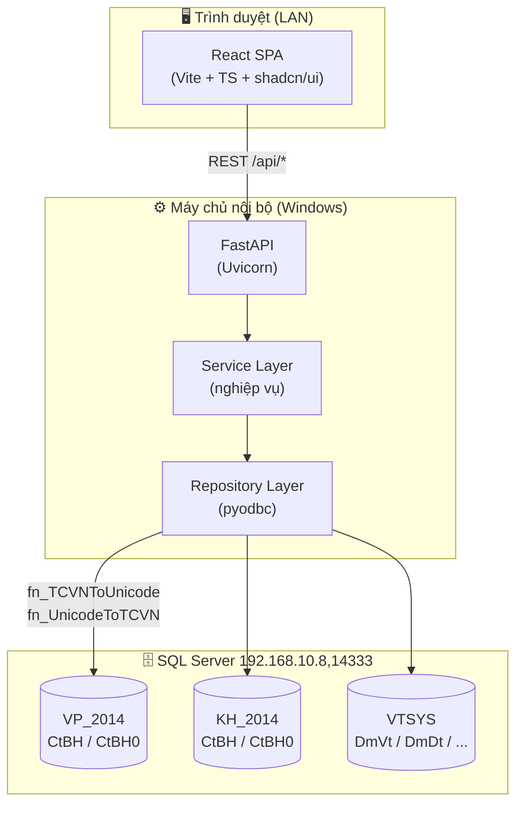
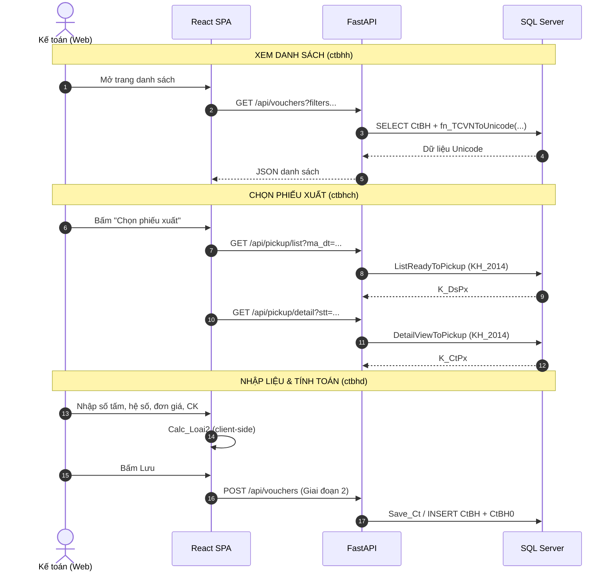

# 📋 KẾ HOẠCH TRIỂN KHAI: WEB APP QUẢN LÝ CHỨNG TỪ BÁN HÀNG (`ctbhh` + `ctbhd`)

> **Mục tiêu:** Xây dựng một web application thay thế/mở rộng chức năng của 2 form Visual FoxPro `ctbhh.scx` (danh sách chứng từ) và `ctbhd.scx` (nhập liệu chứng từ), với đầy đủ tính năng nghiệp vụ tương đương phần mềm 1S, ghi/đọc dữ liệu trên SQL Server, hiển thị Unicode tiếng Việt.
>
> **Tài liệu tham chiếu:**
> - `html/html.md` — Cơ chế ánh xạ `ctbhd` ⟷ `ctbhch`, ghi CSDL `CtBH`/`CtBH0`
> - `html/ctbhd_to_ctbh0_mapping.md` — Ma trận ánh xạ 46 cột Header + 35 cột Detail
> - `html/vp2014_schema.md` — Cấu trúc database `VP_2014` & `VTSYS`
> - `All_fix.md` — Nguyên tắc sửa form, các Fix #1–#24
> - `a_import_python_app.md` — Mẫu tool Python + `pyodbc` hiện có
>
> **Ngày lập:** 2026-10-19  
> **Trạng thái:** Reviewed & Enhanced — Sẵn sàng triển khai  
> **Phiên bản:** v1.1 (Đã tích hợp kết quả đối soát chuyên sâu của 2 Agent Spec Miner & Adversarial Critic)

### 📜 Lịch sử phiên bản (Version History)

| Phiên bản | Ngày | Người thực hiện | Tóm tắt thay đổi |
|:---:|:---:|:---|:---|
| **v1.0** | 2026-10-19 | Solution Architect | Khởi tạo dự thảo kế hoạch (Draft) bao quát kiến trúc tổng thể, mô hình công nghệ FastAPI + React, và danh mục phím tắt VFP. |
| **v1.1** | 2026-10-19 | Multi-Agent Review Team (Agent 1 Miner + Agent 2 Critic + Agent 3 Consolidator) | Hoàn thiện đặc tả chi tiết 10 Endpoint API kèm JSON Schema & Mapping 46 cột Header / 35 cột Detail; Ràng buộc Pydantic `extra='forbid'` và bảo toàn giá vốn (Fix #21); Khóa nguyên tử chống race condition số chứng từ bằng `sp_getapplock` (Fix #9); Xử lý bẫy làm tròn USD song tệ; Cắt chuỗi an toàn `Dia_Chi[:64]`; Kiểm chứng Idempotency TCVN3 ⟷ Unicode; Bổ sung ma trận tài khoản hạch toán ngầm; Tối ưu phân trang Keyset Seek O(1) & Covering Index; Chuẩn hóa quy trình liên kết & giải phóng kho 2 chiều. |


---

## 📑 MỤC LỤC

1. [Tổng quan & Phạm vi](#1-tổng-quan--phạm-vi)
2. [Quyết định kỹ thuật đã chốt](#2-quyết-định-kỹ-thuật-đã-chốt)
3. [Kiến trúc hệ thống](#3-kiến-trúc-hệ-thống)
4. [Cấu trúc thư mục dự án](#4-cấu-trúc-thư-mục-dự-án)
5. [Chiến lược Database & Unicode](#5-chiến-lược-database--unicode)
   - 5.1 [Kết nối CSDL](#51-kết-nối)
   - 5.2 [Chiến lược Unicode (BẮT BUỘC)](#52-chiến-lược-unicode-bắt-buộc)
   - 5.3 [Module chuyển đổi hai chiều unicode.py & Kiểm chứng Idempotency](#53-module-chuyển-đổi-hai-chiều-unicodepy--kiểm-chứng-idempotency)
   - 5.4 [Quy tắc phòng vệ chống tràn độ dài dữ liệu (String Truncation Safeguard)](#54-quy-tắc-phòng-vệ-chống-tràn-độ-dài-dữ-liệu-string-truncation-safeguard)
   - 5.5 [Bảng dữ liệu chính (Header 46 cột & Detail 35 cột)](#55-bảng-dữ-liệu-chính)
6. [Đặc tả API Backend](#6-đặc-tả-api-backend)
   - 6.1 [Chuẩn thiết kế chung](#61-chuẩn-thiết-kế-chung)
   - 6.2 [Chi tiết 10 Endpoint Nghiệp Vụ Cốt Lõi](#62-chi-tiết-10-endpoint-nghiệp-vụ-cốt-lõi)
   - 6.3 [API Xác thực (Auth)](#63-api-xác-thực-auth)
   - 6.4 [API Danh mục tra cứu (Master Data Lookups)](#64-api-danh-mục-tra-cứu-master-data-lookups)
   - 6.5 [API Công nợ & In phiếu](#65-api-công-nợ--in-phiếu)
7. [Đặc tả Frontend](#7-đặc-tả-frontend)
   - 7.1 [Trang & Component](#71-trang--component)
   - 7.2 [Ánh xạ phím tắt (BẮT BUỘC giống hệt VFP)](#72-ánh-xạ-phím-tắt-bắt-buộc-giống-hệt-vfp)
   - 7.3 [Cột hiển thị Grid2](#73-cột-hiển-thị-grid2-theo-ctbhd)
   - 7.4 [Quy tắc điều hướng bàn phím trên DetailGrid (Enter/Tab Flow)](#74-quy-tắc-điều-hướng-bàn-phím-trên-detailgrid-entertab-navigation-flow)
   - 7.5 [Kiến trúc quản trị trạng thái DetailGrid & Blur Triggers](#75-kiến-trúc-quản-trị-trạng-thái-detailgrid-state-management-dirty-checking--blur-triggers)
   - 7.6 [Vòng đời Cache Danh mục & Tìm kiếm tiếng Việt chuẩn hóa](#76-vòng-đời-cache-danh-mục-master-data--tìm-kiếm-tiếng-việt-chuẩn-hóa)
8. [Đặc tả Logic nghiệp vụ](#8-đặc-tả-logic-nghiệp-vụ)
   - 8.1 [Phân loại vật tư & Thuật toán tính toán chi tiết](#81-phân-loại-vật-tư--thuật-toán-tính-toán-chi-tiết-dmvtloai_vt)
   - 8.2 [Thuật toán Calc_Loai2 (hàng Mút xốp)](#82-thuật-toán-calc_loai2-hàng-mút-xốp--quy-chuẩn-bảo-vệ-an-toàn)
   - 8.3 [Đẳng thức tổng thanh toán tối hậu TTien_Nt0 = TTien_Nt2 + TTien_Nt3](#83-đẳng-thức-tổng-thanh-toán-tối-hậu-ttien_nt0--ttien_nt2--ttien_nt3)
   - 8.4 [Nguyên tắc bảo vệ giá vốn tuyệt đối (Fix #21)](#84-nguyên-tắc-bảo-vệ-giá-vốn-tuyệt-đối-fix-21)
   - 8.5 [Bẫy ngoại tệ USD & Nghịch lý sai số làm tròn song tệ](#85-bẫy-ngoại-tệ-usd-usd-currency-trap--nghịch-lý-sai-số-làm-tròn-song-tệ)
   - 8.6 [Chuẩn hóa xóa chiết khấu về 0 & Tính lại thuế bắt buộc](#86-chuẩn-hóa-xóa-chiết-khấu-về-0-fix-5-17--kích-hoạt-tính-lại-thuế-bắt-buộc)
   - 8.7 [Kiểm tra công nợ realtime (Fix #1, #2, #3)](#87-kiểm-tra-công-nợ-realtime-fix-1-2-3)
   - 8.8 [Ma trận tài khoản hạch toán ngầm](#88-ma-trận-tài-khoản-hạch-toán-ngầm-shadow-accounting-mapping-matrix)
9. [Lộ trình triển khai theo giai đoạn](#9-lộ-trình-triển-khai-theo-giai-đoạn)
10. [Kiểm thử & Nghiệm thu](#10-kiểm-thử--nghiệm-thu)
11. [Rủi ro & Lưu ý quan trọng](#11-rủi-ro--lưu-ý-quan-trọng)

---

## 1. TỔNG QUAN & PHẠM VI

### 1.1. Bối cảnh

Phần mềm kế toán 1S hiện chạy trên **Visual FoxPro 8.0** (client) kết nối **SQL Server** qua ADO/OLE DB. Hai form chính:

| Form | Vai trò | Cursor chính |
|:---|:---|:---|
| `ctbhh.scx` | **Danh sách chứng từ** bán hàng (list view) | `K_PhTemp` (header list), `K_CtTemp` (detail) |
| `ctbhd.scx` | **Nhập liệu chứng từ** (entry form) | `K_PhTemp1` (header), `K_CtTemp` (detail) |
| `ctbhch.scx` | **Chọn phiếu xuất** từ kho (`KH_2014`) | `K_DsPx` (danh sách), `K_CtPx` (chi tiết) |

### 1.2. Phạm vi tính năng (đã xác nhận)

| # | Tính năng | Nguồn gốc | Ưu tiên |
|:---:|:---|:---|:---:|
| F1 | Danh sách chứng từ + Thêm/Sửa/Xóa | `ctbhh` (Command1/2/3) | Cao |
| F2 | Nhập liệu header + grid chi tiết | `ctbhd` | Cao |
| F3 | Chọn phiếu xuất từ kho (`KH_2014`) | `ctbhch` + `ListReadyToPickup` | Cao |
| F4 | Tính toán hàng mút (`Calc_Loai2`) | `ctbhd` Rec 3 | Cao |
| F5 | Chiết khấu + Thuế VAT + tổng thanh toán | `ctbhd` Rec 46/59 | Cao |
| F6 | Kiểm tra công nợ realtime (TK 131) | `ctbhd` Rec 12/59 | Cao |
| F7 | In phiếu / Xem trước | `In_Ct_Kh` / `In_Ct_Hd` | Trung bình |
| F8 | Lọc chứng từ (F9) | `filterID` | Trung bình |
| F9 | Chi tiết công nợ | `Command8` → `Edit_Ct_Congno` | Thấp |

### 1.3. Ngoài phạm vi (Out of scope)

- Không thay thế các form khác (`ctckh`, `ctnxh`, `kct04`...).
- Không sửa đổi cấu trúc bảng SQL hiện có.
- Không can thiệp vào các file `.scx/.sct/.fxp` của VFP (trừ khi cần đối chiếu).

---

## 2. QUYẾT ĐỊNH KỸ THUẬT ĐÃ CHỐT

| Hạng mục | Quyết định | Ghi chú |
|:---|:---|:---|
| **Backend** | Python **FastAPI** + `pyodbc` | Tái sử dụng pattern từ `import_baoco_tool.py` |
| **Frontend** | **React + Vite + TypeScript** | SPA hiện đại, dễ mở rộng |
| **UI Library** | shadcn/ui + TailwindCSS | Component nhất quán, hỗ trợ bảng/form tốt |
| **Xác thực** | Đăng nhập đơn giản (tài khoản cấu hình trong `.env`) | Giai đoạn 1; có thể nâng cấp sau |
| **Ghi dữ liệu** | **Giai đoạn 1: READ-ONLY** → Giai đoạn 2: ghi `VP_2014` + `KH_2014` | An toàn dữ liệu thật |
| **Stored Procedures** | **Tái sử dụng tối đa** SP/Function hiện có | `Save_Ct`, `ST_Check_Number`, `ST_Increase_KeyIndex`, `CtBH_Delete`, `ListReadyToPickup`, `DetailViewToPickup`, `SO_Get_Price`, `GL_Alert_ClosingAccount4Customer` |
| **In phiếu** | Tái tạo mẫu in trên web (HTML/CSS → PDF, in từ trình duyệt) | Mẫu `.frx` do người dùng cung cấp |
| **Triển khai** | Máy chủ nội bộ LAN (Windows), truy cập qua IP | Uvicorn + build tĩnh React |
| **Unicode** | `fn_TCVNToUnicode` (đọc) / `fn_UnicodeToTCVN` (ghi) cho **mọi trường text** | `Ten_Vt`, `Ten_Dt`, `Dia_Chi`, `Dien_Giai`, `Ong_Ba`... |
| **Vị trí dự án** | `e:\1S2024\html\webapp\` | Trong thư mục `html` hiện có |

### 2.1. Danh mục lookup (autocomplete) cần nạp

| Cursor gốc | Bảng SQL | Trường hiển thị |
|:---|:---|:---|
| `M_DmVt` | `VTSYS.dbo.DmVt` | `Ma_Vt`, `Ten_Vt`, `Dvt`, `Dvt_Ban`, `Loai_Vt`, `Tk_Gv`, `Tk_Vt`, `Tk_Dt`, `Tk_Ck`, `He_So0..2` |
| `M_DmDt` | `VTSYS.dbo.DmDt` | `Ma_Dt`, `Ten_Dt`, `Dia_Chi`, `Ong_Ba`, `MS_Thue`, `Han_Tt`, `Gioi_Han`, `Toi_Han`, `Doi_Tac` |
| `M_DmKho` | `VTSYS.dbo.DmKho` | `Ma_Kho`, `Ten_Kho` |
| `M_DmThue` | `VTSYS.dbo.DmThue` | `Ma_Thue`, `Thue_GTGT`, `Tk` |
| `M_DmTk` | `VTSYS.dbo.DmTk` | `Tk`, `Ten_Tk`, `Tk_Dt` |
| `M_DmNx` | `VTSYS.dbo.DmNx` | `Ma_Nx`, `Ten_Nx`, `Dinh_Khoan` |
| `M_DmXe` | `VTSYS.dbo.DmXe` | `Ma_Xe`, `Ten_Xe` |
| `M_DmBp` | `VTSYS.dbo.DmBp` | `Ma_Bp`, `Ten_Bp` |
| `M_DmHD` | `VTSYS.dbo.DmHD` | `Ma_HD`, `Ten_HD` |
| `M_DmTte` | `VTSYS.dbo.DmTte` | `Ma_Tte`, `Ty_Gia` |

---

## 3. KIẾN TRÚC HỆ THỐNG



### 3.1. Luồng dữ liệu chính



---

## 4. CẤU TRÚC THƯ MỤC DỰ ÁN

```
e:\1S2024\html\webapp\
├── backend\
│   ├── app\
│   │   ├── main.py                 # FastAPI app, CORS, router mount
│   │   ├── config.py               # Đọc .env (DB, auth)
│   │   ├── database.py             # pyodbc connection pool
│   │   ├── deps.py                 # Dependency injection (auth, db)
│   │   ├── routers\
│   │   │   ├── auth.py             # POST /api/auth/login
│   │   │   ├── vouchers.py         # CRUD chứng từ (ctbhh/ctbhd)
│   │   │   ├── pickup.py           # Chọn phiếu xuất (ctbhch)
│   │   │   ├── lookups.py          # Danh mục (DmVt, DmDt...)
│   │   │   ├── debt.py             # Công nợ TK 131
│   │   │   └── print.py            # Dữ liệu in phiếu
│   │   ├── services\
│   │   │   ├── voucher_service.py  # Nghiệp vụ chứng từ
│   │   │   ├── calc_service.py     # Calc_Loai2, chiết khấu, thuế
│   │   │   ├── pickup_service.py   # ListReadyToPickup/DetailViewToPickup
│   │   │   └── debt_service.py     # GL_Alert_ClosingAccount4Customer
│   │   ├── repositories\
│   │   │   ├── voucher_repo.py     # SQL CtBH/CtBH0
│   │   │   ├── lookup_repo.py      # SQL danh mục
│   │   │   └── unicode.py          # Helper fn_TCVNToUnicode/UnicodeToTCVN
│   │   ├── schemas\                # Pydantic models
│   │   │   ├── voucher.py
│   │   │   ├── detail.py
│   │   │   └── lookup.py
│   │   └── utils\
│   │       ├── money.py            # ROUND 2/0 chữ số
│   │       └── errors.py
│   ├── requirements.txt
│   ├── .env.example
│   └── run.bat                     # 1-click chạy server
├── frontend\
│   ├── src\
│   │   ├── main.tsx
│   │   ├── App.tsx
│   │   ├── api\                    # Axios client + hooks
│   │   ├── components\
│   │   │   ├── ui\                 # shadcn components
│   │   │   ├── VoucherList.tsx     # ctbhh
│   │   │   ├── VoucherForm.tsx     # ctbhd
│   │   │   ├── DetailGrid.tsx      # Grid2
│   │   │   ├── PickupDialog.tsx    # ctbhch
│   │   │   ├── FilterDialog.tsx    # filterID
│   │   │   └── PrintPreview.tsx    # In phiếu
│   │   ├── pages\
│   │   ├── hooks\
│   │   │   ├── useHotkeys.ts       # Xử lý phím tắt giống VFP (F2/F3/F7/F8/F9...)
│   │   │   └── useVoucher.ts       # State chứng từ
│   │   ├── lib\
│   │   │   ├── calc.ts             # Calc_Loai2 (mirror backend)
│   │   │   ├── hotkeys.ts          # Bảng định nghĩa hotkey (map nKeyCode)
│   │   │   └── format.ts           # Định dạng tiền, ngày
│   │   └── types\
│   ├── package.json
│   ├── vite.config.ts
│   └── tailwind.config.js
├── docs\
│   ├── plan.md                     # (bản sao kế hoạch này)
│   ├── api-spec.md                 # Đặc tả API chi tiết
│   └── business-rules.md           # Quy tắc nghiệp vụ
└── README.md                       # Hướng dẫn cài đặt & chạy
```

---

## 5. CHIẾN LƯỢC DATABASE & UNICODE

### 5.1. Kết nối

```python
# backend/app/config.py
DB_SERVER = "192.168.10.8,14333"
DB_VP     = "VP_2014"     # Văn phòng (kế toán)
DB_KH     = "KH_2014"     # Kho
DB_SYS    = "VTSYS"       # Danh mục
DB_USER   = "sa"
DB_PASS   = "sql2008@"    # ⚠️ Chuyển vào .env, không hardcode
```

> ⚠️ **Bảo mật:** Thông tin kết nối phải đặt trong `.env`, không commit vào git. Thêm `.env` vào `.gitignore`.

### 5.2. Chiến lược Unicode (BẮT BUỘC)

Dữ liệu trong SQL lưu ở bảng mã **TCVN3** (font `Vn-Sans-Serif`). Web hiển thị **Unicode**. Do đó:

| Chiều | Cơ chế xử lý | Áp dụng cho |
|:---|:---|:---|
| **Đọc** (SQL → Web) | `dbo.fn_TCVNToUnicode(field)` (hoặc module Python `tcvn_to_unicode()`) | Mọi trường text hiển thị (`Ten_Vt`, `Ten_Dt`, `Dia_Chi`...) |
| **Ghi** (Web → SQL) | `dbo.fn_UnicodeToTCVN(value)` (hoặc module Python `unicode_to_tcvn()`) | Mọi trường text nhập liệu từ form web |

**Các trường text cần chuyển đổi:**

| Bảng | Trường |
|:---|:---|
| `CtBH` | `Ong_Ba`, `Dia_Chi`, `Dien_Giai0`, `Desc_EN0`, `Ten_DtGtGt` |
| `CtBH0` | *(không có trường text dài; `Ma_Vt`, `Dvt` là mã ASCII)* |
| `DmVt` | `Ten_Vt`, `Ten_Vt_E` |
| `DmDt` | `Ten_Dt`, `Dia_Chi`, `Ong_Ba`, `Doi_Tac` |
| `DmKho` | `Ten_Kho` |
| `DmTk` | `Ten_Tk`, `Ten_Tk_E` |
| `DmNx` | `Ten_Nx` |
| `DmXe` | `Ten_Xe` |
| `DmBp` | `Ten_Bp` |
| `DmHD` | `Ten_HD` |

**Ví dụ câu SQL đọc:**

```sql
SELECT
    h.Stt, h.So_Ct, h.Ngay_Ct, h.Ma_Dt,
    dbo.fn_TCVNToUnicode(h.Ong_Ba)      AS Ong_Ba,
    dbo.fn_TCVNToUnicode(h.Dia_Chi)     AS Dia_Chi,
    dbo.fn_TCVNToUnicode(h.Dien_Giai0)  AS Dien_Giai0,
    dbo.fn_TCVNToUnicode(c.Ten_Dt)      AS Ten_Dt
FROM dbo.CtBH h WITH (NOLOCK)
LEFT JOIN VTSYS.dbo.DmDt c WITH (NOLOCK) ON c.Ma_Dt = h.Ma_Dt
WHERE h.Ma_Ct = ? AND h.Ngay_Ct BETWEEN ? AND ?
```

**Ví dụ câu SQL ghi (Giai đoạn 2):**

```sql
INSERT INTO dbo.CtBH (Stt, Ma_DvCs, Ma_Ct, ..., Ong_Ba, Dia_Chi, Dien_Giai0, ...)
VALUES (?, ?, ?, ..., dbo.fn_UnicodeToTCVN(?), dbo.fn_UnicodeToTCVN(?), dbo.fn_UnicodeToTCVN(?), ...)
```

### 5.3. Module Chuyển đổi Hai chiều `unicode.py` & Kiểm chứng Idempotency

Để không phụ thuộc hoàn toàn vào Scalar Function của SQL Server (vốn làm giảm hiệu năng khi query hàng nghìn dòng danh mục), hệ thống triển khai module Python độc lập `backend/app/repositories/unicode.py`:

```python
# backend/app/repositories/unicode.py
import unicodedata

# Bảng mã đối chiếu TCVN3 (ABC 1-byte) <-> Unicode (NFC)
TCVN3_TO_UNICODE = {
    0xB8: 'á', 0xB5: 'à', 0xB6: 'ả', 0xB7: 'ã', 0xB9: 'ạ',
    0xCA: 'ă', 0xBE: 'ắ', 0xBB: 'ằ', 0xBC: 'ẳ', 0xBD: 'ẵ', 0xC6: 'ặ',
    0xD0: 'â', 0xC7: 'ấ', 0xC8: 'ầ', 0xC9: 'ẩ', 0xCB: 'ẫ', 0xCC: 'ậ',
    0xD1: 'é', 0xCE: 'è', 0xCF: 'ẻ', 0xD2: 'ẽ', 0xD3: 'ẹ',
    0xD8: 'ê', 0xD4: 'ế', 0xD5: 'ề', 0xD6: 'ể', 0xD7: 'ễ', 0xD9: 'ệ',
    0xDD: 'í', 0xDA: 'ì', 0xDB: 'ỉ', 0xDC: 'ĩ', 0xDE: 'ị',
    0xDF: 'ó', 0xE1: 'ò', 0xE2: 'ỏ', 0xE3: 'õ', 0xE4: 'ọ',
    0xEE: 'ô', 0xE5: 'ố', 0xE6: 'ồ', 0xE7: 'ổ', 0xE8: 'ỗ', 0xED: 'ộ',
    0xF3: 'ơ', 0xEF: 'ớ', 0xF1: 'ờ', 0xF2: 'ở', 0xF4: 'ỡ', 0xF5: 'ợ',
    0xF8: 'ú', 0xF6: 'ù', 0xF7: 'ủ', 0xFA: 'ũ', 0xFB: 'ụ',
    0xFC: 'ư', 0xFD: 'ứ', 0xFE: 'ừ', 0x80: 'ử', 0x81: 'ữ', 0x82: 'ự',
    0x87: 'ý', 0x83: 'ỳ', 0x84: 'ỷ', 0x85: 'ỹ', 0x86: 'ỵ',
    0xAE: 'đ', 0xA7: 'đ',
    # Ký tự hoa cơ bản trong TCVN3:
    0xC1: 'Ă', 0xC2: 'Â', 0xC3: 'Ê', 0xC4: 'Ô', 0xC5: 'Ơ', 0xA2: 'Ư', 0xA1: 'Đ'
}

UNICODE_TO_TCVN3 = {v: k for k, v in TCVN3_TO_UNICODE.items()}

def tcvn_to_unicode(tcvn_str: str) -> str:
    """Chuyển đổi chuỗi TCVN3 sang Unicode dựng sẵn (NFC)."""
    if not tcvn_str:
        return ""
    res = []
    for char in tcvn_str:
        code = ord(char)
        res.append(TCVN3_TO_UNICODE.get(code, char))
    return unicodedata.normalize('NFC', "".join(res))

def unicode_to_tcvn(uni_str: str) -> str:
    """Chuyển đổi chuỗi Unicode sang TCVN3 byte string."""
    if not uni_str:
        return ""
    uni_norm = unicodedata.normalize('NFC', uni_str)
    res = []
    for char in uni_norm:
        if char in UNICODE_TO_TCVN3:
            res.append(chr(UNICODE_TO_TCVN3[char]))
        else:
            # Fallback cho nguyên âm hoa có dấu không có mã TCVN3 riêng
            res.append(char)
    return "".join(res)
```

#### Xử lý bẫy nguyên âm hoa có dấu & Kiểm chứng tính Idempotency:
1. **Hạn chế cố hữu của TCVN3:** Bảng mã 8-bit TCVN3 không đủ vị trí mã cho toàn bộ nguyên âm hoa có dấu thanh phức tạp (`Ế`, `Ồ`, `Ử`, `Ậ`, `Ấ`...). Trong phần mềm cũ, các chữ hoa này phụ thuộc font `.VnTimeH` hoặc lưu chữ thường.
2. **Chiến lược an toàn trên Web:**
   - Khi ghi dữ liệu: Nếu cột SQL hỗ trợ `nvarchar` (như `Dia_Chi`, `Dien_Giai0`, `Ten_Dt` trong CSDL SQL Server 2014), ưu tiên lưu chuỗi Unicode chuẩn để bảo toàn 100% ngữ nghĩa.
   - Khi tương thích với bảng mã TCVN3 cũ: Module kiểm tra và chuẩn hóa ký tự hoa, tránh hiện tượng sinh ký tự rác `?`.
3. **Quy tắc kiểm thử Idempotency bắt buộc:**
   Mọi chuỗi text sau khi chuyển đổi qua lại phải bảo toàn tính toàn vẹn ngữ nghĩa:
   ```python
   # Unit Test: test_unicode_idempotency()
   sample_texts = [
       "Công ty Cổ phần Mút Xốp Sài Gòn",
       "128 Đường số 7, KCN Tân Bình, TP.HCM",
       "Xuất bán nệm foam theo đơn đặt hàng 19/10/2026"
   ]
   for text in sample_texts:
       encoded = unicode_to_tcvn(text)
       decoded = tcvn_to_unicode(encoded)
       assert tcvn_to_unicode(unicode_to_tcvn(decoded)) == decoded
   ```

---

### 5.4. Quy tắc phòng vệ chống tràn độ dài dữ liệu (String Truncation Safeguard)

Đối chiếu lược đồ CSDL giữa `VTSYS.dbo.DmDt` và `VP_2014.dbo.CtBH`:

| Thực thể | Bảng SQL | Trường | Kiểu dữ liệu & Độ dài | Rủi ro phát hiện |
|:---|:---|:---|:---:|:---|
| Danh mục Khách hàng | `VTSYS.dbo.DmDt` | `Dia_Chi` | **`nvarchar(128)`** | Cho phép lưu địa chỉ dài đến 128 ký tự |
| Chứng từ Bán hàng | `VP_2014.dbo.CtBH` | `Dia_Chi` | **`nvarchar(64)`** | Chỉ chứa tối đa 64 ký tự! |

🔴 **Nguy cơ lỗi:** Khi chọn khách hàng có địa chỉ > 64 ký tự từ danh mục đổ vào chứng từ (hoặc người dùng gõ địa chỉ dài trên form), câu lệnh `INSERT` sẽ làm SQL Server văng lỗi nghiêm trọng:
`Msg 8152, Level 16: String or binary data would be truncated.`

🛡️ **Giải pháp phòng thủ 2 lớp bắt buộc:**
1. **Lớp 1 (Frontend UI/UX):**
   - Ô nhập `Dia_Chi` trên `VoucherForm.tsx` đặt thuộc tính `maxLength={64}`.
   - Khi nạp tự động từ khách hàng `DmDt`, nếu `Dia_Chi.length > 64`, hiển thị icon cảnh báo (warning tooltip): *"Địa chỉ khách hàng (128 ký tự) đã được rút gọn cho vừa chứng từ (64 ký tự)"*.
2. **Lớp 2 (Backend Repository Safeguard):**
   - Tại `voucher_repo.py`, trước khi truyền tham số vào câu lệnh SQL, bắt buộc cắt chuỗi an toàn:
     ```python
     dia_chi_safe = dia_chi[:64] if dia_chi else None
     ong_ba_safe = ong_ba[:64] if ong_ba else None
     dien_giai_safe = dien_giai0[:128] if dien_giai0 else None
     ```

---

### 5.5. Bảng dữ liệu chính

**Header `dbo.CtBH` (46 cột)** — xem chi tiết tại `html/ctbhd_to_ctbh0_mapping.md` Chương 2.

**Detail `dbo.CtBH0` (35 cột)** — xem chi tiết tại `html/ctbhd_to_ctbh0_mapping.md` Chương 3.

> ⚠️ **QUY TẮC BẤT KHẢ XÂM PHẠM (Fix #21):** Tuyệt đối **KHÔNG** gán 4 cột giá vốn (`Gia_Nt`, `Gia`, `Tien_Nt`, `Tien`) bằng đơn giá bán (`Gia_Nt9`, `Gia9`). Các trường này do hệ thống ngầm tính khi chạy sổ giá vốn xuất kho. Khi thêm mới trên Web, mặc định gán `0.0`. Khi sửa chứng từ, **bảo toàn nguyên vẹn giá vốn cũ**, không được xóa trắng!

---

## 6. ĐẶC TẢ API BACKEND

### 6.1. Chuẩn thiết kế chung

1. **Giao thức & Định dạng:**
   - Base URL: `http://<server-ip>:8000/api`
   - Content-Type: `application/json; charset=utf-8`
   - Mọi chuỗi text tiếng Việt truyền qua API **hoàn toàn là Unicode chuẩn** (UTF-8). Tầng Repository phụ trách chuyển đổi qua lại giữa TCVN3 và Unicode bằng module `unicode.py` (hoặc SQL functions `fn_TCVNToUnicode`/`fn_UnicodeToTCVN`).
2. **Xác thực & Ủy quyền:**
   - Bearer Token: `Authorization: Bearer <jwt_token>` trong Header của mọi request (trừ `/api/auth/login`).
   - Tên người dùng (`UserName`) luôn được trích xuất an toàn từ payload của JWT Token trên server, không chấp nhận trường này do client gửi lên.
3. **Cấu trúc phản hồi chuẩn (Envelope Response):**
   ```json
   {
     "success": true,
     "data": { ... },
     "meta": { ... }
   }
   ```
4. **Cấu trúc phản hồi lỗi (Error Response):**
   ```json
   {
     "success": false,
     "error": {
       "code": "DEBT_LIMIT_EXCEEDED",
       "message": "Quá giới hạn nợ! Giới hạn: 50,000,000 VND, Dư nợ hiện tại: 58,450,000 VND.",
       "details": [
         { "field": "ma_dt", "issue": "current_debt >= credit_limit" }
       ]
     }
   }
   ```

---

### 6.2. Chi tiết 10 Endpoint Nghiệp Vụ Cốt Lõi

---

#### 1. `POST /api/vouchers` — Tạo mới chứng từ bán hàng
- **Vai trò:** Tiếp nhận hóa đơn bán hàng từ client, kiểm tra hợp thức, sinh mã duy nhất (`Stt`, `Stt0`), chống trùng số bằng khóa phân tán `sp_getapplock`, kiểm tra công nợ realtime và lưu nguyên tử vào `VP_2014.dbo.CtBH` và `VP_2014.dbo.CtBH0`.
- **Request Headers:**
  - `Content-Type: application/json`
  - `Authorization: Bearer <token>`
- **Request Body JSON Schema (`VoucherCreateSchema`):**

| Tên Field | Kiểu dữ liệu | Nullable | Bắt buộc | Mô tả & Ràng buộc Validation |
|:---|:---|:---:|:---:|:---|
| `ma_dvcs` | `string` | NO | ✅ | Mã đơn vị cơ sở (`char(2)`), mặc định `'01'` (hoặc cấu hình `'S1'`). |
| `ma_ct` | `string` | NO | ✅ | Mã chứng từ (`char(2)`), ví dụ: `'BH'` (Bán hàng), `'X1'` (Xuất bán). |
| `ngay_ct` | `string` (date) | NO | ✅ | Ngày lập chứng từ (`YYYY-MM-DD`). Bắt buộc `> M_Ngay_Kt_Ht` (ngày khóa sổ). |
| `so_ct` | `string` | YES | ❌ | Số chứng từ đề xuất (`char(20)`). Nếu trống hoặc trùng, server tự động sinh số tiếp theo. |
| `ma_dt` | `string` | NO | ✅ | Mã khách hàng (`char(16)`), bắt buộc tồn tại trong `VTSYS.dbo.DmDt`. |
| `ong_ba` | `string` | YES | ❌ | Người nhận/đại diện (`nvarchar(64)`), Unicode UTF-8. Tự động cắt `[:64]`. |
| `dia_chi` | `string` | YES | ❌ | Địa chỉ khách hàng (`nvarchar(64)`), Unicode UTF-8. Tự động cắt `[:64]` chống tràn. |
| `dien_giai0` | `string` | YES | ❌ | Diễn giải tiếng Việt (`nvarchar(128)`), Unicode UTF-8. Tự động cắt `[:128]`. |
| `desc_en0` | `string` | YES | ❌ | Diễn giải tiếng Anh (`nvarchar(128)`). |
| `ma_nx` | `string` | NO | ✅ | Mã lý do nhập xuất (`char(16)`), mặc định `'131'`. |
| `tk2` | `string` | NO | ✅ | Tài khoản nợ phải thu (`char(16)`), mặc định `'1311'`. |
| `ma_bp` | `string` | YES | ❌ | Mã bộ phận (`char(16)`). |
| `ma_xe` | `string` | YES | ❌ | Mã xe vận chuyển (`char(8)`). |
| `ma_hd` | `string` | YES | ❌ | Mã hợp đồng kinh tế (`char(16)`). |
| `ma_tte` | `string` | NO | ✅ | Đồng tiền giao dịch (`char(3)`), ví dụ `'VND'`, `'USD'`. |
| `ty_gia` | `number` | NO | ✅ | Tỷ giá hối đoái (`numeric(18,2)`). Nếu `ma_tte == 'VND'` thì `1.0`. Luôn `> 0`. |
| `ma_thue` | `string` | YES | ❌ | Mã thuế GTGT (`char(4)`), ví dụ `'V00'`, `'V05'`, `'V10'`. |
| `thue_gtgt` | `number` | YES | ❌ | Thuế suất % (`numeric(18,2)`), ví dụ `10.0`. |
| `loai_ck` | `string` | YES | ❌ | `'1'`: CK trước thuế, `'0'` hoặc khác: CK sau thuế. Mặc định `'1'`. |
| `han_tt` | `integer` | YES | ❌ | Hạn thanh toán (số ngày nợ). Lấy từ `DmDt.Han_Tt`. |
| `ma_dtgtgt` | `string` | YES | ❌ | Mã số thuế người mua (`char(20)`). |
| `ten_dtgtgt` | `string` | YES | ❌ | Tên công ty xuất hóa đơn GTGT (`nvarchar(128)`). |
| `so_ct0` | `string` | YES | ❌ | Số chứng từ gốc kèm theo (`char(20)`). |
| `ngay_ct0` | `string` (date) | YES | ❌ | Ngày chứng từ gốc (`YYYY-MM-DD`). |
| `stt_hbtl` | `string` | YES | ❌ | Khóa ngoại hóa đơn gốc khi lập hàng bán trả lại (`char(20)`). |
| `items` | `array[object]` | NO | ✅ | Danh sách các dòng chi tiết (tối thiểu 1 dòng, xem schema dưới). |

- **Detail Items JSON Schema (`DetailItemCreateSchema`):**

| Tên Field | Kiểu dữ liệu | Nullable | Bắt buộc | Mô tả & Ràng buộc |
|:---|:---|:---:|:---:|:---|
| `stt_px` | `string` | YES | ❌ | Khóa ngoại trỏ đến `KH_2014.dbo.CtBH0.Stt0` (nếu nạp từ pickup kho). |
| `ma_vt` | `string` | NO | ✅ | Mã vật tư hàng hóa (`char(16)`), phải tồn tại trong `VTSYS.dbo.DmVt`. |
| `ma_kho` | `string` | NO | ✅ | Mã kho xuất (`char(16)`), tồn tại trong `VTSYS.dbo.DmKho`. |
| `dvt` | `string` | YES | ❌ | ĐVT chuẩn kho (`varchar(8)`). |
| `dvt_ban` | `string` | YES | ❌ | ĐVT bán (`varchar(8)`). |
| `so_tam` | `number` | YES | ❌ | Số tấm (`numeric(18,2)`). Bắt buộc nhập nếu `Loai_Vt = '2'`. |
| `he_so8` | `number` | YES | ❌ | Hệ số độ dày (`numeric(18,2)`). Nếu null/0 fallback về 1.0. |
| `so_luong9` | `number` | NO | ✅ | Số lượng bán thương mại (`numeric(18,2)`). |
| `gia_nt9` | `number` | NO | ✅ | Đơn giá bán ngoại tệ (`numeric(18,2)`). |
| `tien_nt9` | `number` | NO | ✅ | Thành tiền ngoại tệ trước CK (`numeric(18,2)`). |
| `chiet_khau` | `number` | YES | ❌ | Tỷ lệ % chiết khấu dòng (`0` đến `99`). Mặc định `0.0`. |
| `tk_du2` | `string` | NO | ✅ | Tài khoản doanh thu Có (`char(16)`), ví dụ `'5111'`. |
| `gia_tb_tt` | `string` | YES | ❌ | Cờ tính giá tức thời (`char(1)`), `'C'` hoặc `'K'`. Mặc định `'K'`. |

- **Cơ chế Server-Derived Fields (Ánh xạ đầy đủ 46 cột Header & 35 cột Detail):**
  Server tự động tính toán và bổ sung các trường kế toán bắt buộc trước khi ghi SQL Server:
  1. **Header `CtBH` (22 trường server gán tự động):**
     - `Nh_Ct`: Tra cứu từ `VTSYS.dbo.DmCt.Nh_Ct` theo `Ma_Ct` (mặc định `'2'` cho `'BH'`, `'1'` cho `'TL'`).
     - `Ngay_Ps`: Tự động gán `= Ngay_Ct`.
     - `Tk3`: Tài khoản Có thuế GTGT, lấy từ `VTSYS.dbo.DmThue.Tk` tương ứng `Ma_Thue`, fallback `'33311'`.
     - `Tk_Du3`: Tài khoản Nợ thuế GTGT, tự động gán `= Tk2` (mặc định `'1311'`).
     - `Tk4`: Tài khoản Nợ chiết khấu thương mại cấp hóa đơn, mặc định `'521'`.
     - `UserName`: Lấy trực tiếp từ JWT Claim (`current_user.username`).
     - `Confirmed`: Mặc định gán `= 1`.
     - `Posted`: Gán theo cấu hình danh mục: `Posted = IIF(DmNx.Dinh_Khoan == 'C', 1, 0)`.
     - `Printed`: Mặc định gán `= 0`.
     - `TyLeCK`: Mặc định gán `= 0.0`.
     - `TTien_Nt, TTien_Nt4, TTien_Nt2, TTien_Nt3, TTien_Nt0`: Tính theo thuật toán chuẩn Chương 8.
     - `TTien, TTien4, TTien2, TTien3, TTien0`: Bắt buộc tính bằng tổng các dòng Detail nội tệ.
  2. **Detail `CtBH0` (22 trường server gán tự động):**
     - `Tk`: Tài khoản Nợ giá vốn, lấy từ `DmVt.Tk_Gv` (mặc định `'632'`).
     - `Tk_Du`: Tài khoản Có kho/vật tư, lấy từ `DmVt.Tk_Vt` (mặc định `'1561'`).
     - `Tk_Du4`: Tài khoản Nợ chiết khấu dòng, lấy từ `DmVt.Tk_Ck` (mặc định `'521'`).
     - `He_So9`: Hệ số quy đổi ĐVT phụ của hàng Loại 1, lấy từ `DmVt.He_So0..2` (fallback 1.0).
     - `So_Luong8`: Nếu `Loai_Vt = '2'` thì `= ROUND(So_Tam * He_So8, 2)`, ngược lại `= 0.0`.
     - `So_Luong`: Số lượng trừ kho chuẩn: nếu Loại 2 thì `= So_Luong8`, nếu Loại 1 thì `= So_Luong9 * He_So9`.
     - `Tien_Nt3, Tien3`: Gán `= 0` (thuế tính tập trung ở Header).
     - `Gia_Nt2, Gia2, Tien_Nt2, Tien2, Tien_Nt4, Tien4`: Tính từ đơn giá bán và chiết khấu dòng.

- **Bảo vệ giá vốn tuyệt đối (Fix #21):**
  1. Trong Pydantic schema:
     ```python
     class DetailItemCreateSchema(BaseModel):
         # ... các trường hợp lệ
         class Config:
             extra = "forbid"  # Chặn mọi trường lạ (gia_nt, gia, tien_nt, tien)
     ```
  2. Trong câu lệnh SQL INSERT: Hardcode trực tiếp giá vốn `= 0.0`:
     ```sql
     INSERT INTO dbo.CtBH0 (..., Gia_Nt, Gia, Tien_Nt, Tien)
     VALUES (..., 0.0, 0, 0.0, 0);
     ```

- **Chống trùng số chứng từ bằng khóa phân tán nguyên khối (Fix #9):**
  Loại bỏ hoàn toàn bẫy TOCTOU Race Condition bằng cách bao bọc toàn bộ khối cấp số và ghi dữ liệu trong transaction có `sp_getapplock`:
  ```sql
  DECLARE @LockRes NVARCHAR(255) = N'Lock_Voucher_' + RTRIM(@Ma_Ct) + N'_' + CAST(YEAR(@Ngay_Ct) AS NVARCHAR(4));
  EXEC sp_getapplock @Resource = @LockRes, @LockMode = 'Exclusive', @LockOwner = 'Transaction', @LockTimeout = 15000;
  -- Vòng lặp tăng số tự động nếu trùng với PADL tối thiểu 4 chữ số (HD4081 -> HD4082)
  ```

- **Sample Request Payload:**
  ```json
  {
    "ma_dvcs": "01",
    "ma_ct": "BH",
    "ngay_ct": "2026-10-19",
    "so_ct": "HD4082",
    "ma_dt": "KH0089",
    "ong_ba": "Nguyễn Văn Hùng",
    "dia_chi": "128 Đường số 7, KCN Tân Bình, TP.HCM",
    "dien_giai0": "Xuất bán mút tấm theo đơn đặt hàng 19/10",
    "ma_nx": "131",
    "tk2": "1311",
    "ma_bp": "BP01",
    "ma_xe": "51C-9821",
    "ma_tte": "VND",
    "ty_gia": 1.0,
    "ma_thue": "V10",
    "thue_gtgt": 10.0,
    "loai_ck": "1",
    "items": [
      {
        "stt_px": "PXK20261019_0001_01",
        "ma_vt": "MUT_D40_2CM",
        "ma_kho": "KHO01",
        "dvt": "tam",
        "dvt_ban": "tam",
        "so_tam": 20.0,
        "he_so8": 1.5,
        "so_luong9": 30.0,
        "gia_nt9": 100000.0,
        "tien_nt9": 3000000.0,
        "chiet_khau": 5.0,
        "tk_du2": "5111",
        "gia_tb_tt": "K"
      }
    ]
  }
  ```

- **Sample Response Payload (201 Created):**
  ```json
  {
    "success": true,
    "data": {
      "stt": "VPU2026101900000001",
      "ma_dvcs": "01",
      "ma_ct": "BH",
      "so_ct": "HD4082",
      "ngay_ct": "2026-10-19",
      "ma_dt": "KH0089",
      "ten_dt": "Công ty TNHH Sản Xuất Đệm Sài Gòn",
      "ttien_nt": 3000000.0,
      "ttien_nt4": 150000.0,
      "ttien_nt2": 2850000.0,
      "ttien_nt3": 285000.0,
      "ttien_nt0": 3135000.0,
      "ttien": 3000000,
      "ttien4": 150000,
      "ttien2": 2850000,
      "ttien3": 285000,
      "ttien0": 3135000,
      "posted": true,
      "confirmed": true,
      "printed": false,
      "items": [
        {
          "stt0": "VPD2026101900000001",
          "stt": "VPU2026101900000001",
          "stt_px": "PXK20261019_0001_01",
          "ma_vt": "MUT_D40_2CM",
          "ten_vt": "Mút xốp D40 dày 2cm",
          "so_tam": 20.0,
          "he_so8": 1.5,
          "so_luong8": 30.0,
          "so_luong9": 30.0,
          "so_luong": 30.0,
          "gia_nt9": 100000.0,
          "tien_nt9": 3000000.0,
          "chiet_khau": 5.0,
          "tien_nt4": 150000.0,
          "tien_nt2": 2850000.0,
          "gia_nt2": 95000.0,
          "tk": "632",
          "tk_du": "1561",
          "tk_du2": "5111",
          "tk_du4": "521"
        }
      ]
    }
  }
  ```

---

#### 2. `GET /api/vouchers` — Danh sách chứng từ bán hàng (`ctbhh`)
- **Vai trò:** Truy vấn danh sách chứng từ có hỗ trợ bộ lọc đa năng (F9), phân trang dữ liệu lớn, và trả về dòng tổng cộng (Summary Bar).
- **Query Parameters:**
  ```
  ?ma_ct=BH              # Mã chứng từ (mặc định 'BH')
  &ngay_ct1=2026-01-01   # Từ ngày
  &ngay_ct2=2026-12-31   # Đến ngày
  &so_ct1=&so_ct2=       # Khoảng số chứng từ
  &ma_dt=KH0089          # Mã khách hàng
  &ma_kho=KHO01          # Mã kho
  &ma_vt=MUT_D40         # Mã vật tư trong chi tiết
  &ma_tte=VND            # Tiền tệ
  &page=1&page_size=50   # Phân trang truyền thống
  &cursor_date=&cursor_so_ct=&cursor_stt= # Con trỏ Keyset Seek
  ```

- **Tối ưu hóa hiệu năng dữ liệu lớn (50,000+ chứng từ):**
  1. **Covering Index trên SQL Server:**
     ```sql
     CREATE NONCLUSTERED INDEX IX_CtBH_Filter_Paging
     ON dbo.CtBH (Ma_Ct, Ngay_Ct DESC, So_Ct DESC)
     INCLUDE (Stt, Ma_Dt, TTien_Nt0, TTien_Nt2, TTien_Nt3, TTien_Nt4, Confirmed, Posted, Printed, UserName);
     ```
  2. **Keyset Pagination Pattern:** Thay vì dùng `OFFSET 10000 ROWS`, API hỗ trợ con trỏ ba thành phần `(Ngay_Ct, So_Ct, Stt)` giúp nhảy trang với chi phí $O(1)$ thay vì quét toàn bảng.
  3. **Summary Caching:** Lưu kết quả `COUNT(*)` và `SUM(TTien_Nt*)` vào in-memory cache với key `MD5(filter_params)` và TTL = 60 giây, không tính toán lại ở mỗi lần chuyển trang.

- **Sample Response Payload (200 OK):**
  ```json
  {
    "success": true,
    "data": {
      "items": [
        {
          "stt": "VPU2026101900000001",
          "so_ct": "HD4082",
          "ngay_ct": "2026-10-19",
          "ma_dt": "KH0089",
          "ten_dt": "Công ty TNHH Sản Xuất Đệm Sài Gòn",
          "ong_ba": "Nguyễn Văn Hùng",
          "dia_chi": "128 Đường số 7, KCN Tân Bình, TP.HCM",
          "dien_giai0": "Xuất bán mút tấm theo đơn đặt hàng 19/10",
          "ma_tte": "VND",
          "ty_gia": 1.0,
          "ttien_nt2": 2850000.0,
          "ttien_nt3": 285000.0,
          "ttien_nt4": 150000.0,
          "ttien_nt0": 3135000.0,
          "confirmed": true,
          "posted": true,
          "printed": false,
          "user_name": "KETOAN01"
        }
      ],
      "pagination": {
        "page": 1,
        "page_size": 50,
        "total_records": 1284,
        "total_pages": 26,
        "has_next": true,
        "next_cursor": {
          "cursor_date": "2026-10-19",
          "cursor_so_ct": "HD4082",
          "cursor_stt": "VPU2026101900000001"
        }
      },
      "summary": {
        "total_ttien_nt2": 3658900000.0,
        "total_ttien_nt3": 365890000.0,
        "total_ttien_nt4": 182945000.0,
        "total_ttien_nt0": 4024790000.0
      }
    }
  }
  ```

---

#### 3. `GET /api/vouchers/{stt}` — Chi tiết 1 chứng từ
- **Vai trò:** Nạp toàn bộ 46 cột Header và 35 cột Detail của 1 chứng từ, phục vụ form xem hoặc sửa `ctbhd.scx`.
- **Path Parameter:** `stt` (`char(20)`) — Khóa chính Header.
- **Phản hồi:** Trả về đối tượng Header kèm mảng `items` đầy đủ thông tin chuẩn hóa Unicode.

---

#### 4. `PUT /api/vouchers/{stt}` — Sửa chứng từ bán hàng
- **Vai trò:** Cập nhật Header và Detail chứng từ hiện có.
- **Ràng buộc Validation & An toàn nghiệp vụ:**
  - **Khóa sổ:** Nếu `ngay_ct <= M_Ngay_Kt_Ht`, từ chối cập nhật với mã lỗi `PERIOD_LOCKED` (403 Forbidden).
  - **Kiểm tra công nợ:** Nếu sửa số tiền tăng hoặc đổi `ma_dt`, tự động kiểm tra lại hạn mức nợ qua `GL_Alert_ClosingAccount4Customer`.
  - **🔴 QUY TẮC BẢO TOÀN GIÁ VỐN TUYỆT ĐỐI (Fix #21 Audit):**
    - Nghiêm cấm xóa sạch detail rồi insert lại với giá vốn `= 0.0`.
    - Khi cập nhật dòng đã tồn tại (`stt0` cũ): **Bắt buộc giữ nguyên 4 giá trị `Gia_Nt, Gia, Tien_Nt, Tien` hiện có trong database**. Thủ tục tính giá vốn xuất kho (FIFO / Bình quân) đã áp giá vốn vào các dòng này; nếu xóa trắng sẽ phá hủy toàn bộ sổ cái tài khoản 632!
    - Chỉ gán `0.0` cho các dòng thực sự thêm mới trong phiên sửa.

---

#### 5. `DELETE /api/vouchers/{stt}` — Xóa chứng từ bán hàng
- **Vai trò:** Xóa chứng từ khỏi `VP_2014` và **hoàn tác liên kết phiếu xuất kho** dưới `KH_2014`.
- **Thực thi nguyên tử trong Transaction:**
  ```sql
  BEGIN TRANSACTION;
  BEGIN TRY
      -- 1. Giải phóng liên kết các dòng xuất kho tại KH_2014 (nếu có)
      UPDATE [KH_2014].dbo.CtBH0
      SET Stt_PX = NULL
      WHERE Stt_PX IN (SELECT Stt0 FROM [VP_2014].dbo.CtBH0 WHERE Stt = @Stt);

      -- 2. Xóa Detail và Header tại VP_2014
      DELETE FROM [VP_2014].dbo.CtBH0 WHERE Stt = @Stt;
      DELETE FROM [VP_2014].dbo.CtBH WHERE Stt = @Stt;

      COMMIT TRANSACTION;
  END TRY
  BEGIN CATCH
      ROLLBACK TRANSACTION;
      THROW;
  END CATCH;
  ```
- **Kết quả:** Phiếu xuất kho dưới `KH_2014` lập tức xuất hiện trở lại trong `ListReadyToPickup`, không bị tình trạng "mất tích" đơn hàng kho.

---

#### 6. `GET /api/pickup/list` — Danh sách phiếu xuất chưa lập hóa đơn từ Kho (`KH_2014`)
- **Vai trò:** Thực hiện nghiệp vụ `ListReadyToPickup`, truy vấn bảng `KH_2014.dbo.CtBH` để hiển thị trên lưới `Grid1` của dialog `ctbhch.scx`.
- **Query Parameters:** `ma_dt` (bắt buộc), `ngay_ct1`, `ngay_ct2`.
- **Đặc tả logic:** Chỉ lấy các phiếu có `Confirmed = 1` và có ít nhất 1 dòng chi tiết mang `Stt_PX IS NULL`.
- **Sample Response Payload (200 OK):**
  ```json
  {
    "success": true,
    "data": {
      "items": [
        {
          "stt": "KH_PX_20261019_001",
          "so_ct": "PX039",
          "ngay_ct": "2026-10-19",
          "ma_dt": "KH0089",
          "ten_dt": "Công ty TNHH Sản Xuất Đệm Sài Gòn",
          "dia_chi": "128 Đường số 7, KCN Tân Bình, TP.HCM",
          "ma_xe": "51C-9821",
          "total_items": 3,
          "total_so_tam": 65.0,
          "total_so_luong9": 97.5
        }
      ]
    }
  }
  ```

---

#### 7. `GET /api/pickup/detail/{stt}` — Chi tiết phiếu xuất kho (`KH_2014`)
- **Vai trò:** Thực hiện nghiệp vụ `DetailViewToPickup`, đọc chi tiết `KH_2014.dbo.CtBH0` hiển thị trên `Grid2` của `ctbhch.scx`.
- **Sample Response Payload (200 OK):**
  ```json
  {
    "success": true,
    "data": {
      "stt": "KH_PX_20261019_001",
      "items": [
        {
          "stt0": "KHD_20261019_0001_01",
          "ma_vt": "MUT_D40_2CM",
          "ten_vt": "Mút xốp D40 dày 2cm",
          "dvt": "tam",
          "dvt_ban": "tam",
          "ma_kho": "KHO01",
          "so_tam": 20.0,
          "he_so8": 1.5,
          "so_luong8": 30.0,
          "so_luong9": 30.0,
          "loai_vt": "2"
        }
      ]
    }
  }
  ```

---

#### 8. `POST /api/pickup/accept` — Chấp nhận nạp phiếu xuất vào form hóa đơn
- **Vai trò:** Chuyển đổi các dòng chi tiết đã chọn từ `KH_2014` sang cấu trúc dòng `K_CtTemp` của `VP_2014`, tự động gán `stt_px = kh.Stt0`, tra cứu đơn giá bán đề xuất qua `SO_Get_Price` và tài khoản doanh thu mặc định `5111`.
- **Request Body:**
  ```json
  {
    "ma_dt": "KH0089",
    "ma_tte": "VND",
    "ty_gia": 1.0,
    "pickup_stt_list": ["KH_PX_20261019_001"]
  }
  ```
- **Response:** Danh sách các dòng chi tiết sẵn sàng gắn vào form nhập liệu `VoucherForm.tsx`.

---

#### 9. `POST /api/vouchers/calc` — Recalculation Engine
- **Vai trò:** Server-side calculation engine thực thi toàn bộ logic: `Calc_Loai2`, quy đổi ngoại tệ, tính thuế GTGT (`Loai_Ck = '1'` vs `'0'`), tính chiết khấu dòng, chiết khấu tổng có bù phần dư làm tròn (Penny Remainder).
- **Request Body:** Nhận draft voucher object (Header + Items).
- **Response:** Trả về đối tượng voucher với tất cả các trường tính toán (`ttien_nt0`, `ttien_nt2`, `ttien_nt4`, `ttien_nt3`, `tien_nt2`, `gia_nt2`...) đã được chuẩn hóa, kèm danh sách cảnh báo kiểm tra (Validation Warnings).

---

#### 10. `GET /api/vouchers/check-number` — Kiểm tra & Gợi ý số chứng từ tiếp theo
- **Vai trò:** Kiểm tra số chứng từ qua stored procedure `ST_Check_Number`. Nếu trùng, tự động bóc tách phần tiền tố và số, tăng thêm 1 với format tối thiểu 4 chữ số (`PADL >= 4`, ví dụ: `HD4081` $\rightarrow$ `HD4082`, hoặc `HD1` $\rightarrow$ `HD0002` theo đúng chuẩn Fix #9).
- **Query Parameters:** `ma_ct=BH&so_ct=HD4081`
- **Sample Response Payload (200 OK):**
  ```json
  {
    "success": true,
    "data": {
      "is_duplicate": true,
      "current_so_ct": "HD4081",
      "suggested_so_ct": "HD4082"
    }
  }
  ```

---

### 6.3. API Xác thực (Auth)

| Method | Endpoint | Mô tả |
|:---|:---|:---|
| `POST` | `/api/auth/login` | Đăng nhập tài khoản nội bộ, trả JWT Access Token |
| `POST` | `/api/auth/logout` | Hủy phiên đăng nhập (thu hồi token) |
| `GET` | `/api/auth/me` | Lấy thông tin user hiện tại (`username`, `full_name`, `role`, `ma_dvcs`) |

---

### 6.4. API Danh mục tra cứu (Master Data Lookups)

| Method | Endpoint | Mô tả & Bảng SQL Nguồn |
|:---|:---|:---|
| `GET` | `/api/lookups/vat-tu?q=` | Tra cứu danh mục vật tư (`VTSYS.dbo.DmVt`) |
| `GET` | `/api/lookups/khach-hang?q=` | Tra cứu danh mục đối tượng / khách hàng (`VTSYS.dbo.DmDt`) |
| `GET` | `/api/lookups/kho` | Danh mục kho hàng (`VTSYS.dbo.DmKho`) |
| `GET` | `/api/lookups/thue` | Danh mục biểu thuế GTGT (`VTSYS.dbo.DmThue`) |
| `GET` | `/api/lookups/tai-khoan?q=` | Danh mục hệ thống tài khoản kế toán (`VTSYS.dbo.DmTk`) |
| `GET` | `/api/lookups/nhap-xuat` | Danh mục lý do nhập xuất (`VTSYS.dbo.DmNx`) |
| `GET` | `/api/lookups/xe` | Danh mục xe vận tải (`VTSYS.dbo.DmXe`) |
| `GET` | `/api/lookups/bo-phan` | Danh mục phòng ban / bộ phận (`VTSYS.dbo.DmBp`) |
| `GET` | `/api/lookups/hop-dong?q=` | Danh mục hợp đồng bán hàng (`VTSYS.dbo.DmHD`) |
| `GET` | `/api/lookups/tien-te` | Danh mục loại tiền và tỷ giá (`VTSYS.dbo.DmTte`) |

---

### 6.5. API Công nợ & In phiếu

| Method | Endpoint | Mô tả |
|:---|:---|:---|
| `GET` | `/api/debt/customer?ma_dt=&tk=` | Tra cứu dư nợ realtime tại thời điểm hiện tại (`GL_Alert_ClosingAccount4Customer`) |
| `GET` | `/api/debt/detail/{stt}` | Xem chi tiết phát sinh công nợ theo hóa đơn (`Edit_Ct_Congno`) |
| `GET` | `/api/print/{stt}?loai=kh\|hd` | Lấy dữ liệu in phiếu xuất kho hoặc hóa đơn GTGT (JSON chuẩn hóa cho template PDF) |


---

## 7. ĐẶC TẢ FRONTEND

### 7.1. Trang & Component

| Trang/Component | Tương ứng VFP | Mô tả |
|:---|:---|:---|
| `VoucherList.tsx` | `ctbhh` | Bảng danh sách chứng từ, toolbar Thêm/Sửa/Xóa/In/Lọc |
| `VoucherForm.tsx` | `ctbhd` | Form nhập liệu header + grid chi tiết |
| `DetailGrid.tsx` | `Grid2` (ctbhd) | Lưới nhập hàng hóa, tính toán realtime |
| `PickupDialog.tsx` | `ctbhch` | Dialog chọn phiếu xuất (2 grid) |
| `FilterDialog.tsx` | `filterID` | Dialog lọc chứng từ |
| `PrintPreview.tsx` | `In_Ct_Kh/Hd` | Xem trước & in phiếu |
| `DebtPanel.tsx` | `Command8` | Panel chi tiết công nợ |

### 7.2. Ánh xạ phím tắt (BẮT BUỘC giống hệt VFP)

> ⚠️ **YÊU CẦU BẮT BUỘC:** Toàn bộ hotkey trên web **phải giống hệt** 3 form `ctbhd`, `ctbhh`, `ctbhch` để giữ nguyên thói quen và tốc độ thao tác của người dùng. Không được đổi sang tổ hợp khác (ví dụ không dùng `Ctrl+N` thay cho `F2`).

#### 7.2.1. Form danh sách `ctbhh` (kế thừa `DocItemH`)

| Phím VFP | `nKeyCode` | Hành động | Control gọi |
|:---|:---:|:---|:---|
| `F2` | `-1` | Thêm mới chứng từ | `CmdGrpControl.Command1` |
| `Ctrl+F2` | `95` | Thêm mới (SaveAs) | `CmdGrpControl.Command1` |
| `F3` | `-2` | Sửa chứng từ | `CmdGrpControl.Command2` |
| `F6` | `-5` | Nhập số IMEI (chỉ `PN/PX/TL/HD`) | `Nhap_IMEI` |
| `F7` | `-6` | In chứng từ | `CmdGrpControl.Command5` |
| `Shift+F7` | `90` + `Shift` | Xem trước chứng từ | `CmdGrpControl.Command4` |
| `Ctrl+F7` | — | Alias → `Shift+F7` (`ON KEY LABEL CTRL+F7 KEYBOARD [{SHIFT+F7}]`) | `CmdGrpControl.Command4` |
| `F8` | `-7` | Xóa chứng từ | `CmdGrpControl.Command3` |
| `F9` | `-8` | Lọc chứng từ | `CmdGrpControl.Command6` |
| `Ctrl+F3` | `96` + `Ctrl` | Sửa mẫu in (`Edit_Repo`) | — |
| `Ctrl+Home` | `29` | Về dòng đầu lưới | `GO TOP IN K_PhTemp` |
| `Ctrl+End` | `23` | Về dòng cuối lưới | `GO BOTTOM IN K_PhTemp` |
| `Ctrl+F` | `102` | Đánh số chứng từ (`Danh_So_Ct`) | — |
| `Space` | `32` | Đánh dấu / bỏ đánh dấu dòng | `Mark` |
| `Ctrl+A` | `1` + `Ctrl` | Chọn tất cả dòng | `Mark = .T.` |
| `Ctrl+U` | `21` + `Ctrl` | Bỏ chọn tất cả dòng | `Mark = .F.` |
| `Esc` | — | Đóng form (`Command7.Cancel = .T.`) | `CmdGrpControl.Command7` |

#### 7.2.2. Form nhập liệu `ctbhd`

| Phím VFP | `nKeyCode` | Hành động | Ghi chú |
|:---|:---:|:---|:---|
| `F8` | `-7` | Xóa dòng hàng trên `Grid2` | Chỉ khi `ActiveControl = Grid2`, giữ tối thiểu 1 dòng |
| `F4` | `-3` | Mở chọn tài khoản (`Command_F4`) | Chỉ khi `ActiveControl = Grid2` |
| `Ctrl+F7` | — | Alias → `Shift+F7` (xem trước) | `ON KEY LABEL CTRL+F7` |
| `Enter` | `13` | Chuyển sang bản ghi kế tiếp (`GoNextRecord`) | Trong grid |
| `Ctrl+Shift+Tab` | — | Điều hướng ngược trong grid | `KEYBOARD [{CTRL+SHIFT+TAB}]` |
| `Enter` (mặc định) | — | **Chấp nhận / Lưu** (`DefaultButton`) | `Cmgnhan_huy1.Command1` |
| `Esc` | — | **Hủy bỏ** (`Cancel = .T.`) | `Cmgnhan_huy1.Command2` |
| *(nút)* | — | **Chọn phiếu xuất** (`cmdChonPhieuXuat`) | Chỉ hiện khi `M_MA_DB <> M_DB_KHO` |

#### 7.2.3. Form chọn phiếu xuất `ctbhch`

| Phím VFP | `nKeyCode` | Hành động | Ghi chú |
|:---|:---:|:---|:---|
| `Ctrl+Home` | `29` | Về phiếu đầu tiên | `GO TOP IN K_DsPx` |
| `Ctrl+End` | `23` | Về phiếu cuối cùng | `GO BOTTOM IN K_DsPx` |
| `Space` | `32` | Đánh dấu / bỏ đánh dấu phiếu (`Mark` + `Chon='X'`) | Cập nhật `txtTSoPhieu` |
| `Ctrl+A` | `1` + `Ctrl` | Chọn tất cả phiếu | `Mark = .T., Chon = 'X'` |
| `Ctrl+U` | `21` + `Ctrl` | Bỏ chọn tất cả phiếu | `Mark = .F., Chon = ''` |
| `Enter` (mặc định) | — | **Chấp nhận** (`DefaultButton`) | `cmgNhan_huy.Command1` |
| `Esc` | — | **Hủy bỏ** (`Cancel = .T.`) | `cmgNhan_huy.Command2` |

#### 7.2.4. Quy tắc triển khai hotkey trên web

1. **Dùng đúng phím chức năng gốc** (`F2`, `F3`, `F4`, `F6`, `F7`, `F8`, `F9`) — **KHÔNG** thay bằng `Ctrl+N/E/P/...`.
2. **Chặn hành vi mặc định của trình duyệt** cho các phím này (`e.preventDefault()`), đặc biệt `F3` (tìm kiếm), `F7` (caret browsing), `F8`, `Ctrl+A`, `Ctrl+U`, `Ctrl+F`.
3. **`Ctrl+F7` phải alias sang `Shift+F7`** giống VFP (`ON KEY LABEL CTRL+F7 KEYBOARD [{SHIFT+F7}]`).
4. **`Space`** trong lưới = đánh dấu dòng (không phải cuộn trang) → `preventDefault()` khi focus ở grid.
5. **`Esc`** = đóng form/dialog (map với `Cancel = .T.`).
6. **`Enter`** = nút mặc định (Chấp nhận/Lưu) trong form nhập liệu; trong grid = chuyển dòng.
7. **`Ctrl+Home` / `Ctrl+End`** = về đầu/cuối danh sách.
8. Hotkey chỉ hoạt động khi **không ở trong ô nhập text** (trừ các phím điều hướng grid), tránh xung đột khi người dùng đang gõ.
9. Hiển thị **gợi ý phím tắt** (tooltip/help bar) giống `txtHelp` của VFP:
   `F2-Thêm, F3-Sửa, F7-In, F8-Xóa, F9-Lọc, Ctrl+F2-Copy phiếu, Ctrl+F3-Sửa mẫu in, Ctrl+F7-Xem phiếu / Spacebar-Đánh dấu, Esc-Thoát`

### 7.3. Cột hiển thị Grid2 (theo `ctbhd`)

| Order | Caption | ControlSource | ReadOnly | Ghi chú |
|:---:|:---|:---|:---:|:---|
| 1 | Vật tư | `Ma_Vt` | ✏️ | Lookup `DmVt` |
| 2 | Tên vật tư | `Ten_Vt` | 🔒 | Auto từ lookup |
| 3 | Đvt | `Dvt` | ✏️ | |
| 4 | Đvt bán | `Dvt_Ban` | ✏️ | |
| 5 | Số lượng | `So_Luong9` | ✏️ | |
| 6 | Đơn giá | `Gia_Nt9` | ✏️ | |
| 7 | Thành tiền | `Tien_Nt9` | ✏️ | Nhập ngược tính giá |
| 8 | Tk Có | `Tk_Du2` | ✏️ | |
| 9 | SL bán | `So_Luong8` | 🔒 | = Số tấm × Hệ số |
| 10 | Hệ số | `He_So8` | ✏️ | |
| 11 | Số tấm | `So_Tam` | ✏️ | |
| 12 | CK | `Chiet_Khau` | ✏️ | |
| 13 | TT | `gia_tb_tt` | ✏️ | |

---

### 7.4. Quy tắc điều hướng bàn phím trên `DetailGrid` (Enter/Tab Navigation Flow)

Giao diện lưới `DetailGrid` (tái tạo `Grid2` của form `ctbhd.scx`) được thiết kế cho nhân viên nhập liệu chuyên nghiệp thao tác với tốc độ cao, không cần chạm chuột:

```
[Mã VT] ──Enter──> [ĐVT] ──Enter──> [ĐVT Bán] ──Enter──> [Số Lượng] ──Enter──> [Đơn Giá]
                                                                                     │ Enter
[Số Tấm] <──Enter── [Hệ Số] <──Enter── [TK Có] <──Enter── [Thành Tiền] <─────────────┘
   │ Enter
[Chiết Khấu] ──Enter──> [TT] ──Enter (Dòng cuối)──> [TỰ ĐỘNG THÊM DÒNG MỚI & FOCUS VÀO MÃ VT]
```

1. **Chuỗi ô nhập liệu (Editable Tab/Enter Order):**
   - Cột 1: `Ma_Vt` (Nhập mã hoặc gõ tìm kiếm lookup autocomplete).
   - Cột 2: `Ten_Vt` *(Read-only, tự động nhảy qua)*.
   - Cột 3: `Dvt` (Cho phép gõ hoặc chọn ĐVT chuẩn kho).
   - Cột 4: `Dvt_Ban` (ĐVT bán thương mại).
   - Cột 5: `So_Luong9` (Với hàng mút `Loai_Vt = '2'`: tự nhảy qua hoặc khóa để chuyển vào `So_Tam`).
   - Cột 6: `Gia_Nt9` (Đơn giá bán ngoại tệ).
   - Cột 7: `Tien_Nt9` (Thành tiền ngoại tệ - nếu nhập trực tiếp ô này thì tính ngược lại Đơn giá).
   - Cột 8: `Tk_Du2` (Tài khoản doanh thu Có).
   - Cột 9: `So_Luong8` *(Read-only: tự tính bằng Số tấm × Hệ số)*.
   - Cột 10: `He_So8` (Hệ số độ dày mút).
   - Cột 11: `So_Tam` (Số tấm mút).
   - Cột 12: `Chiet_Khau` (Tỷ lệ chiết khấu dòng %).
   - Cột 13: `Gia_Tb_TT` (Cờ tính giá tức thời: 'C'/'K').

2. **Hành vi bàn phím chi tiết:**
   - **`Enter`:**
     - Di chuyển con trỏ sang ô có thể nhập kế tiếp trên cùng một dòng.
     - Khi nhấn `Enter` tại ô nhập cuối cùng (`Gia_Tb_TT`) của dòng hiện tại:
       - Nếu là **dòng cuối cùng** của bảng: Hệ thống **tự động thêm một dòng trống mới** (`APPEND BLANK`) và lập tức chuyển con trỏ focus vào ô `Ma_Vt` của dòng mới tạo.
       - Nếu không phải dòng cuối: Chuyển focus xuống ô `Ma_Vt` của dòng tiếp theo.
   - **`Tab` / `Shift+Tab`:** Điều hướng tiến / lùi tuần tự giữa các ô trong lưới.
   - **`Up Arrow` / `Down Arrow`:** Di chuyển con trỏ lên / xuống giữa các dòng tại cùng một cột.
   - **`F8` (Xóa dòng):**
     - Xóa dòng hàng đang được focus. Luôn bảo đảm giữ lại **tối thiểu 1 dòng** trên lưới (nếu xóa dòng duy nhất thì reset trắng dòng đó thay vì xóa mất lưới).
   - **`F4` (Chọn tài khoản):**
     - Khi con trỏ đang ở cột `Tk_Du2`, nhấn `F4` mở ngay bảng tra cứu danh mục tài khoản `DmTk`.
   - **`Spacebar`:** Khi focus ở cột checkbox chọn phiếu, bật/tắt đánh dấu chọn.

---

### 7.5. Kiến trúc quản trị trạng thái `DetailGrid` (State Management, Dirty Checking & Blur Triggers)

1. **Phân tầng State (Hybrid State Architecture):**
   - **Global Voucher State (Zustand / Redux Toolkit):** Lưu trữ toàn bộ cây chứng từ (Header snapshot + Details array). Được dùng để đồng bộ dữ liệu tổng hợp (`TTien_Nt0`, `TTien_Nt2`...) và làm snapshot đối soát.
   - **Row-Level Local State:** Mỗi dòng trên `DetailGrid` quản lý bộ đệm nháp (draft buffer) trong lúc người dùng đang gõ phím. Giúp triệt tiêu hoàn toàn hiện tượng lag hoặc re-render toàn bộ bảng khi người dùng nhập số tiền nhanh.

2. **Kích hoạt tính toán (Validation & Recalculation Triggers):**
   - **Không** tính toán lại toàn bộ chứng từ trên mỗi sự kiện `onChange` (gây nghẽn CPU và giật layout).
   - Sự kiện tính toán được kích hoạt tại **`onBlur`** của từng ô nhập liệu hoặc khi người dùng nhấn `Enter`/`Tab` rời khỏi ô:
     - Rời ô `So_Tam`, `He_So8`, `Gia_Nt9`: Kích hoạt hàm `calc_loai2_line()` cục bộ trên client $\rightarrow$ cập nhật `So_Luong8`, `So_Luong9`, `Tien_Nt9`, `Tien_Nt2` $\rightarrow$ phát tín hiệu cập nhật Header tổng (`recalc_header_totals()`).
     - Rời ô `Tien_Nt9`: Đặt cờ `_VARREAD2 = 'TIEN_NT9'` để tính ngược đơn giá: `Gia_Nt9 = Tien_Nt9 / So_Luong9` (với điều kiện `So_Luong9 > 0`).
     - Rời ô `Chiet_Khau`: Chuẩn hóa CK = 0 (nếu bằng 0 thì gán `Tien_Nt4 = 0`, `Tien_Nt2 = Tien_Nt9`, `Gia_Nt2 = Gia_Nt9`) $\rightarrow$ phát tín hiệu kích hoạt tính lại thuế GTGT Header.

3. **Dirty Checking & Bảo vệ dữ liệu chưa lưu:**
   - Khi nạp form (hoặc sau khi Lưu thành công), hệ thống lưu lại một bản `original_voucher_hash`.
   - Bất kỳ thay đổi nào trên Header hoặc Detail làm `current_hash !== original_voucher_hash` sẽ kích hoạt cờ `isDirty = true`.
   - Nếu `isDirty = true`, khi người dùng bấm phím Hủy (`Esc`) hoặc chuyển trang, modal cảnh báo lập tức xuất hiện: *"Dữ liệu chứng từ chưa được lưu. Bạn có chắc chắn muốn thoát?"*.

---

### 7.6. Vòng đời Cache Danh mục Master Data & Tìm kiếm tiếng Việt chuẩn hóa

1. **Vòng đời Cache (Lifecycle Strategy):**
   - **Khởi tạo khi đăng nhập:** Tải trước (Preload) 5 danh mục chính vào `IndexedDB` / RAM của trình duyệt: `DmVt` (Vật tư), `DmDt` (Khách hàng), `DmKho` (Kho), `DmThue` (Biểu thuế), `DmTk` (Tài khoản).
   - **TTL (Time-To-Live):** Mặc định 60 phút. Người dùng có thể bấm nút "Làm mới danh mục" (`F5` trên thanh toolbar) để ép tải lại tức thì.
   - **ETag / Hash Versioning:** Khi gọi API nạp danh mục, client gửi kèm header `If-None-Match`. Nếu danh mục trên SQL Server không thay đổi, server trả về `304 Not Modified` giúp tiết kiệm 100% băng thông mạng LAN.

2. **Thuật toán tìm kiếm Tiếng Việt không dấu (Accent-Folding Normalized Search):**
   - Khách hàng và nhân viên thường gõ tìm kiếm không dấu (ví dụ: gõ `dem saigon` hoặc `mut d40`).
   - Hàm chuẩn hóa chuỗi Unicode:
     ```typescript
     export function normalizeSearchText(str: string): string {
       if (!str) return '';
       return str
         .normalize('NFD')
         .replace(/[\u0300-\u036f]/g, '') // Xóa toàn bộ dấu thanh tiếng Việt
         .replace(/đ/g, 'd')
         .replace(/Đ/g, 'D')
         .toLowerCase()
         .trim();
     }
     ```
   - Cơ chế Autocomplete: Lọc đồng thời trên cả mã `Ma_Vt` và tên `normalizeSearchText(Ten_Vt)` với cơ chế Debounce 150ms.

---

## 8. ĐẶC TẢ LOGIC NGHIỆP VỤ

### 8.1. Phân loại vật tư & Thuật toán tính toán chi tiết (`DmVt.Loai_Vt`)

Hệ thống phân định 3 nhóm vật tư với các quy tắc tính toán riêng biệt:

| Loại | Tên nhóm | Cơ chế nhập liệu & Công thức tính toán | Hàm tương ứng |
|:---:|:---|:---|:---|
| `'1'` | Hàng thông thường | Nhập `So_Luong9` (SL bán) và `Gia_Nt9` (Đơn giá bán).<br>$\text{So\_Luong} = \text{So\_Luong9} \times \text{IIF}(\text{He\_So9} \ne 0, \text{He\_So9}, 1)$ (SL trừ kho).<br>$\text{Tien\_Nt9} = \text{ROUND}(\text{So\_Luong9} \times \text{Gia\_Nt9}, 2)$. | `So_Luong2()` |
| `'2'` | Hàng Mút xốp (Foam) | **Cấm tuyệt đối gọi `So_Luong2()` hoặc `So_Luong3()`!**<br>Nhập `So_Tam` (Số tấm) và `He_So8` (Hệ số độ dày).<br>$\text{So\_Luong\_Ban} = \text{ROUND}(\text{So\_Tam} \times \text{He\_So8}, 2)$.<br>Đồng bộ: $\text{So\_Luong8} = \text{So\_Luong9} = \text{So\_Luong} = \text{So\_Luong\_Ban}$. | `Calc_Loai2()` |
| `'3'` | Hàng quy cách đặc thù | Áp dụng cho các mặt hàng tính theo diện tích ($m^2$) hoặc thể tích ($m^3$).<br>$\text{So\_Luong} = \text{Dài} \times \text{Rộng} \times \text{Số lượng tấm/cuộn}$. | `So_Luong3()` |

---

### 8.2. Thuật toán `Calc_Loai2` (hàng Mút xốp) — Quy chuẩn bảo vệ an toàn

```python
def calc_loai2_line(item, ty_gia: float = 1.0, var_read: str = ""):
    # 1. Tỷ giá an toàn (luôn > 0)
    ty_gia = ty_gia if ty_gia > 0 else 1.0

    # 2. Xử lý hệ số và số tấm an toàn (fallback)
    he_so8 = item.he_so8 if (item.he_so8 and item.he_so8 > 0) else 1.0
    so_tam = item.so_tam if (item.so_tam and item.so_tam > 0) else 0.0

    # 3. Tính số lượng bán quy đổi
    so_luong_ban = round(so_tam * he_so8, 2)
    item.so_luong8 = so_luong_ban
    item.so_luong9 = so_luong_ban
    item.so_luong  = so_luong_ban  # SL trừ tồn kho

    # 4. Chiều tính giá và thành tiền
    if var_read == "TIEN_NT9":
        # Nhập ngược từ Thành tiền: tính lại Đơn giá (bọc an toàn chia cho 0)
        item.gia_nt9 = round(item.tien_nt9 / so_luong_ban, 2) if so_luong_ban > 0 else 0.0
    else:
        # Nhập thuận: tính Thành tiền từ Đơn giá
        item.tien_nt9 = round(so_luong_ban * item.gia_nt9, 2)

    # Quy đổi nội tệ VND
    item.gia9  = round(item.gia_nt9 * ty_gia, 0)
    item.tien9 = round(item.tien_nt9 * ty_gia, 0)

    # 5. Chiết khấu dòng
    ck = item.chiet_khau or 0.0
    if ck > 0:
        item.tien_nt4 = round(item.tien_nt9 * ck / 100.0, 2)
        item.tien4    = round(item.tien9 * ck / 100.0, 0)
        item.tien_nt2 = round(item.tien_nt9 - item.tien_nt4, 2)
        item.tien2    = round(item.tien9 - item.tien4, 0)
        item.gia_nt2  = round(item.gia_nt9 * (100.0 - ck) / 100.0, 2)
        item.gia2     = round(item.gia9 * (100.0 - ck) / 100.0, 0)
    else:
        # Chuẩn hóa xóa CK về 0 (Fix #5, #17, #21)
        item.tien_nt4 = 0.0; item.tien4 = 0
        item.tien_nt2 = item.tien_nt9; item.tien2 = item.tien9
        item.gia_nt2  = item.gia_nt9;  item.gia2  = item.gia9

    # 6. Bảo vệ giá vốn (Fix #21)
    # Tuyệt đối không gán item.gia_nt / item.gia / item.tien_nt / item.tien
    return item
```

---

### 8.3. Đẳng thức tổng thanh toán tối hậu `TTien_Nt0 = TTien_Nt2 + TTien_Nt3`

#### A. Bản chất kế toán của các trường tiền Header
Trong cấu trúc dữ liệu của 1S:
- `TTien_Nt`: Tổng tiền hàng **trước chiết khấu** = $\sum Tien\_Nt9_i$
- `TTien_Nt4`: Tổng tiền chiết khấu = $\sum Tien\_Nt4_i$
- `TTien_Nt2`: Tổng tiền hàng **sau chiết khấu** = $\sum Tien\_Nt2_i = \sum (Tien\_Nt9_i - Tien\_Nt4_i) = TTien\_Nt - TTien\_Nt4$
- `TTien_Nt3`: Tiền thuế GTGT
- `TTien_Nt0`: **Tổng thanh toán cuối cùng của hóa đơn (Đã bao gồm thuế GTGT)**.

#### B. Chứng minh toán học độc lập: Triệt tiêu hoàn toàn lỗi trừ kép chiết khấu (Fix #10)

1. **Trường hợp 1: Chiết khấu trước thuế (`Loai_Ck = '1'` — Phổ biến nhất):**
   - Thuế GTGT tính trên tiền sau chiết khấu: $TTien\_Nt3 = \text{ROUND}(TTien\_Nt2 \times \text{Thue\_GTGT} / 100, 2)$
   - Tổng tiền khách phải thanh toán:
     $$\text{Tổng} = \text{Tiền hàng sau CK} + \text{Thuế GTGT} = \mathbf{TTien\_Nt2} + \mathbf{TTien\_Nt3}$$
   - *Phân tích sai lầm lịch sử:* Trong một số bản form cũ, từng viết:
     $$\text{Tổng} = TTien\_Nt2 + TTien\_Nt3 - TTien\_Nt4 = (TTien\_Nt - TTien\_Nt4) + TTien\_Nt3 - TTien\_Nt4 = TTien\_Nt + TTien\_Nt3 - 2 \times TTien\_Nt4$$
     Làm cho **chiết khấu bị trừ hai lần**, gây thất thoát nghiêm trọng tiền bán hàng! Đẳng thức mới loại bỏ hoàn toàn số hạng `- TTien_Nt4`.

2. **Trường hợp 2: Chiết khấu sau thuế (`Loai_Ck = '0'`):**
   - Thuế GTGT tính trên tiền hàng gốc: $TTien\_Nt3 = \text{ROUND}(TTien\_Nt \times \text{Thue\_GTGT} / 100, 2)$
   - Tổng tiền khách phải thanh toán:
     $$\text{Tổng} = \text{Tiền hàng gốc} + \text{Thuế GTGT} - \text{Chiết khấu} = TTien\_Nt + TTien\_Nt3 - TTien\_Nt4$$
   - Vì theo định nghĩa bản chất: $TTien\_Nt2 = TTien\_Nt - TTien\_Nt4$, thay vào ta có:
     $$\text{Tổng} = (TTien\_Nt - TTien\_Nt4) + TTien\_Nt3 = \mathbf{TTien\_Nt2} + \mathbf{TTien\_Nt3}$$

👉 **KẾT LUẬN TOÁN HỌC:** Đẳng thức:
$$\mathbf{TTien\_Nt0} = \mathbf{TTien\_Nt2} + \mathbf{TTien\_Nt3}$$
$$\mathbf{TTien0} = \mathbf{TTien2} + \mathbf{TTien3}$$
**đúng tuyệt đối và vạn năng trong 100% mọi trường hợp**, không phụ thuộc vào việc doanh nghiệp áp dụng chiết khấu trước thuế hay sau thuế!

---

### 8.4. Nguyên tắc bảo vệ giá vốn tuyệt đối (Fix #21)

Hệ thống phân định ranh giới kế toán bất khả xâm phạm giữa hai nhóm trường trong `CtBH0`:

```
┌───────────────────────────────────────────┬───────────────────────────────────────────┐
│     NHÓM GIÁ BÁN & DOANH THU (BÁN HÀNG)   │       NHÓM GIÁ VỐN XUẤT KHO (COGS)        │
│   (Giao diện Web / Kế toán thao tác nhập) │  (Chỉ do hệ thống tính toán khi chạy sổ)  │
├───────────────────────────────────────────┼───────────────────────────────────────────┤
│ - Gia_Nt9, Gia9 (Đơn giá bán trước CK)    │ - Gia_Nt, Gia (Đơn giá vốn xuất kho)      │
│ - Tien_Nt9, Tien9 (Thành tiền trước CK)   │ - Tien_Nt, Tien (Tiền vốn xuất kho)       │
│ - Gia_Nt2, Gia2 (Đơn giá bán sau CK)      │                                           │
│ - Tien_Nt2, Tien2 (Thành tiền sau CK)     │                                           │
└───────────────────────────────────────────┴───────────────────────────────────────────┘
```

> 🔴 **CẢNH BÁO QUAN TRỌNG:**
> 1. **Cấm tuyệt đối** gán `Gia_Nt = Gia_Nt9` hoặc `Tien_Nt = Tien_Nt9`.
> 2. Khi tạo mới chứng từ (`POST`), server gán cứng 4 trường giá vốn bằng `0.0`.
> 3. Khi sửa chứng từ (`PUT`), **bắt buộc bảo tồn nguyên vẹn 4 giá trị giá vốn cũ** của các dòng chi tiết đã tồn tại. Nghiêm cấm xóa-ghi-đè làm mất giá vốn đã chạy theo phương pháp FIFO/Bình quân gia quyền, bảo vệ toàn vẹn sổ cái tài khoản 632 và báo cáo kết quả kinh doanh!

---

### 8.5. Bẫy ngoại tệ USD (USD Currency Trap) & Nghịch lý sai số làm tròn song tệ

#### A. Nghịch lý toán học khi quy đổi song tệ
- **Ngoại tệ (`_Nt`):** Làm tròn 2 số thập phân (`numeric(18,2)`).
- **Nội tệ (VND):** Làm tròn 0 số thập phân (`numeric(18,0)`).

Ta có bất đẳng thức:
$$\sum_{i=1}^{n} \text{ROUND}(Tien\_Nt2_i \times Ty\_Gia, 0) \ne \text{ROUND}\left(\left(\sum_{i=1}^{n} Tien\_Nt2_i\right) \times Ty\_Gia, 0\right)$$

**Chứng minh bằng số liệu thực nghiệm:**
Giả sử tỷ giá $Ty\_Gia = 25,450 \text{ VND/USD}$. Hóa đơn có 2 dòng:
- Dòng 1: $Tien\_Nt2_1 = 10.33 \text{ USD} \rightarrow Tien2_1 = \text{ROUND}(10.33 \times 25,450, 0) = \mathbf{262,899} \text{ VND}$.
- Dòng 2: $Tien\_Nt2_2 = 20.33 \text{ USD} \rightarrow Tien2_2 = \text{ROUND}(20.33 \times 25,450, 0) = \mathbf{517,399} \text{ VND}$.

- **Cách 1 (Quy chuẩn 1S - Đúng):** Tổng VND bằng tổng các dòng Detail:
  $$TTien2 = Tien2_1 + Tien2_2 = 262,899 + 517,399 = \mathbf{780,298} \text{ VND}$$
- **Cách 2 (Sai lầm quy đổi từ Header):** Nhân tổng ngoại tệ với tỷ giá:
  $$TTien\_Nt2 = 10.33 + 20.33 = 30.66 \text{ USD}$$
  $$TTien2 = \text{ROUND}(30.66 \times 25,450, 0) = \mathbf{780,297} \text{ VND} \quad (\text{Lệch 1 đồng so với chi tiết!})$$

#### 🛡️ QUY TẮC BẤT BIẾN CHO BACKEND & FRONTEND:
Toàn bộ các trường tiền VND trên Header (`TTien`, `TTien4`, `TTien2`) **BẮT BUỘC ĐƯỢC TÍNH BẰNG TỔNG CÁC DÒNG DETAIL**, không bao giờ được tính bằng cách nhân tổng ngoại tệ với tỷ giá:
```python
# CHUẨN MỰC TÍNH TOÁN BẤT BIẾN:
ttien   = sum(item.tien9 for item in items)
ttien4  = sum(item.tien4 for item in items)
ttien2  = sum(item.tien2 for item in items)
ttien3  = round(ttien_nt3 * ty_gia, 0)  # Thuế quy đổi từ tổng thuế ngoại tệ
ttien0  = ttien2 + ttien3
```

#### B. Phân bổ chiết khấu tổng cấp hóa đơn & Thuật toán xử lý phần dư Penny Remainder
Khi người dùng nhập số tiền chiết khấu tổng $TTien\_Nt4$ trên Header, hệ thống phân bổ xuống từng dòng theo tỷ trọng:
$$Tien\_Nt4_i = \text{ROUND}\left(TTien\_Nt4 \times \frac{Tien\_Nt9_i}{TTien\_Nt}, 2\right)$$
Do làm tròn trên từng dòng, tổng $\sum_{i=1}^n Tien\_Nt4_i$ có thể lệch $\Delta = \pm 0.01$ (hoặc $\pm 1$ VND) so với $TTien\_Nt4$.
**Thuật toán điều chỉnh phần dư:**
1. Tính sai số: $\Delta = TTien\_Nt4 - \sum_{i=1}^n Tien\_Nt4_i$
2. Nếu $\Delta \ne 0$: Cộng dồn toàn bộ giá trị $\Delta$ vào dòng $k$ có thành tiền $Tien\_Nt9_k$ lớn nhất:
   $$Tien\_Nt4_k = Tien\_Nt4_k + \Delta$$
   $$Tien\_Nt2_k = Tien\_Nt9_k - Tien\_Nt4_k$$
Bảo đảm khớp $100\%$ giữa Header và Detail!

#### C. Bẫy hàng khuyến mại $1.00 – $10.00 trên hóa đơn USD (Fix #17)
Quy tắc tự động đưa chiết khấu về 0 khi đơn giá từ 1 đến 10 đồng chỉ áp dụng riêng cho tiền Đồng Việt Nam:
```python
if ma_tte == "VND" and (1 <= gia_nt9 <= 10):
    chiet_khau = 0
```
Tuyệt đối không áp dụng cho ngoại tệ USD để tránh xóa nhầm chiết khấu hợp pháp của sản phẩm có giá $1.00 – $10.00 USD.

---

### 8.6. Chuẩn hóa xóa chiết khấu về 0 (Fix #5, #17) & Kích hoạt tính lại thuế bắt buộc

Khi người dùng xóa chiết khấu về `0`:
1. Đồng bộ toàn diện 6 trường tiền dòng:
   ```python
   item.tien_nt4 = 0.0
   item.tien4    = 0
   item.tien_nt2 = item.tien_nt9
   item.tien2    = item.tien9
   item.gia_nt2  = item.gia_nt9
   item.gia2     = item.gia9
   ```
2. ⚠️ **KÍCH HOẠT TÍNH LẠI THUẾ BẮT BUỘC:** Khi `tien_nt2` tăng lên (do không còn trừ chiết khấu), tổng `TTien_Nt2` tăng theo. Backend và Frontend phải **tự động gọi lại thủ tục tính thuế GTGT**:
   ```python
   # Tính lại thuế GTGT trên doanh số chịu thuế mới
   ttien_nt3 = round(ttien_nt2 * thue_gtgt / 100.0, 2) if loai_ck == "1" else round(ttien_nt * thue_gtgt / 100.0, 2)
   ttien3 = round(ttien_nt3 * ty_gia, 0)
   ttien_nt0 = ttien_nt2 + ttien_nt3
   ttien0 = ttien2 + ttien3
   ```

---

### 8.7. Kiểm tra công nợ realtime (Fix #1, #2, #3)

```
1. Query trực tiếp SQL Server (KHÔNG dùng cursor cache):
   - VTSYS.dbo.DmDt: Gioi_Han, Toi_Han
   - VTSYS.dbo.DmNhDt: Gioi_HanN, Toi_HanN
2. Lấy dư nợ mới nhất tại DATE() (không phải Ngay_Ct):
   GL_Alert_ClosingAccount4Customer
3. Cảnh báo tới hạn: IF _No_Cu >= _Toi_Han AND _No_Cu < _Gioi_Han AND _Toi_Han <> 0
4. Chặn lưu khi vượt: IF _No_Cu >= _Gioi_Han → hiển thị cảnh báo đỏ và chặn lưu
```

---

### 8.8. Ma trận tài khoản hạch toán ngầm (Shadow Accounting Mapping Matrix)

Khi ghi chứng từ bán hàng, hệ thống tự động sinh 4 cặp định khoản kế toán theo ma trận quy tắc ngầm sau:

| Nghiệp vụ | Bút toán Kế toán | Cột Nợ | Cột Có | Quy tắc xác định tài khoản trong CSDL |
|:---|:---|:---:|:---:|:---|
| **1. Ghi nhận Doanh thu** | Nợ TK 1311 / Có TK 511 | `CtBH.Tk2` | `CtBH0.Tk_Du2` | - Nợ: Lấy từ `K_PhTemp1.Tk2` (mặc định `'1311'`).<br>- Có: Lấy từ `M_DmVt.Tk_Dt` (nếu `Nh_Ct='2'`) hoặc `M_DmVt.Tk_HBTL` (nếu trả hàng, `Nh_Ct<>'2'`). Mặc định `'5111'`. |
| **2. Ghi nhận Thuế GTGT** | Nợ TK 1311 / Có TK 33311 | `CtBH.Tk_Du3` | `CtBH.Tk3` | - Nợ: Gán bằng `Tk2` (TK `'1311'`).<br>- Có: Lấy từ `M_DmThue.Tk` tương ứng với `Ma_Thue` (mặc định `'33311'`). |
| **3. Ghi nhận Chiết khấu** | Nợ TK 521 / Có TK 1311 | `CtBH0.Tk_Du4` | `CtBH.Tk2` | - Nợ: Lấy từ danh mục vật tư `M_DmVt.Tk_Ck` (mặc định `'521'`).<br>- Có: Gán bằng `Tk2` (TK `'1311'`). |
| **4. Ghi nhận Giá vốn kho** | Nợ TK 632 / Có TK 1561 | `CtBH0.Tk` | `CtBH0.Tk_Du` | - Nợ: Lấy từ `M_DmVt.Tk_Gv` (mặc định `'632'`).<br>- Có: Lấy từ `M_DmVt.Tk_Vt` (mặc định `'1561'`). |

---

---

## 9. LỘ TRÌNH TRIỂN KHAI THEO GIAI ĐOẠN

### 🎯 Giai đoạn 0: Khởi tạo dự án (1–2 ngày)

- [ ] Tạo cấu trúc thư mục `webapp/backend` + `webapp/frontend`
- [ ] Cấu hình `pyodbc` + test kết nối SQL Server
- [ ] Khởi tạo FastAPI skeleton + health check
- [ ] Khởi tạo Vite + React + TS + Tailwind + shadcn/ui
- [ ] Cấu hình CORS, `.env`, `.gitignore`
- [ ] Viết `README.md` hướng dẫn chạy

### 🎯 Giai đoạn 1: READ-ONLY (Xem/Lọc/In) — 1–2 tuần

**Backend:**
- [ ] Repository layer: kết nối `VP_2014`, `KH_2014`, `VTSYS`
- [ ] Helper Unicode: `fn_TCVNToUnicode` / `fn_UnicodeToTCVN`
- [ ] API danh mục lookup (10 endpoints)
- [ ] API `GET /api/vouchers` (danh sách + lọc + phân trang)
- [ ] API `GET /api/vouchers/{stt}` (header + detail)
- [ ] API `GET /api/pickup/list` + `/detail/{stt}`
- [ ] API `GET /api/debt/customer`
- [ ] API `GET /api/print/{stt}`

**Frontend:**
- [ ] Layout chính + routing + đăng nhập
- [ ] **`useHotkeys.ts` + `hotkeys.ts`** — hạ tầng phím tắt dùng chung (map `nKeyCode` → action)
- [ ] `VoucherList.tsx` (bảng danh sách, toolbar, **hotkey `ctbhh`**)
- [ ] `FilterDialog.tsx` (lọc chứng từ)
- [ ] `VoucherForm.tsx` (chế độ xem, read-only, **hotkey `ctbhd`**)
- [ ] `DetailGrid.tsx` (hiển thị chi tiết)
- [ ] `PickupDialog.tsx` (xem phiếu xuất, **hotkey `ctbhch`**)
- [ ] `DebtPanel.tsx` (công nợ)
- [ ] `PrintPreview.tsx` (xem trước + in PDF)
- [ ] **Thanh gợi ý phím tắt** (giống `txtHelp` của VFP)

**Nghiệm thu GĐ1:** Xem được danh sách, chi tiết, lọc, chọn phiếu xuất, xem công nợ, in phiếu — **không ghi dữ liệu**; **toàn bộ hotkey hoạt động giống hệt VFP**.

### 🎯 Giai đoạn 2: GHI DỮ LIỆU (Thêm/Sửa/Xóa & Giao dịch Liên Database) — 2–3 tuần

**Backend:**
- [ ] API `POST /api/vouchers` (tạo mới) — phối hợp nguyên tử `VP_2014` và `KH_2014`
- [ ] API `PUT /api/vouchers/{stt}` (sửa) — **bảo tồn tuyệt đối giá vốn cũ** của dòng hiện có
- [ ] API `DELETE /api/vouchers/{stt}` (xóa) — giải phóng liên kết kho nguyên tử
- [ ] API `POST /api/vouchers/check-number` (`ST_Check_Number` + format PADL $\ge 4$)
- [ ] API `POST /api/vouchers/calc` (tính toán server-side)
- [ ] Sinh `Stt`/`Stt0` qua `ST_Increase_KeyIndex`
- [ ] Khóa độc quyền chống race condition số chứng từ bằng `sp_getapplock`
- [ ] Ghi Unicode qua `fn_UnicodeToTCVN` (hoặc module `unicode.py`)
- [ ] Cắt chuỗi an toàn `Dia_Chi[:64]` chống lỗi văng 8152
- [ ] Pydantic schema `extra = 'forbid'` chống can thiệp giá vốn

**Kiến trúc Giao dịch Liên Database `VP_2014` ⟷ `KH_2014`:**
1. **Single-Instance Multi-Database Atomic Transaction:**
   Do `VP_2014` và `KH_2014` cùng nằm trên một SQL Server Instance (`192.168.10.8,14333`), toàn bộ tiến trình ghi hóa đơn và cập nhật kho được thực thi trong một `BEGIN TRANSACTION` duy nhất:
   ```sql
   BEGIN TRANSACTION;
   BEGIN TRY
       -- 1. Khóa tài nguyên cấp số chứng từ
       EXEC sp_getapplock @Resource = @LockRes, @LockMode = 'Exclusive', @LockOwner = 'Transaction', @LockTimeout = 15000;

       -- 2. Ghi Header vào [VP_2014].dbo.CtBH
       INSERT INTO [VP_2014].dbo.CtBH (Stt, Ma_DvCs, Ma_Ct, So_Ct, Ngay_Ct, Ngay_Ps, Nh_Ct, ...)
       VALUES (@Stt, @Ma_DvCs, 'BH', @Actual_So_Ct, @Ngay_Ct, @Ngay_Ct, @Nh_Ct, ...);

       -- 3. Ghi Detail vào [VP_2014].dbo.CtBH0 (Hardcode giá vốn = 0.0 theo Fix #21)
       INSERT INTO [VP_2014].dbo.CtBH0 (Stt0, Stt, Stt_PX, Ma_Vt, So_Luong9, Gia_Nt, Gia, Tien_Nt, Tien, ...)
       VALUES (@Stt0, @Stt, @KH_Stt0, @Ma_Vt, @So_Luong9, 0.0, 0, 0.0, 0, ...);

       -- 4. Liên kết hai chiều với phiếu xuất kho tại [KH_2014]
       IF @KH_Stt0 IS NOT NULL
       BEGIN
           -- Đánh dấu dòng kho trỏ ngược về dòng hóa đơn văn phòng
           UPDATE [KH_2014].dbo.CtBH0
           SET Stt_PX = @Stt0
           WHERE Stt0 = @KH_Stt0;
       END;

       COMMIT TRANSACTION;
   END TRY
   BEGIN CATCH
       ROLLBACK TRANSACTION;
       THROW;
   END CATCH;
   ```

2. **Cơ chế Liên kết Hai chiều (Bidirectional Cross-Reference):**
   - Dòng chi tiết văn phòng trỏ đến kho: `VP_2014.dbo.CtBH0.Stt_PX = KH_2014.dbo.CtBH0.Stt0`.
   - Dòng chi tiết kho trỏ đến văn phòng: `KH_2014.dbo.CtBH0.Stt_PX = VP_2014.dbo.CtBH0.Stt0`.
   - **Lưu ý về cờ `Confirmed` của phiếu kho:** Cờ `Confirmed = 1` của phiếu xuất kho vốn đã được thủ kho bật ngay khi tạo phiếu xuất (điều kiện để `ListReadyToPickup` nhìn thấy). Web App **không sửa cờ Confirmed**, mà theo dõi trạng thái hoàn tất xuất hóa đơn bằng điều kiện:
     ```sql
     -- Phiếu xuất kho đã được xuất hóa đơn 100% khi không còn dòng nào chưa liên kết:
     NOT EXISTS (
         SELECT 1 FROM [KH_2014].dbo.CtBH0 
         WHERE Stt = @KH_Stt AND (Stt_PX IS NULL OR RTRIM(Stt_PX) = '')
     )
     ```

3. **Mô hình Two-Phase Commit (2PC) / Saga Compensation (Mở rộng phân tán):**
   - Khi tách microservices hoặc kho kết nối qua Internet:
     - Giai đoạn 1 (Prepare): Đặt trạng thái `PENDING_INVOICE` trên kho với khóa timeout 5 phút.
     - Giai đoạn 2 (Commit): Ghi `VP_2014` $\rightarrow$ Xác nhận `CONFIRMED` sang `KH_2014`.
     - Bù trừ (Compensation): Nếu lỗi mạng giữa chừng, worker tự động hoàn tác xóa hóa đơn nháp và mở lại liên kết kho.

**Frontend:**
- [ ] `VoucherForm.tsx` chế độ nhập liệu (editable)
- [ ] `DetailGrid.tsx` nhập liệu + tính toán realtime (`calc.ts`)
- [ ] **Hotkey nhập liệu:** `F8` xóa dòng (giữ $\ge 1$), `F4` chọn tài khoản, `Enter` chuyển dòng / tự thêm dòng ở ô cuối, `Ctrl+Shift+Tab` lùi, `Enter` lưu, `Esc` hủy
- [ ] Validation form (bắt buộc, công nợ realtime, khóa sổ)
- [ ] Cắt chuỗi và cảnh báo địa chỉ > 64 ký tự

**Nghiệm thu GĐ2:** Thêm/Sửa/Xóa chứng từ ghi đúng vào SQL, liên kết kho 2 chiều chuẩn xác, bảo tồn giá vốn cũ khi sửa, dữ liệu Unicode chuẩn; **hotkey nhập liệu giống hệt `ctbhd`**.

### 🎯 Giai đoạn 3: Hoàn thiện & Tối ưu — 1 tuần

- [ ] Kiểm thử hồi quy toàn diện (ma trận QA TC-01 → TC-13)
- [ ] Tối ưu hiệu năng (Covering Index `IX_CtBH_Filter_Paging`, Keyset pagination O(1), cache summary 60s)
- [ ] Đóng gói triển khai LAN (build tĩnh + Uvicorn service)
- [ ] Tài liệu hóa & bàn giao

---

## 10. KIỂM THỬ & NGHIỆM THU

### 10.1. Ma trận kiểm thử (theo `ctbhd_to_ctbh0_mapping.md` & Adversarial Audit)

| Mã | Kịch bản kiểm thử | Kết quả mong đợi |
|:---:|:---|:---|
| TC-01 | Nhập hàng Mút: `So_Tam=10`, `He_So8=2.5`, `Gia=100k` | `So_Luong8=25`, `Tien_Nt9=2.5M`, không nhảy về 10 |
| TC-02 | Lấy đơn kho qua pickup, click qua các ô, Lưu | SL giữ nguyên 30, `Tien_Nt9=3M` |
| TC-03 | Nhập ngược từ Thành tiền | `Gia_Nt9` tính ngược đúng (có bảo vệ chia 0) |
| TC-04 | Xóa CK về 0 có thuế | `Tien_Nt4=0`, tự động tính lại thuế GTGT, `TTien_Nt0=TTien_Nt2+TTien_Nt3` |
| TC-05 | Hóa đơn USD giá $1–$10 có CK | CK giữ nguyên, không bị xóa nhầm |
| TC-06 | Hàng thường `He_So9=12` | `So_Luong=60`, `So_Luong9=5` |
| TC-07 | Hàng đặc thù `Loai_Vt='3'` | `So_Luong3` chạy đúng |
| TC-08 | Nợ vượt hạn mức / trùng số | Chặn lưu / tự động tăng số chứng từ |
| **TC-09** | **Sửa chứng từ (`PUT`) đã chạy giá vốn xuất kho** | **Bảo tồn 100% 4 cột giá vốn (`Gia_Nt, Gia, Tien_Nt, Tien`) cũ, không bị xóa về 0** |
| **TC-10** | **2 Kế toán bấm Lưu cùng một số chứng từ đồng thời** | **`sp_getapplock` xếp hàng xử lý; 1 người giữ số, 1 người tự động nhảy số tiếp theo không lỗi** |
| **TC-11** | **Đối soát làm tròn hóa đơn USD đa dòng** | **Tổng VND Header (`TTien`, `TTien2`) khớp 100% với `SUM(Detail.Tien*)`, không lệch 1 đồng** |
| **TC-12** | **Khách hàng có Địa chỉ 128 ký tự từ `DmDt`** | **Frontend cảnh báo và Backend cắt chuỗi an toàn `[:64]`, lưu thành công không văng lỗi SQL 8152** |
| **TC-13** | **Kiểm chứng Idempotency Unicode ⟷ TCVN3** | **Text có nguyên âm hoa có dấu phức tạp chuyển đổi qua lại nguyên vẹn, không sinh dấu `?`** |

### 10.2. Kiểm thử Unicode

- [ ] Đọc `Ten_Vt`, `Ten_Dt`, `Dia_Chi`, `Dien_Giai0` → hiển thị đúng tiếng Việt có dấu
- [ ] Ghi text tiếng Việt → lưu TCVN3 đúng (kiểm tra bằng phần mềm cũ)
- [ ] Round-trip Idempotency: `assert text == tcvn_to_unicode(unicode_to_tcvn(text))`

### 10.3. Kiểm thử an toàn dữ liệu

- [ ] Giai đoạn 1: xác nhận **không có** câu lệnh INSERT/UPDATE/DELETE nào chạy
- [ ] Giai đoạn 2: mọi thao tác ghi đều trong Transaction có `sp_getapplock`, rollback khi lỗi
- [ ] Không ghi đè 4 cột giá vốn (`Gia_Nt`, `Gia`, `Tien_Nt`, `Tien`) khi tạo mới và khi sửa hóa đơn
- [ ] Xóa hóa đơn tại VP tự động giải phóng `Stt_PX = NULL` dưới kho `KH_2014`

### 10.4. Kiểm thử hotkey (BẮT BUỘC khớp VFP)

| Mã | Form | Phím | Kết quả mong đợi |
|:---:|:---|:---|:---|
| HK-01 | `ctbhh` | `F2` | Mở form thêm mới chứng từ |
| HK-02 | `ctbhh` | `F3` | Mở form sửa chứng từ đang chọn |
| HK-03 | `ctbhh` | `F7` | In chứng từ (không hiện popup) |
| HK-04 | `ctbhh` | `Shift+F7` / `Ctrl+F7` | Xem trước chứng từ |
| HK-05 | `ctbhh` | `F8` | Xóa chứng từ (có xác nhận) |
| HK-06 | `ctbhh` | `F9` | Mở dialog lọc |
| HK-07 | `ctbhh` | `Space` | Đánh dấu/bỏ đánh dấu dòng |
| HK-08 | `ctbhh` | `Ctrl+A` / `Ctrl+U` | Chọn/bỏ chọn tất cả |
| HK-09 | `ctbhh` | `Ctrl+Home` / `Ctrl+End` | Về đầu/cuối danh sách |
| HK-10 | `ctbhh` | `Esc` | Đóng form |
| HK-11 | `ctbhd` | `F8` (trong Grid2) | Xóa dòng hàng (giữ $\ge 1$ dòng) |
| HK-12 | `ctbhd` | `F4` (trong Grid2) | Mở chọn tài khoản |
| HK-13 | `ctbhd` | `Enter` | Lưu chứng từ (nút mặc định) |
| HK-14 | `ctbhd` | `Esc` | Hủy bỏ, đóng form |
| HK-15 | `ctbhch` | `Space` | Đánh dấu phiếu xuất |
| HK-16 | `ctbhch` | `Ctrl+A` / `Ctrl+U` | Chọn/bỏ chọn tất cả phiếu |
| HK-17 | `ctbhch` | `Enter` / `Esc` | Chấp nhận / Hủy bỏ |
| HK-18 | Tất cả | `F3`, `F7`, `Ctrl+A`, `Ctrl+F` | **Không** kích hoạt hành vi mặc định trình duyệt |

---

## 11. RỦI RO & LƯU Ý QUAN TRỌNG

### 11.1. Rủi ro kỹ thuật & Biện pháp phòng vệ

| # | Rủi ro phát hiện | Mức độ | Giải pháp phòng vệ kỹ thuật |
|:---:|:---|:---:|:---|
| R1 | Ghi sai bảng mã TCVN3/Unicode | 🔴 Cao | Test round-trip Idempotency, sử dụng module `unicode.py` có fallback nguyên âm hoa |
| R2 | Ghi đè giá vốn bằng giá bán (Fix #21) | 🔴 Cao | Pydantic `extra = 'forbid'`, gán cứng `0.0` khi INSERT, **bảo toàn giá vốn cũ khi PUT** |
| R3 | Sai số lượng hàng Mút (nhảy về số tấm) | 🔴 Cao | Mirror chính xác `Calc_Loai2`, không gọi `So_Luong2`, bọc kiểm tra `He_So8 > 0` |
| R4 | Tranh chấp số chứng từ (TOCTOU Race Condition) | 🔴 Cao | Khóa giao dịch nguyên tử SQL Server qua `sp_getapplock` trên tài nguyên `Lock_Voucher_{Ma_Ct}_{Year}` |
| R5 | Trừ kép chiết khấu (Fix #10) | 🟡 TB | Áp dụng đẳng thức vạn năng: `TTien_Nt0 = TTien_Nt2 + TTien_Nt3` |
| R6 | Xóa nhầm CK hóa đơn USD (Fix #17) | 🟡 TB | Bọc điều kiện `Ma_Tte == 'VND'` trước khi kiểm tra khoảng giá 1–10đ |
| R7 | Mất kết nối SQL khi đang ghi liên database | 🟡 TB | Transaction 2 database đồng nhất, rollback tự động khi lỗi, ghi log đối soát |
| R8 | Tràn độ dài trường `Dia_Chi` (128 vs 64) | 🟡 TB | Frontend giới hạn `maxLength=64`, Backend cắt chuỗi an toàn `[:64]` trước khi ghi SQL |
| R9 | Lệch 1 đồng giữa Header và Detail trên hóa đơn USD | 🟡 TB | Quy tắc bất biến: Toàn bộ trường tiền VND Header (`TTien*`) bắt buộc bằng `SUM(Detail.Tien*)` |
| R10 | Quên tính lại thuế khi xóa chiết khấu về 0 | 🟡 TB | Tự động kích hoạt hàm tính lại thuế GTGT trên `TTien_Nt2` mới ngay khi CK thay đổi |
| R11 | Nghẽn I/O khi phân trang bảng lớn | 🟡 TB | Sử dụng Covering Index `IX_CtBH_Filter_Paging`, Keyset Seek $O(1)$, cache summary 60s |
| R12 | Lộ thông tin kết nối DB | 🟡 TB | Cấu hình trong `.env`, thêm vào `.gitignore`, không hardcode vào mã nguồn |

### 11.2. Nguyên tắc bất di bất dịch

1. **Giai đoạn 1 tuyệt đối READ-ONLY** — không chạy bất kỳ lệnh ghi nào.
2. **Không sửa cấu trúc bảng SQL** hiện có.
3. **Không can thiệp file `.scx/.sct/.fxp`** của VFP.
4. **Mọi trường text** phải qua `fn_TCVNToUnicode` / `fn_UnicodeToTCVN` (hoặc module `unicode.py`).
5. **Không đụng 4 cột giá vốn** (`Gia_Nt`, `Gia`, `Tien_Nt`, `Tien`) khi tạo mới; bảo toàn tuyệt đối giá vốn cũ khi sửa hóa đơn.
6. **Mọi thao tác ghi** phải trong Transaction có khóa `sp_getapplock` và cơ chế rollback.
7. **Xóa hóa đơn phải giải phóng liên kết kho** `KH_2014.dbo.CtBH0.Stt_PX = NULL`.
8. **File tạm** đặt trong `scratch/`, dọn sạch sau khi xong.
9. **Hotkey phải giống hệt VFP** — dùng đúng `F2/F3/F4/F6/F7/F8/F9`, `Shift+F7`, `Ctrl+F7`, `Ctrl+F2`, `Ctrl+F3`, `Ctrl+A`, `Ctrl+U`, `Ctrl+Home`, `Ctrl+End`, `Space`, `Enter`, `Esc`. Không tự ý đổi tổ hợp phím.

### 11.3. Điểm cần người dùng cung cấp thêm

- [ ] **File mẫu in** (`.frx` hoặc ảnh/PDF) cho `In_Ct_Kh` và `In_Ct_Hd`
- [ ] **Xác nhận thông tin kết nối** SQL Server (server, user, pass) — hiện dùng `192.168.10.8,14333`
- [ ] **Danh sách user** đăng nhập web (nếu dùng tài khoản cấu hình)
- [ ] **Xác nhận `Ma_DvCs`** thực tế (theo `a_import_python_app.md` là `'S1'`, không phải `'01'`)
- [ ] **Mã chứng từ** cần hỗ trợ (`BH`, `X1`, `N5`...)

---

## 📌 TỔNG KẾT

Kế hoạch này chia thành **4 giai đoạn** rõ ràng, ưu tiên **an toàn dữ liệu** (read-only trước, ghi sau). Các điểm cốt lõi:

- ✅ Tái sử dụng tối đa Stored Procedure/Function hiện có của 1S
- ✅ Chuyển đổi Unicode chuẩn qua `fn_TCVNToUnicode` / `fn_UnicodeToTCVN` kèm kiểm chứng Idempotency
- ✅ Mirror chính xác logic nghiệp vụ (`Calc_Loai2`, chiết khấu, thuế, công nợ)
- ✅ Tuân thủ nghiêm ngặt các Fix #1–#24 trong `All_fix.md`
- ✅ Khóa chống race condition số chứng từ bằng `sp_getapplock`
- ✅ Bảo vệ giá vốn tuyệt đối theo Fix #21 cả khi tạo mới và khi sửa hóa đơn
- ✅ Xử lý triệt để bẫy làm tròn tiền ngoại tệ USD và phân bổ chiết khấu có bù phần dư
- ✅ Kiến trúc tách lớp (Router → Service → Repository) dễ bảo trì, sẵn sàng mở rộng

**Bước tiếp theo:** Chờ phê duyệt kế hoạch → bắt đầu **Giai đoạn 0** (khởi tạo dự án).

